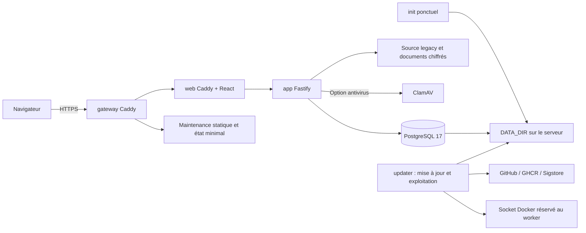

# Architecture technique

Référence applicative analysée : `c704fa6e6d6d516db75f963db8dd5d2049ab42c8`. Mise à jour : 2026-10-11T00:46:53+02:00 (Europe/Paris).

Production : Node/React compilés en images API/web ; image updater dédiée.
Dockerfiles multi-stage, conteneurs applicatifs non root, lecture seule et
capabilities limitées ; exceptions init/updater documentées. Réseaux public,
edge et backend définis dans docker-compose.yml, montages bind persistants.

Développement : docker-compose.dev.yml, projet distinct suivi-audits-dev,
rechargement Vite/tsx, cookie non Secure local et PostgreSQL trust. Les dépendances
ont un volume nommé ; les données de dev sont en .donnees-dev (ignoré).
L’updater et le gateway de production ne sont pas automatiquement présents dans dev.

CI : qualité, Vitest/PostgreSQL, installation vierge, pile Docker/Playwright,
montée de version et CodeQL. Publication distincte : garde du commit exact,
Trivy HIGH/CRITICAL, cosign, SBOM, trois composants exposés ensemble.

Dépendances externes : GitHub/Git SSH, GHCR, Sigstore, registres Node et Alpine,
images Docker de base ; ClamAV si profil actif. L’accès réseau du workspace
ne prouve pas celui du serveur client. Aucun système email/SSO externe déployé
n’est identifié par le code actuel.

Compatibilité : Node >=24, pnpm épinglé, PostgreSQL 17, navigateur moderne
supportant SVG/Fetch/SSE/BroadcastChannel ; compatibilité exhaustive des
navigateurs et système de fichiers clients NON VÉRIFIÉE.
