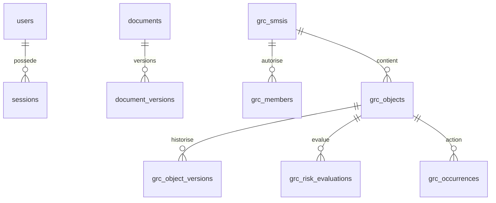

# Base de données

Référence applicative analysée : `c704fa6e6d6d516db75f963db8dd5d2049ab42c8`. Mise à jour : 2026-10-11T00:46:53+02:00 (Europe/Paris).

PostgreSQL 18, migrations versionnées au démarrage sous verrou consultatif.
`schema_migrations` suit les versions ; ne jamais modifier une migration
publiée. Les DDL ci-dessous créent 42 tables repérées ; ce relevé n’est pas une
inspection de la base client. Schéma TypeScript : apps/api/src/db/schema.ts.

| Migration                                                                                                                | Tables introduites / objet                                                                                                                                                             |
| ------------------------------------------------------------------------------------------------------------------------ | -------------------------------------------------------------------------------------------------------------------------------------------------------------------------------------- |
| [apps/api/migrations/001_init.sql](../../apps/api/migrations/001_init.sql)                                               | users, sessions, settings, audit_log, app_state, state_history, documents, document_versions, links                                                                                    |
| [apps/api/migrations/002_v3_fondations.sql](../../apps/api/migrations/002_v3_fondations.sql)                             | import_batches                                                                                                                                                                         |
| [apps/api/migrations/003_droits.sql](../../apps/api/migrations/003_droits.sql)                                           | roles, groups, group_roles, user_groups, user_roles                                                                                                                                    |
| [apps/api/migrations/004_affichage_et_ecrans_muraux.sql](../../apps/api/migrations/004_affichage_et_ecrans_muraux.sql)   | wall_screens                                                                                                                                                                           |
| [apps/api/migrations/005_cartographie.sql](../../apps/api/migrations/005_cartographie.sql)                               | maps, map_versions                                                                                                                                                                     |
| [apps/api/migrations/006_sauvegardes.sql](../../apps/api/migrations/006_sauvegardes.sql)                                 | backup_worker, backup_jobs                                                                                                                                                             |
| [apps/api/migrations/007_exploitation.sql](../../apps/api/migrations/007_exploitation.sql)                               | backup_policy, operation_jobs, operation_receipts                                                                                                                                      |
| [apps/api/migrations/008_activation_modules.sql](../../apps/api/migrations/008_activation_modules.sql)                   | module_activation                                                                                                                                                                      |
| [apps/api/migrations/009_mises_a_jour.sql](../../apps/api/migrations/009_mises_a_jour.sql)                               | update_jobs                                                                                                                                                                            |
| [apps/api/migrations/010_configuration_environnement.sql](../../apps/api/migrations/010_configuration_environnement.sql) | environment_versions, environment_configuration                                                                                                                                        |
| [apps/api/migrations/011_evaluations_versionnees.sql](../../apps/api/migrations/011_evaluations_versionnees.sql)         | risk_assessments                                                                                                                                                                       |
| [apps/api/migrations/012_catalogues_metier.sql](../../apps/api/migrations/012_catalogues_metier.sql)                     | business_policy_versions, business_policy_configuration                                                                                                                                |
| [apps/api/migrations/013_socle_smsi_grc.sql](../../apps/api/migrations/013_socle_smsi_grc.sql)                           | grc_smsis, grc_members, grc_objects, grc_object_versions, grc_links, grc_framework_versions, grc_method_versions, grc_risk_evaluations, grc_series, grc_occurrences, grc_notifications |
| [apps/api/migrations/014_automatisation_smsi.sql](../../apps/api/migrations/014_automatisation_smsi.sql)                 | Contraintes, garde et automatisation ; aucune nouvelle table CREATE repérée.                                                                                                           |
| [apps/api/migrations/015_pilotage_decisions.sql](../../apps/api/migrations/015_pilotage_decisions.sql)                   | pilotage_decisions                                                                                                                                                                     |

Vue logique simplifiée : le SQL est la référence pour les FK exactes, nullable,
index et contraintes. grc_links utilise des références multi-types ; les
validations métier contrôlent les cibles au-delà des FK.

## Sources et relations

- app_state/state_history : état historique et versions ; recomposition maps
  par mapper, dix familles Pilotage adaptées directement.
- documents/document_versions/links : métadonnées, contenu chiffré, version
  physique et rattachements ; preuve réutilise la référence, pas un fichier copié.
- grc_smsis/grc_members : noms conservés pour compatibilité, périmètre commun
  et périmètres restreints ; pas de création imposée dans le parcours normal.
- grc_objects/grc_links/versions : objets transversaux, relations et snapshots.
- framework/method/policy/environment versions : publications exactes ; les
  évaluations stockent la version utilisée, ne suivent pas silencieusement la dernière.
- séries/occurrences/notifications : définitions distinctes des actions produites,
  unicité d’occurrence et reprise transactionnelle.
- pilotage_decisions : examen, contrôle, efficacité, clôture, validation et
  étapes guidées immuables/idempotentes.
- backup_jobs/operation_jobs/update_jobs et receipts : protocoles serveur,
  heartbeat, exclusivité, autorisations et traçabilité ; pas de commande arbitraire.

## Conservation et limites

Migration v2 → v3, schéma ORM et intégrité testés dans apps/api/test/migrations.test.ts
et CI ; NON EXÉCUTÉS sur la base client. Champs extra/IDs/import_batch_id
préservés par le contrat. Export JSON legacy ne transporte pas toutes les nouvelles
décisions GRC/configurations : sauvegarde PostgreSQL complète nécessaire.

SQL et pagination limitent les listes ; carte et exports ont des limites
annoncées. État legacy JSON reste un verrou global pour les modifications de
familles non normalisées, source de couplage ; pas de benchmark client.
Rétention : historique legacy configurable par STATE_HISTORY_KEEP, cartes
limitées par code, sauvegardes planifiées par politique et sauvegardes de
mise à jour gardées selon scripts. Valeurs exactes client inconnues.
