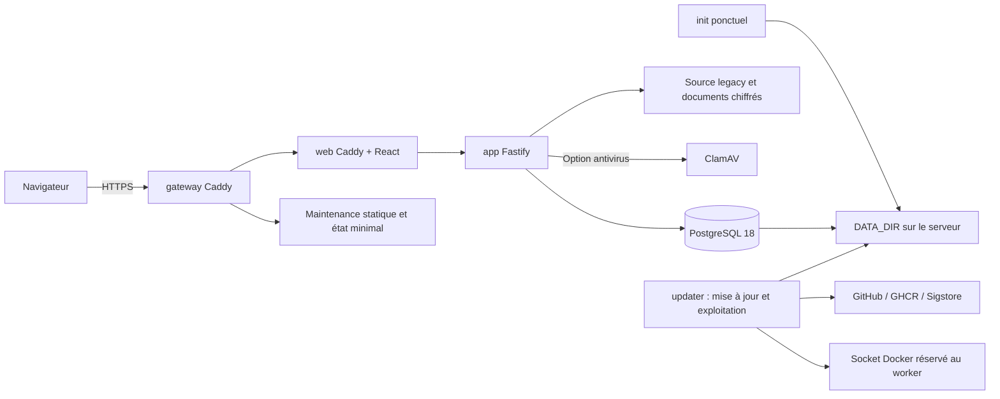

# Dossier d’architecture technique

Référence applicative analysée : `c704fa6e6d6d516db75f963db8dd5d2049ab42c8`. Mise à jour : 2026-10-11T00:46:53+02:00 (Europe/Paris).

## Périmètre et contraintes

Application auto-hébergée, pilotage multi-référentiels, audits, risques, actions,
preuves et continuité. État **effectivement implémenté au commit analysé** ;
OIDC, D/J/I/F et fin du legacy sont des cibles, pas des composants déployés.
Environnements connus : Compose production/recette, Compose dev et runners CI.
Serveur utilisateur, OS exact, dimensionnement, volumétrie et SLO : INCONNUS.

## Composants et communications

- `gateway` : HTTPS stable, maintenance accessible pendant l’arrêt de app/web ;
  seuls 80/443 exposés en Compose production.
- `web` : interface React compilée et proxy interne via Caddy, distinct du frontal.
- `app` : Fastify, routes REST/OpenAPI, auth, SSE, données/legacy et automate métier.
- `db` : PostgreSQL 18 ; transaction, contraintes, verrous, NOTIFY. Pas de port public.
- `init` : ponctuel, root sans réseau, génère uniquement les secrets manquants
  et prépare propriétaires/dossiers.
- `updater` : conteneur root distinct, socket Docker et dépôt pour opérations
  contrôlées ; intègre le worker d’exploitation par défaut depuis 3.0.2. Sans
  identifiants SSH ni registre par défaut ; installation commandée depuis
  l’interface avec code TOTP et fenêtre de maintenance, reçu structuré
  ([ADR 0061](../adr/0061-mise-a-jour-web-renforcee.md)).
- `clamav` : facultatif, profil antivirus.

API et base appartiennent à des réseaux internes ; les flux externes de mise
à jour viennent du worker. Il n’existe pas de bus distribué ou Redis ajouté.
SSE transmet identifiants/version/opération après filtrage des droits ; TanStack
Query invalide les données concernées. If-Match protège les mises à jour.

## Technologies vérifiées

| Technologie                   | Version de source vérifiée                                                  |
| ----------------------------- | --------------------------------------------------------------------------- |
| Node                          | minimum 24 ; images node:24-alpine, version exacte de patch dépend du build |
| pnpm / TypeScript             | 10.34.6 / 5.9.3                                                             |
| Fastify / zod / pg            | 5.12.5 / 4.6.5 / 8.23.1                                                     |
| Drizzle ORM                   | 0.45.2                                                                      |
| React / Mantine               | 19.3.0 / 8.3.18                                                             |
| TanStack Query / React Router | 5.104.1 / 7.18.4                                                            |
| Vite / Vitest / Playwright    | 7.3.7 / 3.2.7 / 1.56.1                                                      |
| PostgreSQL                    | 17, image 17-alpine                                                         |
| Caddy                         | 2.11.7, recompilé avec Go 1.26.10                                            |
| Trivy                         | 0.75.0 dans le workflow CI                                                  |

Versions déclarées/épinglées dans package.json/lockfiles/Dockerfiles ; elles ne
prouvent pas les binaires actuellement installés chez l’utilisateur.

## Modèle de données et intégrité

15 migrations SQL additives et schema_migrations ; rôle applicatif limité,
schéma Drizzle et base comparés en CI. App_state demeure source des familles
historiques ; maps est recomposé par mapper. Pilotage adapte directement dix
clés historiques sans dupliquer les fiches.

Objets/relations GRC par périmètre, séries/occurrences, méthodes/référentiels,
évaluations et décisions versionnées. Décisions sensibles append-only et
idempotentes, audit transactionnel ; traitements/actions ne modifient pas
automatiquement les évaluations résiduelles. Documents/version physique
chiffrés ; liens vers document:ID:version lors d’un examen.

Voir [base](BASE_DE_DONNEES.md), [API](API_INTERFACES.md) et
[sécurité](SECURITE.md) pour schémas, accès et limites.

## Traitements asynchrones

API : purge/expiration de sessions et comptes, notifications/occurrences métier.
L’automate de tâches utilise transactions et unicité ; fuseaux des périmètres.
Worker externe à l’API : file exploitation/sauvegarde/restauration/TLS et
mise à jour, verrous hôte, receipts privés et état public minimal. Les
notifications métier sont internes ; aucun transport email livré.

## Exploitation, reprises et limites

DATA_DIR persistant : postgres, secrets, certificats, état, sauvegardes et
reçus. Un arrêt/suppression de conteneur n’est pas une remise à zéro des données.
Sauvegarde complète chiffrée ; clés gardées sur le serveur, pas dans l’API.
Mise à jour : versions numériques, signatures, sauvegarde avant maintenance,
migrations, santé et données ; rollback selon reçu durable et archive.
Le frontal stable est entretenu séparément de la mise à jour web.

Installation/exploitation : [déploiement](DEPLOIEMENT.md),
[maintenance](EXPLOITATION_MAINTENANCE.md), [guide rejoué en CI](../INSTALLATION.md).
L’audit n’a ni déployé ni restauré ; charge, HA, RPO/RTO réels et reprise après
perte matérielle sont NON VÉRIFIÉS.
