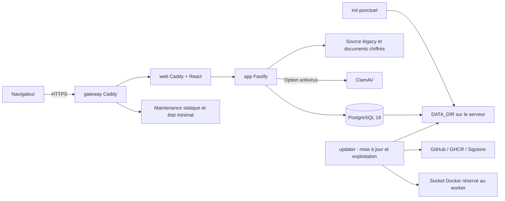

# Dossier d’architecture technique

Référence applicative analysée : `c704fa6e6d6d516db75f963db8dd5d2049ab42c8`. Mise à jour : 2026-10-11T00:46:53+02:00 (Europe/Paris).

## Périmètre et contraintes

Application auto-hébergée, pilotage multi-référentiels, audits, risques, actions,
preuves et continuité. État **effectivement implémenté au commit analysé** ;
OIDC, D/J/I/F et fin du legacy sont des cibles, pas des composants déployés.
Environnements connus : Compose production/recette, Compose dev et runners CI.
Serveur utilisateur, OS exact, dimensionnement, volumétrie et SLO : INCONNUS.

## Composants et communications

- `gateway` : HTTPS stable, maintenance accessible pendant l’arrêt de app/web ;
  seuls 80/443 exposés en Compose production.
- `web` : interface React compilée et proxy interne via Caddy, distinct du frontal.
- `app` : Fastify, routes REST/OpenAPI, auth, SSE, données/legacy et automate métier.
- `db` : PostgreSQL 18 ; transaction, contraintes, verrous, NOTIFY. Pas de port public.
- `init` : ponctuel, root sans réseau, génère uniquement les secrets manquants
  et prépare propriétaires/dossiers.
- `updater` : conteneur root distinct, socket Docker et dépôt pour opérations
  contrôlées ; intègre le worker d’exploitation par défaut depuis 3.0.2. Sans
  identifiants SSH ni registre par défaut ; installation commandée depuis
  l’interface avec code TOTP et fenêtre de maintenance, reçu structuré
  ([ADR 0061](../adr/0061-mise-a-jour-web-renforcee.md)).
- `clamav` : facultatif, profil antivirus, démarré et arrêté par l'exécutant selon le flux « antivirus » (ADR 0097).

API et base appartiennent à des réseaux internes ; les flux externes de mise
à jour viennent du worker.

Flux vers l'extérieur ([ADR 0097](../adr/0097-flux-sortants-pilotes-par-les-modules.md), lots 1 à 3 livrés) : un registre partagé
(`packages/shared/src/flux-externes.ts`) décrit chaque module qui sort ou expose un port (assistant par `assistant-relais`,
courriel et mises à jour par `updater`, ACME par `gateway`, signatures antivirus par `freshclam`). Tout est fermé par défaut ;
activer un module ouvre son flux, dans la même transaction que l'activation, après validation explicite par un
administrateur (`fluxConfirme`) ; le désactiver le referme (table `flux_externes`, migration `071`, journal
`flux.externe.ouvert` / `flux.externe.ferme` avec l'origine du geste). La carte « Flux vers l'extérieur » n'est qu'un résumé, où
l'on ferme un flux. L'API relit l'état à chaque usage et refuse de faire sortir un module fermé ;
l'exécutant lit l'état voulu (`suivi flux-souhaites`) et rapporte l'état appliqué (`suivi flux-appliques`, au changement et
toutes les 30 minutes). Lot 2 : `update-worker.py` démarre (`docker compose --profile <profil> up -d --no-deps`, services dans
l'ordre, sans bloquer sa boucle) ou arrête et retire (`rm --stop --force`) les profils `assistant` et `antivirus`, et n'émet
aucune vérification ni installation de version flux fermé ; `exploitation-worker.py` ne réclame aucun courriel flux fermé,
relit le flux avant d'appliquer une demande ACME et ramène la passerelle à l'autorité interne si elle est en ACME flux fermé.
Profils et services viennent de listes fermées dans les deux scripts, dont la concordance avec le registre est vérifiée par
le test d'architecture. Reprise de l'existant (7.2.1, précision du RSSI du 16/11/2026) : avant toute fermeture, chaque
exécutant lit l'état voulu par `suivi flux-reprise` en déclarant les modules qu'il porte et qui sont en service (passerelle en
ACME ; conteneur de sortie présent ou réglage de `.env` ; mise à jour déjà installée) ; un module jamais décidé est enregistré
ouvert par `reprise-mise-a-jour` (journal `flux.externe.repris`), un module décidé n'est jamais touché ; le courriel actif
est repris par l'API à son démarrage. État voulu illisible : rien n'est émis par l'exécutant lui-même, les conteneurs restent dans leur
état, rien n'est rapporté. L'assistant ne joint son relais que si le flux est ouvert **et** appliqué ouvert ; l'antivirus suit
l'état voulu seul (connexion interne à `clamav`, et `CLAMAV_REQUIRED` refuse un dépôt tant que le démon ne répond pas). Un test d'architecture (`apps/api/test/architecture-flux.test.ts`)
refuse tout service du compose qui sort ou publie un port sans être porté par le registre ou justifié dans le cœur de
plateforme (`gateway`, `web`, `updater`). Lot 3 : la dernière étape de l'installation, à la première connexion complète du
compte créé (demande mémorisée dans `settings`, `flux_questions_en_attente`, comme la démonstration), pose « Activer » ou
« Plus tard » pour chaque module et ouvre par les mêmes gestes (route commune, réglages de l'assistant) ; courriel et ACME
renvoient à leur page. Il n’existe pas de bus distribué ou Redis ajouté.

Connecteurs du module Intégrations ([ADR 0076](../adr/0076-module-integrations.md), socle partiel) : catalogue des types en
code (`packages/shared/src/integrations.ts` : portée, schéma de configuration, champs secrets, flux, liste fermée des points
d'accès de lecture), instances et file des exécutions en base (`integrations`, `integration_executions`, migration `073`),
secrets scellés par le coffre dans `settings` (`secret:integration:<id>`, AAD `integration:<id>:<champ>`), jamais relus par
l'interface. L'API n'a toujours aucun accès sortant : elle inscrit l'exécution ; `exploitation-worker.py` la réclame
(`suivi integrations-claim`, secrets compris) seulement si le flux du type est ouvert, lance `scripts/integration-http.py`
(`python -I`, uid 65534, environnement minimal, entrée standard seule, bibliothèque standard, HTTPS vérifié en TLS 1.2 au
minimum, aucune redirection, réponse bornée, liste fermée recopiée et comparée au catalogue par
`apps/api/test/integrations-architecture.test.ts`) et rapporte un résultat normalisé (`suivi integrations-finish`). Premier
type : Tenable Security Center (flux `tenable`, porté par `updater`, port réglé dans l'adresse, 443 par défaut), opérations
« Tester la connexion », qui ne rend que la version, et « Synchroniser » ([ADR 0100](../adr/0100-module-vulnerabilites.md),
lot V5) : le tic de l'API en inscrit une par jour et par instance active (créneau consommé avant l'inscription, dans
`vulnerabilites_tenable_etat`, migration `075`) ; le script lit `POST /rest/analysis` (`vulndetails`, paginé, borné en pages,
détections et durée) puis `GET /rest/hosts` (inventaire expérimental, échec toléré), ne garde que des champs listés et
l'exécutant les rapporte par lots de 500 (`suivi integrations-lot`, validés par zod) avant la fin. Machines, constats, CVE et
détections sont rangés sans doublon ; une détection garde le numéro de la dernière synchronisation qui l'a vue et n'est plus
« présente » qu'après une synchronisation **complète** plus récente qui ne l'a pas vue (rien n'est supprimé ; une
synchronisation interrompue ou incomplète ne fait rien disparaître). Lecture par l'interface à travers le périmètre de chaque
machine (`grc_smsi_visible`, pyramide des ADR 0092 et 0095) ; une machine sans périmètre n'est lisible qu'avec
`vulnerabilites:administrer`. Lot V4d (migration `082`) : le périmètre lu est le périmètre **effectif**, celui indiqué à la
main sur la machine, sinon celui de son dépôt de Tenable (`vulnerabilites_tenable_depots.perimetre_id`, dépôt lu dans les
résultats de l'analyse, liaison par `vulnerabilites:administrer`, `If-Match`, écriture sur les périmètres) ; un seul fragment
SQL (`perimetreMachine`) porte cette règle pour toutes les lectures. Ces données ne partent nulle part ailleurs (ni assistant, ni notification, ni export).

Type sans réseau : « Nessus, import de fichier » (`nessus-fichier`, [ADR 0100](../adr/0100-module-vulnerabilites.md), lot N1 ;
migration `092`). Ni adresse, ni clé, ni flux, ni exécutant (`flux: null`, absent du script et de l'exécutant). Le fichier
`.nessus` est lu dans le navigateur (`DOMParser`, DOCTYPE et entités refusés avant l'analyse,
`apps/web/src/integrations/nessus.ts`) ; l'API ne lit aucun XML : elle reçoit un extrait JSON en liste blanche, par lots de
machines entières (`POST /api/integrations/instances/:id/imports`, `…/lots`, `…/fin`, `integrations:administrer`, corps de
8 Mio au plus, limites de débit), revalidé par `LotImportNessus` (`packages/shared/src/import-nessus.ts`), et le range par le
chemin d'écriture de Tenable (`SynchronisationTenable.rangerPassage`, mêmes tables, même numéro de passage). Chaque lot est
un passage complet pour ses machines : les détections présentes des autres machines de l'instance sont reportées au numéro du
passage, si bien qu'une faille disparaît seulement sur une machine du fichier. Journal des imports : `vulnerabilites_imports`
(nombres seulement), exécution `importer` de l'instance (`apps/api/src/vulnerabilites/import-nessus.ts`).

Second type : AlgoLightHouse ([ADR 0100](../adr/0100-module-vulnerabilites.md), lot ALH1 ; flux `algolighthouse`, porté par
`updater`, service de l'éditeur sur Internet, adresse `https://<espace>.algolighthouse.fr` seulement, port 443, en-tête
`X-API-Key`). Liste fermée de huit `GET` de la version 1 de l'API, sans paramètre ; jamais d'écriture. Le socle range chaque
opération par lots dans le récepteur de son type (`enLots['<type>:<opération>']`) : `apps/api/src/vulnerabilites/surface-externe.ts`
range périmètres de l'éditeur, hôtes, domaines, alertes (détail des 300 plus récentes), technologies, leurs actifs et leurs
CVE (migration `080`), avec la même règle de présence que Tenable (`vulnerabilites_alh_etat`). Lecture : chaque élément hérite
du périmètre de la plateforme relié à son périmètre de l'éditeur (`vulnerabilites_alh_perimetres.perimetre_id`, liaison par
`vulnerabilites:administrer`, `If-Match`, écriture sur les périmètres), `grc_smsi_visible` ; non relié :
`vulnerabilites:administrer`. Une technologie se lit par ses actifs. Ces données ne partent nulle part ailleurs (ni
assistant, ni priorité, ni notification).
Lot ALH3 (migration `083`) : un actif (hôte ou domaine) se relie aux machines internes de Tenable
(`vulnerabilites_alh_liaisons_machines`, cycle « proposée, confirmée, rejetée, retirée » du rapprochement des failles,
`apps/api/src/vulnerabilites/liaisons-machines.ts`). Les propositions (même adresse, nom complet, nom court) sont recalculées
dans la transaction de fin de chaque synchronisation reçue d'AlgoLightHouse ou de Tenable, sous un verrou consultatif ;
lecture si l'actif (`lisibleAlh`) et la machine (`lisible`, périmètre effectif) sont lisibles ; écriture par
`vulnerabilites:modifier`, `If-Match` (`vulnerabilites_alh_actifs.liaisons_version`), écriture sur les deux périmètres.
Lot ALH5 (migration `084`) : la priorité se calcule sur tous les faits connus, sans les droits de la personne (fragment
`cvesAlh` de `apps/api/src/vulnerabilites/sql.ts`) ; seules les lignes rendues restent filtrées. Majoration d'un cran par
liaison confirmée vers une machine interne portant une faille présente en P1 ou P2 (`majoration.ts`, règle
`majorerPriorite` du paquet partagé), appliquée à l'alerte, à la technologie et à leurs CVE sur la surface externe seulement.
Liaison en masse (`POST …/surface/liaisons/masse/apercu`, puis `POST …/surface/liaisons/masse`) : joker `*` comparé en
littéral (`correspondanceJoker`), aperçu borné à 200 paires et lié à son empreinte (personne, demande, paires et versions),
paires revérifiées sous le même verrou consultatif, origine `masse`, une entrée de journal par opération.
Lot ALH6 (migration `085`) : aucun appel nouveau ; dans le détail d'alerte déjà lu, le script ne garde d'un fragment que
`alert_cves` et `json_data` (`CHAMPS_FRAGMENT_ALH`), et de `json_data`, pour les seuls types `port`, `vulnerable_component` et
`subdomain`, les champs de service (`CHAMPS_SERVICE_ALH` : `fragment_type`, `port`, `protocol`, `service_name`, `product`,
`version`, `vendor`, `cpe`, `ports`, `version_status`) ; jamais `banner`, `state`, `subdomain`, `sensitive_data`. Listes
recopiées du paquet partagé et comparées par `integrations-architecture.test.ts`. Rangement par instance, actif, port et
protocole (`vulnerabilites_alh_services`, `UNIQUE NULLS NOT DISTINCT`), liens vers les alertes
(`vulnerabilites_alh_service_alertes`) remplacés à chaque lecture du détail (`apps/api/src/vulnerabilites/services-surface.ts`) ;
rendu sous les droits de l'actif, tant qu'une alerte ouverte et présente porte le service ; rien ne part vers l'assistant.
Lot V6 (migration `086`, `apps/api/src/vulnerabilites/alertes.ts`) : alertes décidées par la plateforme (règles pures
`packages/shared/src/alertes-vulnerabilites.ts`, aucun appel au modèle ni réseau). Évaluation sous un verrou consultatif, à la
fin de chaque synchronisation reçue de Tenable ou d'AlgoLightHouse (dans sa transaction, sous un point de sauvegarde : un échec
est journalisé et annulé seul), après chaque collecte reçue de la veille et après les décisions qui changent les faits (dans une
transaction propre, après la leur) ; module désactivé : rien. Faits sur tous les faits connus (lot ALH5), une alerte ouverte par
faille (`vulnerabilites_alertes`, index unique partiel sur `cle`), prise en compte par `vulnerabilites:modifier` avec `If-Match`.
Notifications par le module existant (`grc_notifications`, types `vulnerabilites_alerte_critique` et `vulnerabilites_alerte`
sans SMSI ni objet, `NotificationsMetier.diffuser`, courriel par l'exécutant si la personne l'a choisi) : niveau, CVE, produit et
lien seulement, jamais de nom de machine, de domaine, d'adresse ni de périmètre. Temps réel : entité `vulnerabilites_alertes`
(`vulnerabilites:lire`). Fenêtre d'alerte critique côté interface, montée une fois dans la mise en page.

Veille du module Vulnérabilités ([ADR 0100](../adr/0100-module-vulnerabilites.md), lots V2 et V3) : même chemin que les
connecteurs, sans secret. Le tic de 60 s de l'API inscrit au plus une collecte par source et par période réglée (lot F1, migration `090` :
deux heures par défaut, NVD deux heures au moins, EPSS une fois par jour ; référence de la dernière demande automatique
consommée avant l'inscription) dans `vulnerabilites_veille_collectes` (migration `074`) ; `exploitation-worker.py` la réclame
(`suivi veille-claim`) si le flux `veille-vulnerabilites` est ouvert et le module actif, lance `scripts/veille-vulnerabilites.py`
(`python -I`, uid 65534, environnement minimal, GET seulement, HTTPS vérifié en TLS 1.2 au minimum, aucune redirection, liste
fermée des cinq hôtes et de leurs chemins comparée au registre partagé par `apps/api/test/veille-architecture.test.ts`, réponses
et éléments bornés, RSS sans déclaration de type ni entité) et rapporte des champs structurés par lots de 500 au plus
(`suivi veille-lot`, validés par zod), puis le bilan (`suivi veille-finish`). Failles et avis sont rangés sans doublon dans
`vulnerabilites_veille_cve` et `vulnerabilites_veille_avis` ; ce sont des données publiques, effacées par la remise à vide.
Depuis le lot V4a (migration `076`), chaque faille NVD porte ses produits touchés, tirés du seul champ `configurations` (CPE,
version exacte, bornes, drapeau « vulnérable », vingt au plus), rangés dans `vulnerabilites_veille_cve_produits` avec leurs
noms normalisés. Après chaque collecte NVD réussie (hors de la transaction de clôture) et dans la transaction de chaque création
ou modification d'un produit surveillé, `apps/api/src/vulnerabilites/rapprochements.ts` recalcule, produit par produit et sous
le verrou de sa fiche, les `vulnerabilites_rapprochements` (rattachée d'office, écartée, proposée, confirmée, rejetée, retirée)
par les fonctions pures du paquet partagé (`rapprochement-vulnerabilites.ts` : comparaison de versions sûre, classement,
transitions). Un produit surveillé se relie à la main aux machines (`vulnerabilites_produits_machines`). Priorité P1 à P4 et rang
des machines sont calculés à la lecture par `priorite-vulnerabilites.ts` (fonctions pures, seuil EPSS rangé dans `settings`,
clé `vulnerabilites:priorite`) sur les seules machines lisibles ; rien n'en sort du serveur.
Depuis le lot V4b (migration `077`), `apps/api/src/vulnerabilites/suivi.ts` tient l'état de suivi d'un constat ou d'une
faille déclarée (`vulnerabilites_suivis`, ligne créée à la première décision), son historique en ajout seul
(`vulnerabilites_suivi_historique`, déclencheurs d'immuabilité, sans clé étrangère : il survit à l'objet) et ses liens vers les
actions du registre (`vulnerabilites_suivi_actions`, clé étrangère vers `grc_objects`). Une action est créée dans la transaction
du lien par les méthodes du registre (`registreDeCreation`, `normalize`, `insert` de `grc/core.ts`), avec la session et les droits
de la personne. La fin d'une synchronisation de Tenable (`tenable.ts`, même transaction) et le recalcul des rapprochements
(`rapprochements.ts`, même transaction) préviennent le suivi, qui propose « corrigée » (après une synchronisation complète
seulement), retire la proposition ou remet « à traiter » une faille corrigée qui réapparaît ; il ne passe jamais rien à
« corrigée ».
Depuis le lot V4c (migration `078`, décisions V23, V24, V26 et V27), la collecte du CERT Santé lit aussi, sur le même hôte et à
un chemin à motif strict de la liste fermée (`/alertes/{slug}`), la page des publications nouvelles ou dont le titre a changé
(empreinte du titre remise par l'API, relecture après sept jours), 30 au plus par collecte, avec `html.parser` de la
bibliothèque standard : seules des mentions structurées en sortent (exploitée, correctif, contournement, preuve de concept,
score CVSS v3.1), rangées avec le produit cité sur la ligne de `vulnerabilites_veille_avis`, avec la date du premier
signalement. Chaque fait reste dans les colonnes de sa source ; `apps/api/src/vulnerabilites/sources.ts` les rassemble à la
lecture (exploitation avérée et « exploitable » par source, rangées de la première à la dernière ; valeurs par source), et la
priorité prend la plus sévère (`valeursRetenues`, fonction pure). Une CVE connue seulement par une publication du CERT Santé est
rapprochée par le nom du produit cité (proposition « avis_seulement ») ; la collecte du CERT Santé déclenche aussi le recalcul
des rapprochements. Une confirmation ou un rejet s'annule (`POST …/rapprochements/:id/annulation`, `If-Match`) : décision
effacée, rapprochement recalculé, annulation gardée sur la ligne et au journal ; le suivi est prévenu comme pour tout
changement de rattachement (une confirmation aussi).
Depuis la migration `079` (décisions V14, V25, V28, V29 et V30), l'assistant lit le module par un service du module
(`apps/api/src/vulnerabilites/assistant.ts`), appelé avec la session de la personne, jamais par les tables en direct ; ses outils
(`evaluer_cve`, `machines_prioritaires`, `failles_prioritaires`, `proposer_action_vulnerabilite`) ne sont déclarés au modèle
qu'en conversation, pour le profil « Mise en œuvre », module actif et droit `vulnerabilites:lire`. Chaque machine y est un
repère de la conversation (`vulnerabilites_assistant_reperes`, clé étrangère en cascade vers `assistant_conversations`, machine
à `SET NULL` pour qu'un numéro ne soit jamais réattribué) ; la table de correspondance ne sort pas du serveur. Le transport du
modèle est enveloppé par un masque (`apps/api/src/assistant/masque.ts`, en conversation et en ronde) qui relit toute la demande
avant le relais et remplace tout nom, premier libellé, adresse ou identifiant de Tenable de l'inventaire par le repère ou par
« [machine] » : c'est le dernier point de contrôle avant la sortie. Le masque reçoit aussi la liste de mots à ne pas masquer
(décision V31 ; `apps/api/src/vulnerabilites/mots-non-masques.ts`, clé `vulnerabilites:masque` de `settings`, droit
`vulnerabilites:administrer`, sans migration) : un mot de la liste écrit seul n'est plus remplacé ; le nom complet, tout jeton
plus long, l'adresse et les identifiants le restent, et un réglage illisible vaut liste vide. Le texte du modèle est rangé avec ses repères
(`assistant_messages`, `vulnerabilites_assistant_propositions`) ; la route d'une conversation et celle des propositions les
remplacent à la lecture, selon les droits de la personne. À la confirmation d'une proposition, la création de l'action et la
mise à jour de la proposition se font dans une seule transaction (`SuiviFailles.creerActionProposee`), repères remplacés par les
noms sur le serveur. Toute action créée depuis une faille porte dans sa description les actifs touchés (V30), calculés à la
création avec les droits de la personne et le rang des machines.

Mandataire sortant de l'établissement ([ADR 0101](../adr/0101-mandataire-sortant.md), lot P1) : réglage système unique
(`administration:administrer`, `If-Match`), rangé sans migration dans `settings` (`systeme:mandataire` : actif, adresse
`http://hôte:port`, identifiant, autorité PEM ; `secret:mandataire` : mot de passe scellé par le coffre, AAD dédiée, jamais
relu ni renvoyé, effacé quand l'adresse ou l'identifiant change). Service `apps/api/src/mandataire.ts`, routes
`/api/admin/mandataire`, journal `systeme.mandataire.*` sans secret, `motDePasse` et `Proxy-Authorization` dans `REDACT`. Le
mandataire ne sert qu'aux flux vers Internet, flux par flux : au lot P1, la veille l'emprunte ; au lot ALH1, le connecteur
AlgoLightHouse aussi (`integrations-claim` joint ses paramètres pour les seuls types dont le flux l'utilise, l'exécutant ne
les passe qu'aux types de `INTEGRATIONS_MANDATAIRE`, et le script les refuse pour tout autre type). `veille-claim` joint ses
paramètres (mot de passe compris) à la demande remise à l'exécutant, seulement s'il est actif (réglage illisible : collecte
close, jamais en direct) ; l'exécutant les passe au script par l'entrée standard ; le script ouvre un tunnel `CONNECT` vers
l'hôte de la liste fermée, n'envoie `Proxy-Authorization: Basic` qu'au mandataire, puis TLS jusqu'à la source (certificat et nom
vérifiés, autorité de l'établissement ajoutée au magasin du système pour ces seules connexions). Les connecteurs internes
(Tenable) restent en accès direct par construction : aucun paramètre remis, et `integration-http.py` refuse un mandataire
reçu pour eux ;
le courriel (SMTP) aussi. L'assistant, les mises à jour, l'antivirus et ACME ne l'empruntent pas encore (lots P2 et P3). Le
registre des flux (`USAGE_MANDATAIRE`, `fluxSelonMandataire`) dit, quand il est actif, que la veille et AlgoLightHouse passent
par lui et remplace leur ligne de pare-feu par la sortie vers le mandataire.
SSE transmet identifiants/version/opération après filtrage des droits ; TanStack
Query invalide les données concernées. If-Match protège les mises à jour.

Lecture entre modules ([ADR 0083](../adr/0083-porte-de-lecture-autorisee-entre-modules.md), acceptée) : une donnée d'un
module qui sort vers un autre passe par une portée de lecture (`apps/api/src/acces/portee.ts`), calculée une fois par
requête pour un lecteur : droit de module, périmètre, registre restreint, rôle attribué. Le branchement des lecteurs
existants est progressif ; seul le module existe à ce stade.

## Technologies vérifiées

| Technologie                   | Version de source vérifiée                                                  |
| ----------------------------- | --------------------------------------------------------------------------- |
| Node                          | minimum 26 ; images node:26-alpine, version exacte de patch dépend du build |
| pnpm / TypeScript             | 10.34.6 / 6.0.3                                                             |
| Fastify / zod / pg            | 5.12.7 / 4.6.7 / 8.23.1                                                     |
| Kysely                        | 0.29.7 (ADR 0062)                                                           |
| React / Mantine               | 19.3.1 / 9.7.3                                                              |
| TanStack Query / React Router | 5.104.4 / 8.5.0                                                             |
| Vite / Vitest / Playwright    | 8.3.4 / 5.0.5 / 1.56.1                                                      |
| PostgreSQL                    | 18, image 18-alpine                                                         |
| Caddy                         | 2.11.7, recompilé avec Go 1.26.10                                           |
| Trivy                         | 0.75.0, binaire officiel à empreinte vérifiée (ADR 0063)                    |

Versions déclarées/épinglées dans package.json/lockfiles/Dockerfiles ; elles ne
prouvent pas les binaires actuellement installés chez l’utilisateur.

## Modèle de données et intégrité

15 migrations SQL additives et schema_migrations ; rôle applicatif limité,
types Kysely générés de la base migrée et comparés en CI (ADR 0062). App_state demeure source des familles
historiques ; maps est recomposé par mapper. Pilotage adapte directement dix
clés historiques sans dupliquer les fiches.

Objets/relations GRC par périmètre, séries/occurrences, méthodes/référentiels,
évaluations et décisions versionnées. Décisions sensibles append-only et
idempotentes, audit transactionnel ; traitements/actions ne modifient pas
automatiquement les évaluations résiduelles. Documents/version physique
chiffrés ; liens vers document:ID:version lors d’un examen.

Voir [base](BASE_DE_DONNEES.md), [API](API_INTERFACES.md) et
[sécurité](SECURITE.md) pour schémas, accès et limites.

**Habilitation déléguée sur un objet (30/10/2026, [ADR 0080](../adr/0080-habilitation-deleguee-contribution-retex.md)).**
Le RETEX d’un incident (chronologie `timeline` et collecte `retexCollecte`, dans l’incident de l’état historique) admet
des contributeurs **sans droit de module** : leurs six routes `/api/retex/...` sont en accès `auth` (session complète,
CSRF, origine, zod), listées explicitement dans `rbac.test.ts`. Les écritures passent par
`RegistreHistorique.modifierDelegue`, qui reprend `modifier` (verrou, version, audit, SSE) mais vérifie l’habilitation
propre à l’objet sous verrou, sur l’état courant ; les lectures par `lireDelegue`, dont l’appelant filtre la réponse
(contexte minimal et propositions de la personne). Un compte non invité reçoit la même 404 qu’un incident absent. Les
invitations et relances sont des notifications métier `retex_contribution` sans SMSI ni objet (migration additive `049`,
qui étend la contrainte posée par la `046`). Le pilote garde le droit `incidents:modifier`.

**Déclarations réglementaires des incidents (18/11/2026, [ADR 0105](../adr/0105-declaration-reglementaire-des-incidents.md)).**
Les déclarations santé (CERT Santé, ARS) et NIS 2 (ANSSI) d’un incident sont rangées hors de l’état historique, dans la table
`incidents_declarations` (migration additive `089`), repérées par l’identifiant et le périmètre de l’incident, sans clé
étrangère (les lignes de `suivi_incidents` sont réécrites à chaque enregistrement). La date de qualification de l’incident
(`qualifiedAt`, colonne `suivi_incidents.qualified_at`, alignée avec `historique/tables/collections.ts`) est posée au premier
passage à « Incident de sécurité », dans la transaction de l’incident, qui propose aussi les déclarations probables.
Service `apps/api/src/historique/declarations.ts` : chaque geste prend le verrou de l’état historique, contrôle le périmètre
(404), If-Match sur la version de la déclaration, journal d’audit ; préparer demande `incidents:modifier`, confirmer, écarter,
marquer envoyée, ouvrir, compléter et corriger la date de qualification demandent le rôle prédéfini `rssi` (lu à chaque appel,
comme la prise en compte des alertes du module Vulnérabilités). Un déclencheur refuse toute modification ou suppression d’une
ligne `envoyee` ou `non_requise` (et toute troncature) ; seule la remise à vide le suspend. Règles pures (délais, propositions,
rubriques et leur source, pré-remplissage, jalons de rappel) dans `packages/shared/src/declarations-incidents.ts`. Identité de
l’établissement : section de paramètres `etablissement` (table `settings`), droits `parametres` et `conformite`.

## Traitements asynchrones

API : purge/expiration de sessions et comptes, notifications/occurrences métier.
L’automate de tâches utilise transactions et unicité ; fuseaux des périmètres.
Rappels des déclarations d’incident (ADR 0105) : passage en tête de l’automate (60 s), indépendant du module des écarts,
arrêté avec le module incidents ; notifications `incident_declaration` sans SMSI ni objet (contrainte recréée par la `089`),
une par personne et par jalon (index unique sur `user_id, due_key`), au responsable de l’incident s’il correspond à un compte
et aux comptes au rôle RSSI qui voient le périmètre ; titre sans régime ni contenu, repris seul dans le courriel.
Worker externe à l’API : file exploitation/sauvegarde/restauration/TLS et
mise à jour, verrous hôte, receipts privés et état public minimal. Les
notifications métier sont internes ; aucun transport email livré.

## Exploitation, reprises et limites

DATA_DIR persistant : postgres, secrets, certificats, état, sauvegardes et
reçus. Un arrêt/suppression de conteneur n’est pas une remise à zéro des données.
Sauvegarde complète chiffrée ; clés gardées sur le serveur, pas dans l’API.
Mise à jour : versions numériques, signatures, sauvegarde avant maintenance,
migrations, santé et données ; rollback selon reçu durable et archive.
Le frontal stable n’est pas recréé pendant une mise à jour web (ADR 0061) ; à la
fin, il est mis à jour seulement si l’empreinte de ce qu’il exécute et sert, calculée
à la construction de l’image `web`, diffère de celle du frontal en service, avec une
coupure de quelques secondes annoncée sur la page de maintenance (ADR 0103).
Pendant la préparation, l'exécutant tire les trois images par l'API du moteur Docker
(socket Unix déjà monté) et publie dans l'état public les octets reçus sur un total fixé
d'après les manifestes du registre ; la page de maintenance en remplit sa barre. Repli sur
`docker pull`, sans progression, avec des identifiants de registre ou si l'API ne répond
pas (ADR 0104) ; les vérifications de signature qui suivent sont inchangées.
L’empreinte du frontal couvre aussi l’identité épinglée de son image de base Caddy
(`CADDY_IMAGE`) et le magasin des autorités racines : un correctif de l’image de base met le
frontal à jour à la mise à jour suivante (ADR 0103, addendum du 19/11/2026).
Conservation et espace disque (ADR 0106) : la politique de sauvegarde (`backup_policy`,
migration `091`) porte, avec la durée, le nombre maximal de sauvegardes régulières (30 par
défaut) et celui des sauvegardes d’avant mise à jour (3) ; l’exécutant les lit par
`suivi ops-policy` et les transmet à `backup.sh` et `mettre-a-jour.sh` (`.env` pour les appels
directs). Avant une sauvegarde ou une mise à jour, la place nécessaire est estimée (dernière
sauvegarde, images à télécharger, marge) et un manque refuse l’opération avant de commencer.
L’exécutant d’exploitation publie dans `etat.json` le relevé du disque des données (libre,
total, sauvegardes, images de l’application ; aucun chemin) ; l’API, à la synchronisation,
alerte les administrateurs actifs dans l’application (`grc_notifications`, type
`alerte_securite`, sans nouveau type ni migration) sous 15 % libre, une fois par
franchissement (état dans `settings`, réarmement à 20 %). Après une mise à jour, un retour
arrière ou un échec avant l’installation, `scripts/images-application.py` ne garde que les
images de l’application en service, précédente et du frontal en service (par étiquette,
version OCI ou empreinte épinglée), sans toucher aux autres images ni « prune » global.

**Dimensionnement retenu (28/10/2026) : une organisation, une quinzaine d’utilisateurs
simultanés au plus, une seule instance d’API** (limiteurs en mémoire, verrous
consultatifs, un seul exécutant d’exploitation). Le pool PostgreSQL garde ses 10
connexions. Une transaction annulée par deadlock ou échec de sérialisation (codes
40P01 et 40001) est rejouée entière, au plus deux fois, après 50 à 200 ms, chaque
relance journalisée ; une transaction restée inactive est coupée après une minute.
L’analyse antivirale est limitée à 15 s ; si elle échoue, le dépôt est refusé quand
elle est obligatoire et le contact technique reçoit au plus une alerte par heure.
Sondes Docker : `app` prête quand la base répond et que les migrations sont
appliquées, `web` et `gateway` quand Caddy répond ; `gateway` attend `web`. Écartés à
cette échelle : disjoncteur, plusieurs instances, clé d’idempotence, analyse des
requêtes en CI (le test de performance sur 10 000 risques fait foi ; une requête
n’est corrigée que si un parcours dépasse 500 ms sur un jeu réaliste).

Installation/exploitation : [déploiement](DEPLOIEMENT.md),
[maintenance](EXPLOITATION_MAINTENANCE.md), [guide rejoué en CI](../INSTALLATION.md).
L’audit n’a ni déployé ni restauré ; charge, HA, RPO/RTO réels et reprise après
perte matérielle sont NON VÉRIFIÉS.
