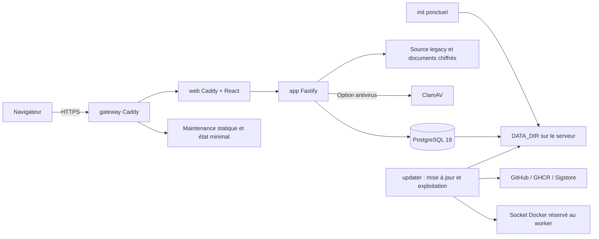

# Dossier d’architecture technique

Référence applicative analysée : `c704fa6e6d6d516db75f963db8dd5d2049ab42c8`. Mise à jour : 2026-10-11T00:46:53+02:00 (Europe/Paris).

## Périmètre et contraintes

Application auto-hébergée, pilotage multi-référentiels, audits, risques, actions,
preuves et continuité. État **effectivement implémenté au commit analysé** ;
OIDC, D/J/I/F et fin du legacy sont des cibles, pas des composants déployés.
Environnements connus : Compose production/recette, Compose dev et runners CI.
Serveur utilisateur, OS exact, dimensionnement, volumétrie et SLO : INCONNUS.

## Composants et communications

- `gateway` : HTTPS stable, maintenance accessible pendant l’arrêt de app/web ;
  seuls 80/443 exposés en Compose production.
- `web` : interface React compilée et proxy interne via Caddy, distinct du frontal.
- `app` : Fastify, routes REST/OpenAPI, auth, SSE, données/legacy et automate métier.
- `db` : PostgreSQL 18 ; transaction, contraintes, verrous, NOTIFY. Pas de port public.
- `init` : ponctuel, root sans réseau, génère uniquement les secrets manquants
  et prépare propriétaires/dossiers.
- `updater` : conteneur root distinct, socket Docker et dépôt pour opérations
  contrôlées ; intègre le worker d’exploitation par défaut depuis 3.0.2. Sans
  identifiants SSH ni registre par défaut ; installation commandée depuis
  l’interface avec code TOTP et fenêtre de maintenance, reçu structuré
  ([ADR 0061](../adr/0061-mise-a-jour-web-renforcee.md)).
- `clamav` : facultatif, profil antivirus, démarré et arrêté par l'exécutant selon le flux « antivirus » (ADR 0097).

API et base appartiennent à des réseaux internes ; les flux externes de mise
à jour viennent du worker.

Flux vers l'extérieur ([ADR 0097](../adr/0097-flux-sortants-pilotes-par-les-modules.md), lots 1 à 3 livrés) : un registre partagé
(`packages/shared/src/flux-externes.ts`) décrit chaque module qui sort ou expose un port (assistant par `assistant-relais`,
courriel et mises à jour par `updater`, ACME par `gateway`, signatures antivirus par `freshclam`). Tout est fermé par défaut ;
activer un module ouvre son flux, dans la même transaction que l'activation, après validation explicite par un
administrateur (`fluxConfirme`) ; le désactiver le referme (table `flux_externes`, migration `071`, journal
`flux.externe.ouvert` / `flux.externe.ferme` avec l'origine du geste). La carte « Flux vers l'extérieur » n'est qu'un résumé, où
l'on ferme un flux. L'API relit l'état à chaque usage et refuse de faire sortir un module fermé ;
l'exécutant lit l'état voulu (`suivi flux-souhaites`) et rapporte l'état appliqué (`suivi flux-appliques`, au changement et
toutes les 30 minutes). Lot 2 : `update-worker.py` démarre (`docker compose --profile <profil> up -d --no-deps`, services dans
l'ordre, sans bloquer sa boucle) ou arrête et retire (`rm --stop --force`) les profils `assistant` et `antivirus`, et n'émet
aucune vérification ni installation de version flux fermé ; `exploitation-worker.py` ne réclame aucun courriel flux fermé,
relit le flux avant d'appliquer une demande ACME et ramène la passerelle à l'autorité interne si elle est en ACME flux fermé.
Profils et services viennent de listes fermées dans les deux scripts, dont la concordance avec le registre est vérifiée par
le test d'architecture. Reprise de l'existant (7.2.1, précision du RSSI du 16/11/2026) : avant toute fermeture, chaque
exécutant lit l'état voulu par `suivi flux-reprise` en déclarant les modules qu'il porte et qui sont en service (passerelle en
ACME ; conteneur de sortie présent ou réglage de `.env` ; mise à jour déjà installée) ; un module jamais décidé est enregistré
ouvert par `reprise-mise-a-jour` (journal `flux.externe.repris`), un module décidé n'est jamais touché ; le courriel actif
est repris par l'API à son démarrage. État voulu illisible : rien n'est émis par l'exécutant lui-même, les conteneurs restent dans leur
état, rien n'est rapporté. L'assistant ne joint son relais que si le flux est ouvert **et** appliqué ouvert ; l'antivirus suit
l'état voulu seul (connexion interne à `clamav`, et `CLAMAV_REQUIRED` refuse un dépôt tant que le démon ne répond pas). Un test d'architecture (`apps/api/test/architecture-flux.test.ts`)
refuse tout service du compose qui sort ou publie un port sans être porté par le registre ou justifié dans le cœur de
plateforme (`gateway`, `web`, `updater`). Lot 3 : la dernière étape de l'installation, à la première connexion complète du
compte créé (demande mémorisée dans `settings`, `flux_questions_en_attente`, comme la démonstration), pose « Activer » ou
« Plus tard » pour chaque module et ouvre par les mêmes gestes (route commune, réglages de l'assistant) ; courriel et ACME
renvoient à leur page. Il n’existe pas de bus distribué ou Redis ajouté.

Connecteurs du module Intégrations ([ADR 0076](../adr/0076-module-integrations.md), socle partiel) : catalogue des types en
code (`packages/shared/src/integrations.ts` : portée, schéma de configuration, champs secrets, flux, liste fermée des points
d'accès de lecture), instances et file des exécutions en base (`integrations`, `integration_executions`, migration `073`),
secrets scellés par le coffre dans `settings` (`secret:integration:<id>`, AAD `integration:<id>:<champ>`), jamais relus par
l'interface. L'API n'a toujours aucun accès sortant : elle inscrit l'exécution ; `exploitation-worker.py` la réclame
(`suivi integrations-claim`, secrets compris) seulement si le flux du type est ouvert, lance `scripts/integration-http.py`
(`python -I`, uid 65534, environnement minimal, entrée standard seule, bibliothèque standard, HTTPS vérifié en TLS 1.2 au
minimum, aucune redirection, réponse bornée, liste fermée recopiée et comparée au catalogue par
`apps/api/test/integrations-architecture.test.ts`) et rapporte un résultat normalisé (`suivi integrations-finish`). Premier
type : Tenable Security Center (flux `tenable`, porté par `updater`, port réglé dans l'adresse, 443 par défaut), opérations
« Tester la connexion », qui ne rend que la version, et « Synchroniser » ([ADR 0100](../adr/0100-module-vulnerabilites.md),
lot V5) : le tic de l'API en inscrit une par jour et par instance active (créneau consommé avant l'inscription, dans
`vulnerabilites_tenable_etat`, migration `075`) ; le script lit `POST /rest/analysis` (`vulndetails`, paginé, borné en pages,
détections et durée) puis `GET /rest/hosts` (inventaire expérimental, échec toléré), ne garde que des champs listés et
l'exécutant les rapporte par lots de 500 (`suivi integrations-lot`, validés par zod) avant la fin. Machines, constats, CVE et
détections sont rangés sans doublon ; une détection garde le numéro de la dernière synchronisation qui l'a vue et n'est plus
« présente » qu'après une synchronisation **complète** plus récente qui ne l'a pas vue (rien n'est supprimé ; une
synchronisation interrompue ou incomplète ne fait rien disparaître). Lecture par l'interface à travers le périmètre de chaque
machine (`grc_smsi_visible`, pyramide des ADR 0092 et 0095) ; une machine sans périmètre n'est lisible qu'avec
`vulnerabilites:administrer`. Ces données ne partent nulle part ailleurs (ni assistant, ni notification, ni export).

Veille du module Vulnérabilités ([ADR 0100](../adr/0100-module-vulnerabilites.md), lots V2 et V3) : même chemin que les
connecteurs, sans secret. Le tic de 60 s de l'API inscrit au plus une collecte par source et par jour (créneau consommé avant
l'inscription) dans `vulnerabilites_veille_collectes` (migration `074`) ; `exploitation-worker.py` la réclame
(`suivi veille-claim`) si le flux `veille-vulnerabilites` est ouvert et le module actif, lance `scripts/veille-vulnerabilites.py`
(`python -I`, uid 65534, environnement minimal, GET seulement, HTTPS vérifié en TLS 1.2 au minimum, aucune redirection, liste
fermée des cinq hôtes et de leurs chemins comparée au registre partagé par `apps/api/test/veille-architecture.test.ts`, réponses
et éléments bornés, RSS sans déclaration de type ni entité) et rapporte des champs structurés par lots de 500 au plus
(`suivi veille-lot`, validés par zod), puis le bilan (`suivi veille-finish`). Failles et avis sont rangés sans doublon dans
`vulnerabilites_veille_cve` et `vulnerabilites_veille_avis` ; ce sont des données publiques, effacées par la remise à vide.
Depuis le lot V4a (migration `076`), chaque faille NVD porte ses produits touchés, tirés du seul champ `configurations` (CPE,
version exacte, bornes, drapeau « vulnérable », vingt au plus), rangés dans `vulnerabilites_veille_cve_produits` avec leurs
noms normalisés. Après chaque collecte NVD réussie (hors de la transaction de clôture) et dans la transaction de chaque création
ou modification d'un produit surveillé, `apps/api/src/vulnerabilites/rapprochements.ts` recalcule, produit par produit et sous
le verrou de sa fiche, les `vulnerabilites_rapprochements` (rattachée d'office, écartée, proposée, confirmée, rejetée, retirée)
par les fonctions pures du paquet partagé (`rapprochement-vulnerabilites.ts` : comparaison de versions sûre, classement,
transitions). Un produit surveillé se relie à la main aux machines (`vulnerabilites_produits_machines`). Priorité P1 à P4 et rang
des machines sont calculés à la lecture par `priorite-vulnerabilites.ts` (fonctions pures, seuil EPSS rangé dans `settings`,
clé `vulnerabilites:priorite`) sur les seules machines lisibles ; rien n'en sort du serveur.
Depuis le lot V4b (migration `077`), `apps/api/src/vulnerabilites/suivi.ts` tient l'état de suivi d'un constat ou d'une
faille déclarée (`vulnerabilites_suivis`, ligne créée à la première décision), son historique en ajout seul
(`vulnerabilites_suivi_historique`, déclencheurs d'immuabilité, sans clé étrangère : il survit à l'objet) et ses liens vers les
actions du registre (`vulnerabilites_suivi_actions`, clé étrangère vers `grc_objects`). Une action est créée dans la transaction
du lien par les méthodes du registre (`registreDeCreation`, `normalize`, `insert` de `grc/core.ts`), avec la session et les droits
de la personne. La fin d'une synchronisation de Tenable (`tenable.ts`, même transaction) et le recalcul des rapprochements
(`rapprochements.ts`, même transaction) préviennent le suivi, qui propose « corrigée » (après une synchronisation complète
seulement), retire la proposition ou remet « à traiter » une faille corrigée qui réapparaît ; il ne passe jamais rien à
« corrigée ».
Depuis le lot V4c (migration `078`, décisions V23, V24, V26 et V27), la collecte du CERT Santé lit aussi, sur le même hôte et à
un chemin à motif strict de la liste fermée (`/alertes/{slug}`), la page des publications nouvelles ou dont le titre a changé
(empreinte du titre remise par l'API, relecture après sept jours), 30 au plus par collecte, avec `html.parser` de la
bibliothèque standard : seules des mentions structurées en sortent (exploitée, correctif, contournement, preuve de concept,
score CVSS v3.1), rangées avec le produit cité sur la ligne de `vulnerabilites_veille_avis`, avec la date du premier
signalement. Chaque fait reste dans les colonnes de sa source ; `apps/api/src/vulnerabilites/sources.ts` les rassemble à la
lecture (exploitation avérée et « exploitable » par source, rangées de la première à la dernière ; valeurs par source), et la
priorité prend la plus sévère (`valeursRetenues`, fonction pure). Une CVE connue seulement par une publication du CERT Santé est
rapprochée par le nom du produit cité (proposition « avis_seulement ») ; la collecte du CERT Santé déclenche aussi le recalcul
des rapprochements. Une confirmation ou un rejet s'annule (`POST …/rapprochements/:id/annulation`, `If-Match`) : décision
effacée, rapprochement recalculé, annulation gardée sur la ligne et au journal ; le suivi est prévenu comme pour tout
changement de rattachement (une confirmation aussi).
Depuis la migration `079` (décisions V14, V25, V28, V29 et V30), l'assistant lit le module par un service du module
(`apps/api/src/vulnerabilites/assistant.ts`), appelé avec la session de la personne, jamais par les tables en direct ; ses outils
(`evaluer_cve`, `machines_prioritaires`, `failles_prioritaires`, `proposer_action_vulnerabilite`) ne sont déclarés au modèle
qu'en conversation, pour le profil « Mise en œuvre », module actif et droit `vulnerabilites:lire`. Chaque machine y est un
repère de la conversation (`vulnerabilites_assistant_reperes`, clé étrangère en cascade vers `assistant_conversations`, machine
à `SET NULL` pour qu'un numéro ne soit jamais réattribué) ; la table de correspondance ne sort pas du serveur. Le transport du
modèle est enveloppé par un masque (`apps/api/src/assistant/masque.ts`, en conversation et en ronde) qui relit toute la demande
avant le relais et remplace tout nom, premier libellé, adresse ou identifiant de Tenable de l'inventaire par le repère ou par
« [machine] » : c'est le dernier point de contrôle avant la sortie. Le masque reçoit aussi la liste de mots à ne pas masquer
(décision V31 ; `apps/api/src/vulnerabilites/mots-non-masques.ts`, clé `vulnerabilites:masque` de `settings`, droit
`vulnerabilites:administrer`, sans migration) : un mot de la liste écrit seul n'est plus remplacé ; le nom complet, tout jeton
plus long, l'adresse et les identifiants le restent, et un réglage illisible vaut liste vide. Le texte du modèle est rangé avec ses repères
(`assistant_messages`, `vulnerabilites_assistant_propositions`) ; la route d'une conversation et celle des propositions les
remplacent à la lecture, selon les droits de la personne. À la confirmation d'une proposition, la création de l'action et la
mise à jour de la proposition se font dans une seule transaction (`SuiviFailles.creerActionProposee`), repères remplacés par les
noms sur le serveur. Toute action créée depuis une faille porte dans sa description les actifs touchés (V30), calculés à la
création avec les droits de la personne et le rang des machines.

Mandataire sortant de l'établissement ([ADR 0101](../adr/0101-mandataire-sortant.md), lot P1) : réglage système unique
(`administration:administrer`, `If-Match`), rangé sans migration dans `settings` (`systeme:mandataire` : actif, adresse
`http://hôte:port`, identifiant, autorité PEM ; `secret:mandataire` : mot de passe scellé par le coffre, AAD dédiée, jamais
relu ni renvoyé, effacé quand l'adresse ou l'identifiant change). Service `apps/api/src/mandataire.ts`, routes
`/api/admin/mandataire`, journal `systeme.mandataire.*` sans secret, `motDePasse` et `Proxy-Authorization` dans `REDACT`. Le
mandataire ne sert qu'aux flux vers Internet, flux par flux : au lot P1, seule la veille l'emprunte. `veille-claim` joint ses
paramètres (mot de passe compris) à la demande remise à l'exécutant, seulement s'il est actif (réglage illisible : collecte
close, jamais en direct) ; l'exécutant les passe au script par l'entrée standard ; le script ouvre un tunnel `CONNECT` vers
l'hôte de la liste fermée, n'envoie `Proxy-Authorization: Basic` qu'au mandataire, puis TLS jusqu'à la source (certificat et nom
vérifiés, autorité de l'établissement ajoutée au magasin du système pour ces seules connexions). Les connecteurs internes
(Tenable, `integration-http.py`) restent en accès direct par construction : ni paramètre remis, ni lecture dans le script ;
le courriel (SMTP) aussi. L'assistant, les mises à jour, l'antivirus et ACME ne l'empruntent pas encore (lots P2 et P3). Le
registre des flux (`USAGE_MANDATAIRE`, `fluxSelonMandataire`) dit, quand il est actif, que la veille passe par lui et remplace
sa ligne de pare-feu par la sortie vers le mandataire.
SSE transmet identifiants/version/opération après filtrage des droits ; TanStack
Query invalide les données concernées. If-Match protège les mises à jour.

Lecture entre modules ([ADR 0083](../adr/0083-porte-de-lecture-autorisee-entre-modules.md), acceptée) : une donnée d'un
module qui sort vers un autre passe par une portée de lecture (`apps/api/src/acces/portee.ts`), calculée une fois par
requête pour un lecteur : droit de module, périmètre, registre restreint, rôle attribué. Le branchement des lecteurs
existants est progressif ; seul le module existe à ce stade.

## Technologies vérifiées

| Technologie                   | Version de source vérifiée                                                  |
| ----------------------------- | --------------------------------------------------------------------------- |
| Node                          | minimum 26 ; images node:26-alpine, version exacte de patch dépend du build |
| pnpm / TypeScript             | 10.34.6 / 6.0.3                                                             |
| Fastify / zod / pg            | 5.12.7 / 4.6.7 / 8.23.1                                                     |
| Kysely                        | 0.29.7 (ADR 0062)                                                           |
| React / Mantine               | 19.3.1 / 9.7.3                                                              |
| TanStack Query / React Router | 5.104.4 / 8.5.0                                                             |
| Vite / Vitest / Playwright    | 8.3.4 / 5.0.5 / 1.56.1                                                      |
| PostgreSQL                    | 18, image 18-alpine                                                         |
| Caddy                         | 2.11.7, recompilé avec Go 1.26.10                                           |
| Trivy                         | 0.75.0, binaire officiel à empreinte vérifiée (ADR 0063)                    |

Versions déclarées/épinglées dans package.json/lockfiles/Dockerfiles ; elles ne
prouvent pas les binaires actuellement installés chez l’utilisateur.

## Modèle de données et intégrité

15 migrations SQL additives et schema_migrations ; rôle applicatif limité,
types Kysely générés de la base migrée et comparés en CI (ADR 0062). App_state demeure source des familles
historiques ; maps est recomposé par mapper. Pilotage adapte directement dix
clés historiques sans dupliquer les fiches.

Objets/relations GRC par périmètre, séries/occurrences, méthodes/référentiels,
évaluations et décisions versionnées. Décisions sensibles append-only et
idempotentes, audit transactionnel ; traitements/actions ne modifient pas
automatiquement les évaluations résiduelles. Documents/version physique
chiffrés ; liens vers document:ID:version lors d’un examen.

Voir [base](BASE_DE_DONNEES.md), [API](API_INTERFACES.md) et
[sécurité](SECURITE.md) pour schémas, accès et limites.

**Habilitation déléguée sur un objet (30/10/2026, [ADR 0080](../adr/0080-habilitation-deleguee-contribution-retex.md)).**
Le RETEX d’un incident (chronologie `timeline` et collecte `retexCollecte`, dans l’incident de l’état historique) admet
des contributeurs **sans droit de module** : leurs six routes `/api/retex/...` sont en accès `auth` (session complète,
CSRF, origine, zod), listées explicitement dans `rbac.test.ts`. Les écritures passent par
`RegistreHistorique.modifierDelegue`, qui reprend `modifier` (verrou, version, audit, SSE) mais vérifie l’habilitation
propre à l’objet sous verrou, sur l’état courant ; les lectures par `lireDelegue`, dont l’appelant filtre la réponse
(contexte minimal et propositions de la personne). Un compte non invité reçoit la même 404 qu’un incident absent. Les
invitations et relances sont des notifications métier `retex_contribution` sans SMSI ni objet (migration additive `049`,
qui étend la contrainte posée par la `046`). Le pilote garde le droit `incidents:modifier`.

## Traitements asynchrones

API : purge/expiration de sessions et comptes, notifications/occurrences métier.
L’automate de tâches utilise transactions et unicité ; fuseaux des périmètres.
Worker externe à l’API : file exploitation/sauvegarde/restauration/TLS et
mise à jour, verrous hôte, receipts privés et état public minimal. Les
notifications métier sont internes ; aucun transport email livré.

## Exploitation, reprises et limites

DATA_DIR persistant : postgres, secrets, certificats, état, sauvegardes et
reçus. Un arrêt/suppression de conteneur n’est pas une remise à zéro des données.
Sauvegarde complète chiffrée ; clés gardées sur le serveur, pas dans l’API.
Mise à jour : versions numériques, signatures, sauvegarde avant maintenance,
migrations, santé et données ; rollback selon reçu durable et archive.
Le frontal stable est entretenu séparément de la mise à jour web.

**Dimensionnement retenu (28/10/2026) : une organisation, une quinzaine d’utilisateurs
simultanés au plus, une seule instance d’API** (limiteurs en mémoire, verrous
consultatifs, un seul exécutant d’exploitation). Le pool PostgreSQL garde ses 10
connexions. Une transaction annulée par deadlock ou échec de sérialisation (codes
40P01 et 40001) est rejouée entière, au plus deux fois, après 50 à 200 ms, chaque
relance journalisée ; une transaction restée inactive est coupée après une minute.
L’analyse antivirale est limitée à 15 s ; si elle échoue, le dépôt est refusé quand
elle est obligatoire et le contact technique reçoit au plus une alerte par heure.
Sondes Docker : `app` prête quand la base répond et que les migrations sont
appliquées, `web` et `gateway` quand Caddy répond ; `gateway` attend `web`. Écartés à
cette échelle : disjoncteur, plusieurs instances, clé d’idempotence, analyse des
requêtes en CI (le test de performance sur 10 000 risques fait foi ; une requête
n’est corrigée que si un parcours dépasse 500 ms sur un jeu réaliste).

Installation/exploitation : [déploiement](DEPLOIEMENT.md),
[maintenance](EXPLOITATION_MAINTENANCE.md), [guide rejoué en CI](../INSTALLATION.md).
L’audit n’a ni déployé ni restauré ; charge, HA, RPO/RTO réels et reprise après
perte matérielle sont NON VÉRIFIÉS.
