# Dossier des incohérences et défauts graphiques — recette du RSSI virtuel (12/11/2026)

Destinataire : session de développement dédiée. Émetteur : session de recette « Agent RSSI virtuel »
(`session_01EnWdzi6XW7jw824ozEWpfF`), qui ne corrige pas l'application. Complète la
[demande de correctifs](DEMANDE-CORRECTIFS-2026-11-12.md).

| Élément | Valeur |
| --- | --- |
| Version | 6.3.0, `claude-suivi-smsi` au commit `779a727` |
| Date | 2026-11-12 (Europe/Paris) |
| Méthode | Une quarantaine de captures prises ; **16 vues examinées** : 11 écrans de bureau en 1440 × 900 (Tableau de bord, Parcours guidé, Synthèse, Annexe A, Amélioration continue, Plan d'actions, Risques, Tâches récurrentes, Revues de direction, Périmètres, Fournisseurs), 2 fenêtres (mesure de la DdA, tâche récurrente), 3 écrans en 390 × 844 (Tableau de bord, Annexe A, Amélioration continue). Extraits dans [`captures-2026-11-12/`](captures-2026-11-12/) |
| Données | Jeu fictif du harnais, plus un écart au titre très long |
| Environnement | Pile native (PostgreSQL 16, Node 22, Chrome du poste), **pas les briques de l'application** (PostgreSQL 18, Node 26) : accès aux images toujours refusé. Le rendu graphique ne dépend pas de la base ; à confirmer tout de même sur la pile réelle. |

## Synthèse

| Gravité | Nombre |
| --- | --- |
| Forte | 4 |
| Moyenne | 9 |
| Faible | 10 |

23 constats, numérotés GR-01 à GR-23, en quatre familles.

Priorité proposée : GR-16, GR-17 et GR-07 (défauts visibles dès la première utilisation), puis l'unification des composants
(GR-01 à GR-03), qui règle plusieurs constats d'un coup.

## Non examiné

Capturés mais non examinés : Applicabilité et justifications, Audits internes, Objectifs, Incidents, Contexte, Référentiels,
Documents, Plateforme, Système, Compte, Aide, Exports, Registres, Cartographie, Mur ; fenêtres du constat et du risque ;
Parcours guidé et Revues de direction sur téléphone. Non capturés : rubriques Résilience, impression, thème sombre, tablette.

## À confirmer hors de la pile de recette

- Le champ « Mois » du Plan d'actions affiche « November 2026 » en anglais : peut venir du navigateur de recette.
- La page « Page introuvable » s'affiche sans en-tête ni menu : choix ou oubli, à trancher.

## A. Incohérences de style entre écrans

### GR-01 — Boutons principaux bleus avec halo, verts partout ailleurs

- Gravité : Moyenne
- Écran : Revues de direction
- Observé : « Préparer une revue avec ces entrées » et « Ajouter revue de direction » sont bleus, en pilule, avec un halo ; « Filtres » et les exports sont aussi en pilule. Sur tous les autres écrans, le bouton principal est vert foncé à coins peu arrondis.
- Attendu : Un seul style de bouton principal, celui de la charte (`packages/ui`).

### GR-02 — Quatre présentations différentes des chiffres clés

- Gravité : Moyenne
- Écran : DdA, Amélioration continue, Fournisseurs, Synthèse
- Observé : DdA : cartes de largeur variable. Amélioration continue : cartes de texte (« 0 ouvertes · 0 closes »). Fournisseurs : chiffres nus sans carte. Synthèse : colonnes séparées par un filet.
- Attendu : Un composant unique de chiffre clé.

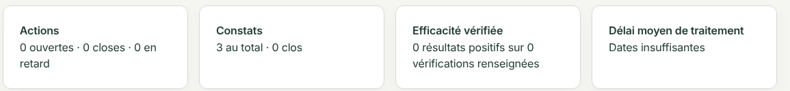

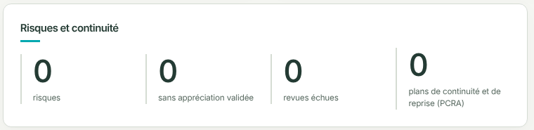

### GR-03 — Quatre états vides différents

- Gravité : Moyenne
- Écran : Plan d'actions, Risques, Revues, Fournisseurs
- Observé : Plan d'actions : bandeau vert sous l'en-tête du tableau. Risques : texte nu « Aucun risque ne correspond. » alors qu'aucun filtre n'est posé. Revues : carte blanche placée au-dessus de l'en-tête. Fournisseurs : en-tête seul puis texte nu.
- Attendu : Un état vide unique, sous l'en-tête ou à sa place, avec un message qui distingue « registre vide » de « aucun résultat pour ces filtres ».

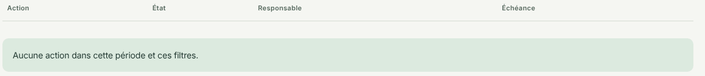

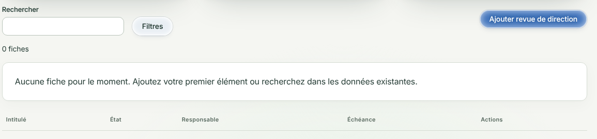

### GR-04 — Anneau « Écarts ouverts » : couleurs différentes selon l'écran

- Gravité : Faible
- Écran : Tableau de bord, Synthèse
- Observé : Même donnée (1 majeure, 2 mineures) : orange vif et rouge vif au tableau de bord, brun et rouge sombre dans la Synthèse.
- Attendu : Mêmes couleurs de classification partout.

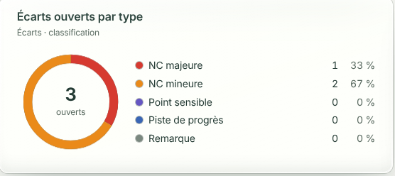

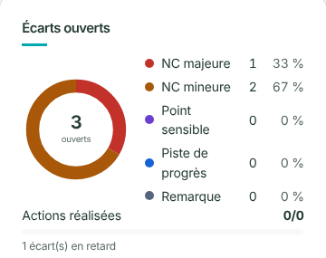

### GR-05 — Même sous-titre générique sur huit écrans au moins

- Gravité : Faible
- Écran : Synthèse, Parcours, DdA, Plan d'actions, Risques, Périmètres, Fournisseurs, Tâches récurrentes
- Observé : « Qualité, sécurité et référentiels : pilotez vos travaux à partir des données existantes. » sous chaque titre ; sur la DdA, le titre est en plus doublé (« Annexe A (DdA) » puis « Conformité — Annexe A (DdA) »).
- Attendu : Sous-titre propre à l'écran, comme sur Amélioration continue et Revues de direction, ou pas de sous-titre.

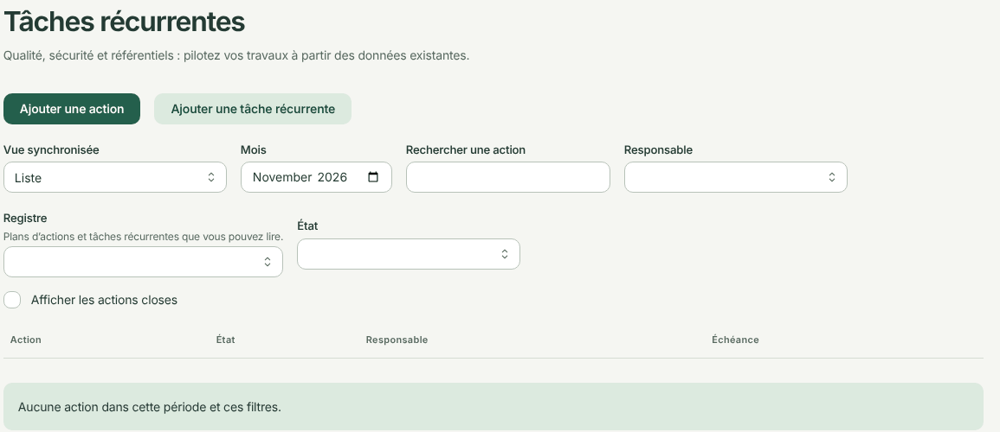

### GR-06 — Trois styles de bouton sur une même ligne

- Gravité : Faible
- Écran : Amélioration continue
- Observé : « Ouvrir » (fond vert clair), « Vérifier l'efficacité » (contour), « Autres actions » (texte), ce dernier renvoyé seul sur une seconde ligne. « Non attribué » est coupé en deux lignes. L'échéance dépassée (01/10/2026) n'est pas signalée ici alors que le tableau de bord l'affiche « En retard ».
- Attendu : Actions alignées sur une ligne ; échéance dépassée mise en évidence comme au tableau de bord.

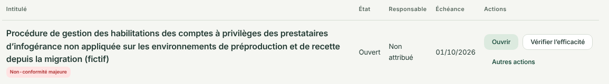

## B. Défauts de mise en page

### GR-07 — Carte du périmètre désalignée et bloc des totaux sans style

- Gravité : Forte
- Écran : Organisation → Périmètres (vue Graphe)
- Observé : Dans la carte, la valeur de « Tâches récurrentes » passe à la ligne et s'aligne à gauche, « Couverture indisponible » est éclaté, et un tiers de la carte reste vide. Le bloc des totaux a une bordure sombre fine, sans le style des autres cartes. « Mettre le flux en pause », « Modifier » et « Ajouter un enfant » sont de très petits boutons en pilule.
- Attendu : Libellé à gauche et valeur à droite sur chaque ligne ; hauteur ajustée au contenu ; bloc des totaux au style de carte.

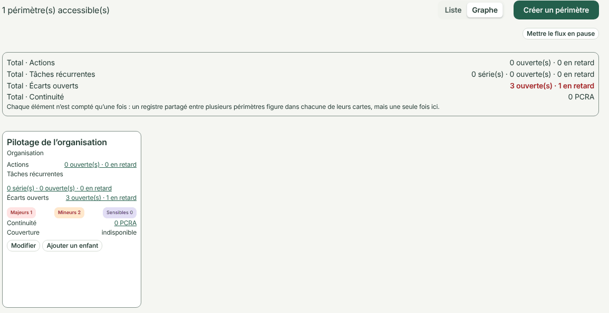

### GR-08 — Grille irrégulière avec des trous

- Gravité : Moyenne
- Écran : Tableau de bord
- Observé : Une rangée de trois cartes qui n'occupe pas la largeur, puis une rangée de trois de largeur différente, puis une rangée de deux avec un vide ; cartes largement vides (« Tâches récurrentes en retard », « Plans du SMSI 2026 »).
- Attendu : Colonnes constantes ; dernière rangée complétée ou étirée.

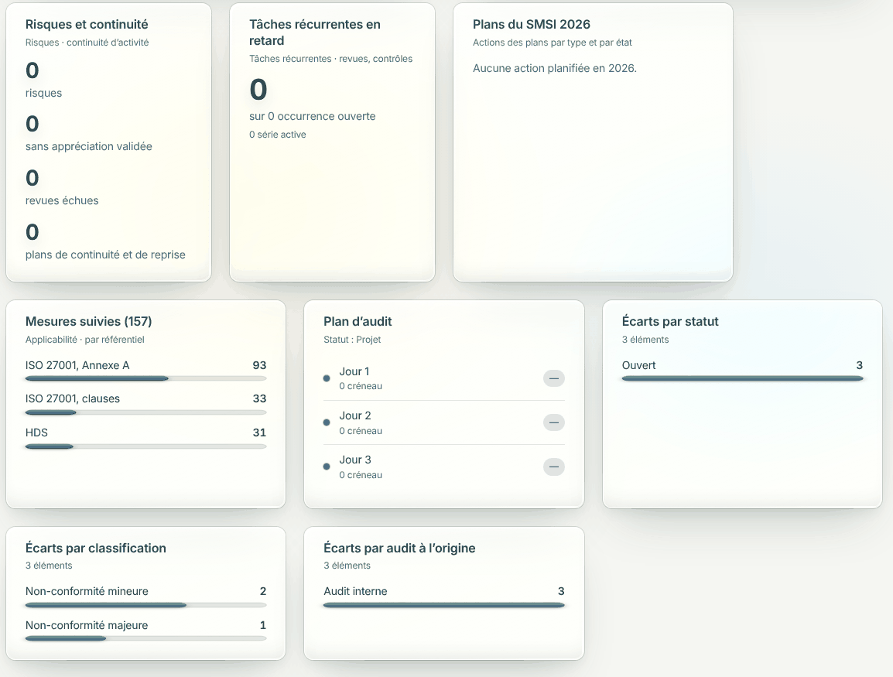

### GR-09 — Carte « Risques et continuité » : chiffre décalé

- Gravité : Faible
- Écran : Pilotage → Synthèse
- Observé : Le quatrième chiffre est plus haut que les trois autres parce que son libellé tient sur deux lignes ; la carte ne remplit pas la rangée.
- Attendu : Chiffres alignés sur la même ligne de base.

### GR-10 — Graphique « Conformité par référentiel » illisible

- Gravité : Moyenne
- Écran : Pilotage → Synthèse
- Observé : Graduations et noms des référentiels en caractères minuscules ; étiquette « 100 % » au-dessus de barres presque entièrement « non renseigné », qui se lit comme une conformité de 100 %.
- Attendu : Libellés à la taille du texte courant ; étiquette portant la part mise en œuvre, pas le total de la barre.

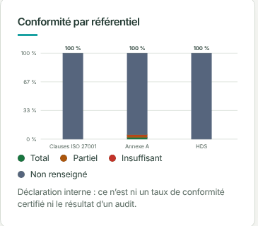

### GR-11 — Titres de l'arbre traversés par les branches

- Gravité : Faible
- Écran : Pilotage → Parcours guidé (vue Arbre)
- Observé : « MAÎTRISER » et son sous-titre sont barrés par la branche jaune ; « ÉVALUER & AMÉLIORER » est recouvert à droite par la branche violette et une feuille ; « CADRER » touche une feuille.
- Attendu : Titres dégagés des tracés.

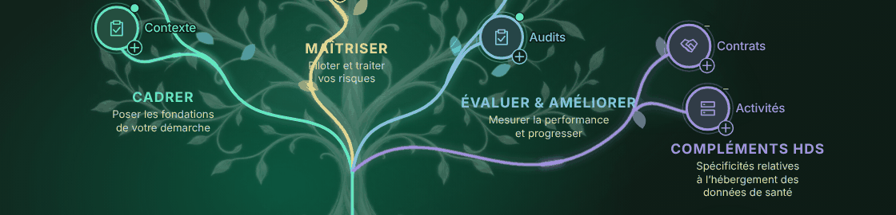

### GR-12 — Filtres désalignés

- Gravité : Faible
- Écran : Actions → Plan d'actions
- Observé : Le champ « État » est plus haut que le champ « Registre », décalé par son texte d'aide ; quatre filtres sur la première rangée, deux de largeur différente sur la seconde.
- Attendu : Champs alignés sur leur base.

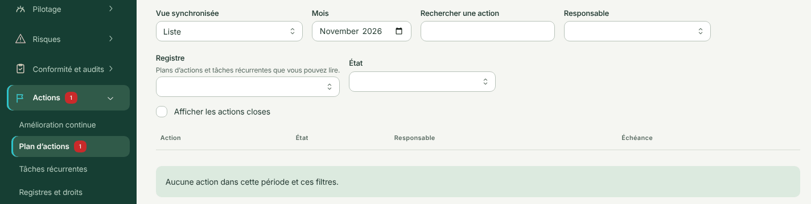

### GR-13 — Titre de section coupé au défilement, champ plus étroit

- Gravité : Faible
- Écran : Fiche « Créer — Tâche récurrente »
- Observé : Au défilement, le titre « Récurrence et automatisation » passe à moitié sous l'en-tête de la fenêtre ; le champ « Périodicité » est plus étroit que les autres ; cette fenêtre fait environ 780 px de large contre 620 px pour la fiche d'une mesure.
- Attendu : Contenu défilant sous un en-tête opaque avec marge ; largeurs de champs et de fenêtres homogènes.

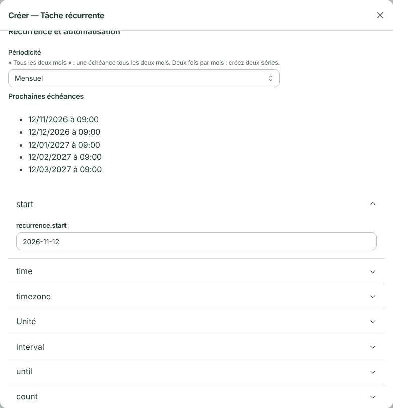

### GR-14 — « Conformité et audits » passe sur deux lignes quand la section est ouverte

- Gravité : Faible
- Écran : Menu latéral
- Observé : Le libellé tient sur une ligne quand la section est fermée, et sur deux quand elle est active (texte en gras) : le menu se décale.
- Attendu : Libellé sur une ligne dans les deux états.

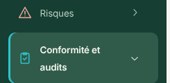

### GR-15 — Bande claire sous la barre latérale en bas des pages longues

- Gravité : Faible
- Écran : Tableau de bord, Parcours guidé
- Observé : Le fond vert de la barre latérale s'arrête une quinzaine de pixels avant le bas de la page.
- Attendu : Barre latérale jusqu'au bas de la page.

## C. Incohérences d'affichage des données

### GR-16 — Justification saisie mais colonne vide ; listes sans libellé ; écart en identifiant technique

- Gravité : Forte
- Écran : Conformité → Annexe A (DdA)
- Observé : Pour A.5.1, la justification « Exigence du SMSI et du référentiel HDS » est dans la fiche, mais la colonne « Actions ou justification » du tableau reste vide. Les listes non renseignées sont des cases blanches sans mention. L'écart s'affiche comme un identifiant technique rouge sur deux lignes.
- Attendu : Justification visible dans la colonne ; mention « non examinée » dans les listes vides ; intitulé de l'écart.
- Déjà au registre : BUG-019 pour l'identifiant

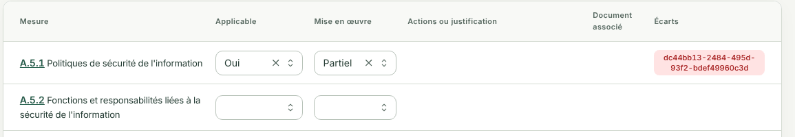

### GR-17 — Réglages nommés en anglais technique

- Gravité : Forte
- Écran : Fiche « Créer — Tâche récurrente »
- Observé : « start », « time », « timezone », « interval », « until », « count » et le champ « recurrence.start », au milieu de libellés français (« Unité », « Périodicité »).
- Attendu : Libellés français.
- Déjà au registre : BUG-029

### GR-18 — Pastille rouge « 1 » alors que la liste est vide

- Gravité : Moyenne
- Écran : Menu Actions, Plan d'actions
- Observé : Le menu affiche « 1 » sur « Actions » et « Plan d'actions » ; l'écran indique « Aucune action dans cette période et ces filtres » et Amélioration continue « 0 ouvertes ».
- Attendu : Pastille cohérente avec ce que l'écran liste, ou info-bulle disant ce qu'elle compte.

### GR-19 — « Tous les indicateurs disposent d'une valeur mesurée » avec zéro indicateur

- Gravité : Moyenne
- Écran : Revues de direction
- Observé : L'entrée 9.3.2 c 5 l'affirme alors que l'entrée voisine indique « 0/0 indicateur(s) ».
- Attendu : « Aucun indicateur enregistré » quand il n'y en a pas.

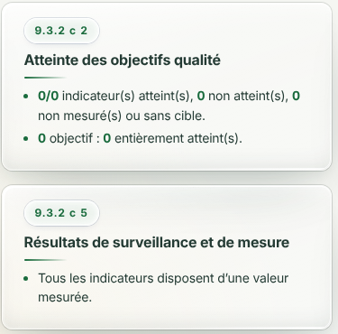

### GR-20 — L'écran des tâches récurrentes s'ouvre sur le plan d'actions

- Gravité : Moyenne
- Écran : Actions → Tâches récurrentes
- Observé : Bouton principal « Ajouter une action », filtres et message « Aucune action… » identiques au Plan d'actions ; la liste des séries n'arrive qu'en bas, avec un second champ de recherche.
- Attendu : Bouton principal « Ajouter une tâche récurrente » et liste des séries en tête.

### GR-21 — Tiret isolé à la place de la date du prochain audit

- Gravité : Faible
- Écran : Tableau de bord
- Observé : Quand la date n'est pas saisie, la carte affiche un grand tiret au-dessus de « 2027 — Surveillance 2 ».
- Attendu : « Date à définir », avec le lien vers le réglage du cycle.

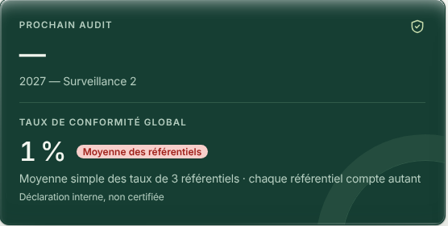

## D. Affichage sur téléphone (390 px de large)

### GR-22 — Listes trop étroites : la valeur choisie est masquée

- Gravité : Forte si l'usage mobile est prévu
- Écran : Conformité → Annexe A (DdA)
- Observé : Les listes « Applicable » et « Mise en œuvre » n'affichent plus que la croix et les chevrons ; « Oui » et « Partiel » sont invisibles. Les onglets de filtre sont coupés à droite sans indication de défilement.
- Attendu : Valeur lisible (liste pleine largeur ou présentation en cartes, comme Amélioration continue).

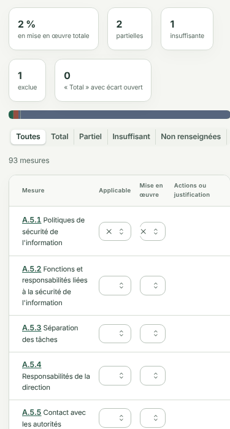

### GR-23 — Cartes coupées à droite

- Gravité : Moyenne
- Écran : Amélioration continue et autres écrans
- Observé : Le bord droit des cartes sort de l'écran et « Déconnexion » touche le bord.
- Attendu : Marge droite égale à la marge gauche.

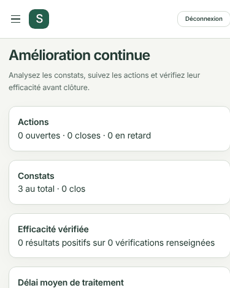
