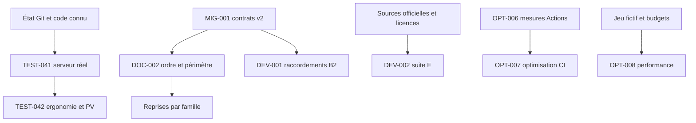

# Dépendances et blocages

Référence applicative analysée : `c704fa6e6d6d516db75f963db8dd5d2049ab42c8`. Mise à jour : 2026-10-11T00:46:53+02:00 (Europe/Paris).

| Dépendance              | État / blocage                                                                                    |
| ----------------------- | ------------------------------------------------------------------------------------------------- |
| Serveur utilisateur     | Résultats et configuration réelle inconnus ; aucun accès serveur supposé.                         |
| Tests API               | Instance dédiée requise, setup supprimant bases temporaires ; pas exécuté sur l’existant.         |
| Référentiels/ressources | Métadonnées officielles disponibles ; textes ISO sous licence et grilles ANS/HDS manquants.       |
| Dépôt/images privées    | Accès serveur Git/registry nécessaires ; valeurs et dates d’expiration non inspectées.            |
| Réutilisation legacy    | Contrats et sources uniques avant migration ; aucune suppression de /legacy avant recette.        |
| D/J/I/F                 | Exclus par demande ; nouveau périmètre explicite avant développement.                             |
| Coût CI                 | Statistiques de fréquence/coût mensuel non collectées ; 50 % des scans n’est pas 50 % de minutes. |

Les dépendances externes de runtime/build sont dans le DAT. Aucun nouveau paquet
n’a été ajouté pour la documentation.
