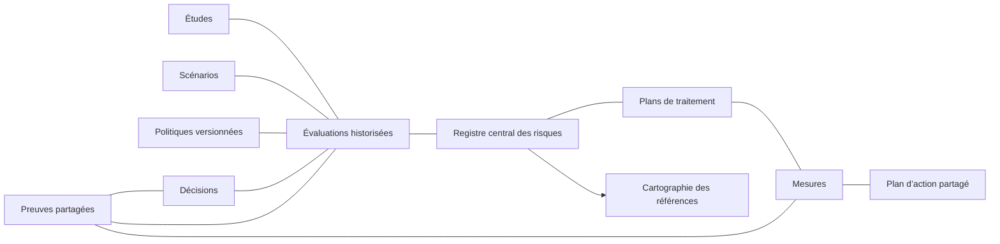

# Risques centraux et administration Legacy

Branche exclusive `legacy/test-lots-d-f`, 11 octobre 2026. Cette évolution concerne
la copie Legacy HTML/CSS/JavaScript/JSON et son serveur local Python/SQLite.

## Utilisation

Après démarrage avec `python3 demarrer.py`, ouvrir **Risques et études EBIOS RM**.

1. Dans **Politiques méthodologiques**, définir une méthode, sa couverture, les
   échelles d’impact et vraisemblance, les niveaux, couleurs et acceptabilités.
   Choisir une appréciation justifiée ou une matrice explicite. Chaque modification
   produit une nouvelle version ; les évaluations anciennes gardent leur politique.
2. Dans **Registre central**, créer une fiche de risque avec description, périmètres,
   responsable et prochaine revue. Aucune étude n’est obligatoire.
3. Dans **Études EBIOS RM**, créer une étude et sélectionner les risques existants.
   Les cinq ateliers structurent les travaux. Sources, événements redoutés et
   scénarios stratégiques/opérationnels sont des objets distincts dans **Scénarios**.
4. Depuis une fiche, **Évaluer** ajoute une évaluation datée : méthode/politique,
   étude facultative, niveau initial ou résiduel, impact, vraisemblance, justification,
   résultats, scénarios et preuves. L’auteur est le compte authentifié, fixé sur le serveur.
5. Un validateur désigne l’évaluation de référence pour chaque niveau. Il peut
   enregistrer une décision d’acceptation, réduction, transfert, évitement ou réévaluation.
   Le niveau accepté provient de l’évaluation examinée par la décision d’acceptation.
6. Dans **Traitements et mesures**, définir le plan et ses mesures ; relier les preuves
   et mesures ISO/HDS existantes, puis créer l’action centrale. Le bouton ouvre ensuite
   la même action dans le plan existant. Sa clôture ne change jamais le résiduel.
7. **Cartographie consolidée** filtre par GHT/établissement, niveau initial/résiduel/
   accepté, statut et texte. « Tous mes périmètres autorisés » consolide les couvertures
   auxquelles le compte a accès. Cliquer une tuile ouvre la fiche et ses évaluations.
   Excel et rapport imprimable/PDF exportent les données du filtre courant.

Une étude clôturée ou archivée conserve ses risques et évaluations. Elle ne reçoit
plus de nouvelles évaluations. Les évaluations/décisions/politiques existantes ne sont
ni modifiables ni supprimables par l’API. Ajouter une nouvelle évaluation, décision ou
version pour documenter un changement. Le serveur refuse aussi la suppression des
risques, études, scénarios, traitements et mesures déjà enregistrés.

La carte ne choisit pas automatiquement le dernier historique : un risque sans
référence pour le niveau demandé apparaît **Non évalué**. Elle ne mélange pas les
barèmes : les groupes, légendes et couleurs sont ceux de chaque version de politique.
Une acceptation arrivée à échéance est signalée, sans transformer l’historique.

## Administration, responsables et démonstration

Le menu **Administration**, ainsi que l’engrenage pour un administrateur, ouvre :
vue d’ensemble, comptes/habilitations, rôles/responsabilités, référentiels, journal et
données de démonstration. Ce panneau ne comporte pas de commande de sauvegarde ou
de mise à jour. Les fonctions métier existantes des autres menus sont conservées.

Dix rôles fonctionnels de base sont ajoutés si absents : Direction, RSSI, DSI,
Responsable PCRA, Responsable métier, Responsable qualité, DPO, Responsable financier,
Référent établissement et Auditeur interne. Ils utilisent le registre `S.roles` existant.
Renseigner les titulaires, fonctions, suppléants, couvertures et comptes affectés dans
**Rôles et responsabilités**. Le sélecteur partagé **Responsable · personne / fonction /
rôle** reprend ces affectations, y compris dans les périmètres et le parcours guidé.
Un rôle fonctionnel ne confère pas automatiquement une permission d’administration.

Dans **Administration → Données de démonstration → Ajouter le jeu FICTIF**, confirmer
l’ajout. Les données antérieures sont conservées ; relancer n’ajoute aucun doublon.
Le jeu comporte un GHT, deux établissements, un SI mutualisé, des rôles fictifs,
deux processus métier, CaRE D2, une facture physique, un BIA à deux activités, un PCA,
un exercice/RETEX et des actions centrales. Aucun compte ni mot de passe n’est créé.

Le scénario d’acceptation est prêt à consulter :

- Première étude : trois risques (dossier patient, sauvegardes mutualisées, imagerie),
  avec trois évaluations initiales dans le registre central.
- Deuxième étude : réévaluation résiduelle du premier risque seulement, puis décision
  d’acceptation documentée. Sa fiche conserve les deux évaluations.
- Le registre contient toujours trois risques ; la cartographie consolidée du GHT
  retrouve leurs références distinctes. Archiver la première étude les conserve.

Tous les noms et documents de ce jeu portent la mention **FICTIF**. Les validations
de démonstration ne constituent aucune déclaration de conformité ANS, ISO ou HAS.

## Données et architecture

`S.riskMgmt.schema = 1` contient huit collections indépendantes. L’état reste dans
le document métier SQLite existant ; aucune base de risques séparée par étude.

| Collection | Relations et règles |
| --- | --- |
| `risks` | Une fiche durable ; périmètres, responsable, références `initial`/`residual`, décision acceptée |
| `studies` | Méthode, cinq ateliers, état, date, périmètres, `riskIds` sans duplication |
| `assessments` | `riskId`, `studyId` facultatif, `policyId`, stade, date/auteur/justification/résultats ; immuable |
| `scenarios` | Sources/événements/scénarios ; liens vers étude, risques et scénario amont, sans cycle |
| `policies` | Méthode, échelles, calcul, matrice, couleurs, acceptabilité ; versions immuables |
| `treatments` | `riskId`, stratégie, objectifs, responsable, échéance, état |
| `measures` | `riskId`, `treatmentId`, `controlIds`, `proofRefs`, action centrale unique |
| `decisions` | `riskId`, `assessmentId`, type, date/auteur/justification/validité/preuves ; immuable |

Le parcours guidé utilise maintenant `businessRef.kind = risk` à l’étape risques,
au lieu d’une fiche de processus générique. Il ouvre le même formulaire que le registre.
Les liens génériques avec les objets métier, actions et preuves utilisent les mécanismes
partagés existants. Les risques IA spécifiques restent dans leur module d’origine ;
aucune conversion implicite de ces textes n’est effectuée.

L’historique des risques, études, scénarios, traitements et mesures est produit par le
serveur : auteur authentifié, date, champs changés et snapshot précédent sans historique
imbriqué. Il ne peut pas être effacé par une sauvegarde cliente. Ces anciens snapshots
restent réservés à l’administration pour éviter une fuite après reclassement de périmètre.
Les évaluations et décisions historiques sont consultables dans la couverture autorisée.

## Références internes et migration

Les anciennes clés techniques `id` sont conservées pour préserver tous les liens.
Le nouveau champ de présentation `internalId` est attribué automatiquement :

| Objet | Exemple |
| --- | --- |
| Périmètre / rôle | `PERI-000001` / `ROLE-000001` |
| BIA / activité BIA / PCA / PRA | `IMP-000001` / `ACTI-000001` / `PCA-000001` / `PRA-000001` |
| Risque / étude / évaluation | `RISK-000001` / `EBRM-000001` / `EVR-000001` |
| Scénario / traitement / mesure / décision | `SCEN-000001` / `TRT-000001` / `MES-000001` / `DEC-000001` |
| Action / preuve / politique | `ACT-000001` / `PRE-000001` / `POL-000001` |

Le catalogue complet couvre toutes les collections métier contrôlées par le serveur
dans `sources/identifiants.json`, plus les activités BIA. Les références existantes sont
conservées ; les nouvelles sont non modifiables et uniques. Les compteurs SQLite
transactionnels ne réutilisent pas les numéros supprimés dans l’installation courante.
Une ancienne sauvegarde complète de la base restaure naturellement ses compteurs.

SQLite passe automatiquement à `user_version = 2` et ajoute `code_counters`.
Au premier chargement administrateur, une sauvegarde de migration attribue les codes
manquants et complète les rôles sans recréer les existants. Les codes de présentation
ne modifient pas les révisions/validations métier BIA/PCA/parcours. Conserver le dossier
privé `.legacy-data` lors d’une mise à niveau. Une politique avec des références historiques
reste immuable. Dans cette version, le changement de couverture d’un risque déjà
évalué est bloqué si ses évaluations conserveraient une couverture différente.
Définir la couverture du risque avant la première évaluation. Un ancien ZIP dont les
historiques sont moins complets que ceux de la base courante sera refusé : le restaurer
dans une installation isolée, ou restaurer le dossier privé complet serveur arrêté.

## Contrôles serveur et limites

Les API de session, CSRF, stockage de pièces et versions concurrentes sont réutilisées.
Le serveur contrôle les relations, la couverture du risque et de l’étude/politique,
la méthode, les références, auteurs, dates et résultats de matrice. Les créations de
politique, décisions et choix de référence nécessitent la capacité de validation.
`GET /api/admin/status` et `/api/audit` sont réservés aux administrateurs.

Un parent couvre ses descendants. Les liens SI mutualisés ne donnent pas de droits.
Un objet multi-établissements exige l’accès à toute sa couverture. Une politique du
GHT est consultable par ses établissements en lecture seule, sans ouvrir les autres
risques ou études. La projection serveur préserve les objets cachés lors d’une édition.

EBIOS RM, ISO 27005, MÉHARI et Personnalisée sont des méthodes déclarées avec
des politiques distinctes. Les cinq ateliers EBIOS sont une structure de travail ;
les échelles proposées sont internes. Le moteur supporte une appréciation justifiée ou
une matrice de décision explicite, avec 1 à 20 modalités par échelle. Il ne reproduit
pas l’intégralité des moteurs de calcul spécifiques à MÉHARI ou de normes sous licence.
Le rapport/PDF utilise la boîte d’impression du navigateur. Le stockage JSON et les
filtres en mémoire restent adaptés à cette version locale ; aucun test de charge à
plusieurs dizaines de milliers de risques n’est revendiqué.

Référence de la méthode EBIOS : [ANSSI — EBIOS Risk Manager](https://cyber.gouv.fr/la-methode-ebios-risk-manager).
Les décisions internes, barèmes et jeu de démonstration ne sont pas des exigences
normatives ajoutées aux référentiels. Voir les résultats réellement exécutés dans
[la recette](RECETTE-RISQUES-ADMINISTRATION.md).
