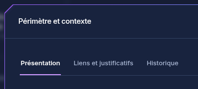
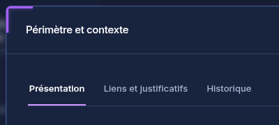
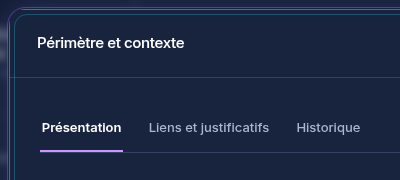
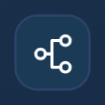
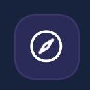

# Cadres néon et pictogrammes animés

01/11/2026, Europe/Paris. Session : Codex. Branche `codex/refonte-neon-main`, depuis `bf7530595e517c4fcfd8a3213f8e9e116de8639c`.

## Trois propositions pour la grande dalle

Le contenu du contexte, les cinq rubriques, les listes et les commandes sont conservés. Seul l’encadrement de la fenêtre varie :

| Proposition      | Traitement                                                              |
| ---------------- | ----------------------------------------------------------------------- |
| **1 · Biseau**   | Quatre angles coupés, contour fin violet/cyan et diagonales lumineuses. |
| **2 · Équerres** | Angles presque carrés et repères d’angle lumineux plus présents.        |
| **3 · Halo**     | Coins arrondis, double liseré et lueur extérieure discrète.             |

Biseau est appliqué provisoirement dans la copie de refonte. Les trois styles sont déclarés dans la feuille UI et sélectionnés par l’attribut décoratif `data-cadre`. Pour les comparatifs, la recette change uniquement cet attribut dans le navigateur. Aucun menu ou réglage enregistré n’est ajouté au produit ; les trois propositions restent à départager par le demandeur.

| Biseau                                                                                   | Équerres                                                                                       | Halo                                                                               |
| ---------------------------------------------------------------------------------------- | ---------------------------------------------------------------------------------------------- | ---------------------------------------------------------------------------------- |
|  |  |  |

Vues complètes : [Biseau](captures-cadres/biseau-dark-1440.png), [Équerres](captures-cadres/equerres-dark-1440.png), [Halo](captures-cadres/halo-dark-1440.png).

Comparatifs clairs : [Biseau](captures-cadres/biseau-light-1440.png), [Équerres](captures-cadres/equerres-light-1440.png), [Halo](captures-cadres/halo-light-1440.png). Les gros plans et captures mobiles sont dans le même dossier.

## Animations des pictogrammes

Les cinq pictogrammes conservent leurs formes ; seuls certains éléments internes bougent : fenêtres du bâtiment, cadre intérieur du périmètre, nœuds des interfaces, aiguille de la boussole et flèche de sortie. Sept éléments SVG sont animés, sans déplacement des textes ou des blocs.

Une activation de 3,2 secondes se joue à l’ouverture, avec un léger décalage entre les nœuds. L’animation se poursuit lorsque le pointeur survole le pictogramme. La préférence système de mouvement réduit supprime les animations. Les décorations sont masquées aux lecteurs d’écran et ne capturent aucun clic. Le cadre décoratif disparaît en couleurs forcées au profit d’une bordure système.

 

Ces GIFs proviennent de 36 captures du navigateur à différentes positions des animations CSS, assemblées avec FFmpeg. Ils montrent les pictogrammes réels agrandis par le facteur de pixels du navigateur, sans modification des données ni dessin de remplacement. Les captures statiques utilisent le mouvement réduit pour faciliter la comparaison.

## Contrôles exécutés

Instance fictive isolée, vraie API et PostgreSQL 18, Node 26.13.0, Chromium système :

- 18 vues vérifiées : trois cadres, clair/sombre, 1440 × 1080, 1024 × 768 et 390 × 844 ; six gros plans supplémentaires. Aucun débordement horizontal de page. Les cinq sections restent entièrement visibles à 1440 × 1080 sur le jeu fictif.
- Les boutons restent visibles et cliquables dans les trois cadres ; le calque décoratif ne reçoit pas les événements de pointeur.
- Six analyses axe sur les fenêtres bureau : aucune violation détectée dans cet échantillon.
- Sept animations actives observées avec le mouvement autorisé ; aucune animation active après activation du mouvement réduit. Couleurs forcées : suppression du cadre décoratif et de la découpe vérifiées.
- Aucune erreur JavaScript, violation CSP, réponse API en échec ou écriture d’objet/relation pendant la recette de comparaison.
- Deux parcours e2e existants réussis, sans changement d’assertions : consultation, agrandissement, modification, annulation, sauvegarde, création et compte réel limité à la lecture avec refus serveur HTTP 403.
- Trois tests ciblés de charte, typage web, lint du composant, formatage et build réussis. Avertissements de build existants : script `/update/client.js` externe et taille de chunks. Les suites unitaires complètes ne sont pas déclarées rejouées pour ce lot graphique.

Preuve détaillée hors Git : `/workspace/work/neon-instance/validation-cadres-contexte.json`. Les 36 poses de connexions sont distinctes ; 32 poses de boussole le sont également. Les GIFs bouclent pour la démonstration ; le produit conserve l’activation brève puis le survol.

Aucune modification métier, de droits, d’API ou de données de production. Aucune nouvelle dépendance ni référence visuelle de CI remplacée automatiquement. Main, le dépôt d’origine et le graphique RETEX restent intacts. Aucun déploiement. Prochaine étape : choix visuel du cadre par le demandeur.
