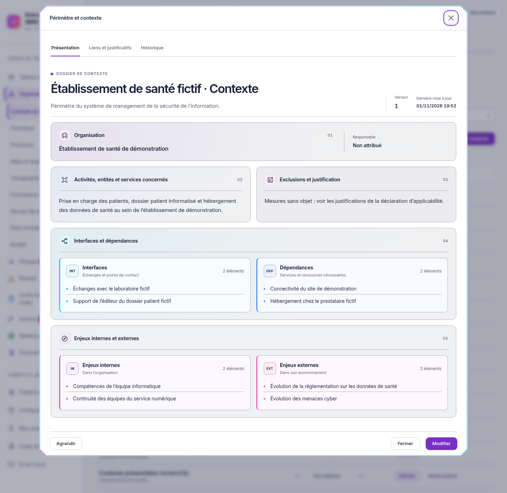

# Distinguer les catégories du contexte

01/11/2026, Europe/Paris. Session : Codex. Branche `codex/refonte-neon-main`, depuis `fede36115ae543c6a0485571160eef9657bd3252`.

La consultation « Périmètre et contexte » présente quatre zones identifiées : **Interfaces**, **Dépendances**, **Enjeux internes** et **Enjeux externes**. Chaque catégorie possède un titre, une courte explication, un repère et un accent décoratif propres. Les titres et la séparation des panneaux permettent de les distinguer sans dépendre de la couleur. Organisation, activités et exclusions restent visibles ; le cadre Biseau, les animations validées et le défilement extérieur sont conservés.

Les deux champs existants sont des textes libres. La présentation lit les catégories explicitement indiquées dans ces textes. Les éléments sans catégorie apparaissent dans **À préciser**, avec leur contenu conservé. Une catégorie vide porte « Catégorie non renseignée ». Aucun classement n’est déduit du sens des mots, aucune donnée existante n’est réécrite à l’ouverture, aucun autre registre n’est fusionné avec la fiche.

La saisie conserve les deux champs actuels, avec une aide. Exemples :

```text
Enjeux internes :
Compétences des équipes
Continuité des équipes
Enjeux externes :
Évolution réglementaire
Évolution des menaces
```

```text
Interfaces :
Échanges avec le laboratoire fictif
Support de l’éditeur fictif
Dépendances :
Connectivité du site
Hébergement chez le prestataire fictif
```

Les préfixes sur une ligne (`Interne : …`, `[Externe] …`, `[Interface] …`, `[Dépendance] …`) sont également reconnus. Une ligne préfixée ne classe pas implicitement la suivante. Le titre `[À préciser]` permet de conserver un groupe non catégorisé. L’ordre des éléments est conservé dans chaque catégorie. Les valeurs enregistrées, les schémas et les appels de sauvegarde restent inchangés ; les modifications continuent à passer par Modifier et Enregistrer, avec les droits et versions existants.

## Captures réelles

Ces captures proviennent du produit connecté à l’instance isolée et d’une nouvelle fiche **fictive**, créée avec des catégories explicites pour montrer les quatre zones. La fiche de démonstration historique n’a pas été reclassée ni modifiée pour produire ces images. La capture de bureau mesure 1440 × 1400 ; sur un écran plus bas, le voile extérieur défile.

[](captures-categories/light-1440.png)

[Vue sombre](captures-categories/dark-1440.png) · [Mobile](captures-categories/enjeux-light-390.png) · [Ancien texte sans catégories](captures-categories/historique-a-preciser.png).

## Validation exécutée

Instance fictive PostgreSQL 18/API réelle, Node 26.13.0, Chromium système, sans déploiement. Preuve brute privée : `/workspace/work/neon-instance/validation-categories.json`.

- **230 tests web** réussis dans 30 fichiers, dont sept nouveaux cas de classement explicite : titres, préfixes, accents, puces, lignes non catégorisées et entrées particulières.
- **Trois parcours e2e Contexte** réussis : catégories séparées à 1440 et 390 px, consultation sans écriture et données identiques avant/après, annulation/enregistrement, droits d’un lecteur réel et accès au bas des formulaires longs.
- TypeScript web et tests e2e, ESLint, formatage des sources modifiées et `git diff --check` : code 0.
- Build web : code 0, avec les avertissements existants sur `/update/client.js` et les chunks supérieurs à 900 ko.
- Rendu à 1440, 1024 et 390 px dans les deux thèmes : aucun défilement vertical interne au dialogue, aucun débordement horizontal de page, aucune erreur JavaScript ou violation de la CSP stricte.
- Axe WCAG 2 A/AA et 2.1 AA sur quatre vues de dialogue : aucune violation détectée dans cet échantillon.
- Fiche ancienne non classée : deux groupes À préciser présents ; nouvelle fiche de recette relue inchangée depuis l’API, aucune écriture lors des consultations.

Les autres modules, les tests API complets, les exports et l’audit par lecteur d’écran ne sont pas rejoués dans ce lot. Les références visuelles de CI ne sont pas remplacées. Prochaine étape : validation visuelle sur la copie Windows, notamment des textes réels qui nécessitent encore une catégorie. Publication uniquement sur la branche de refonte, sans fusion ni déploiement.
