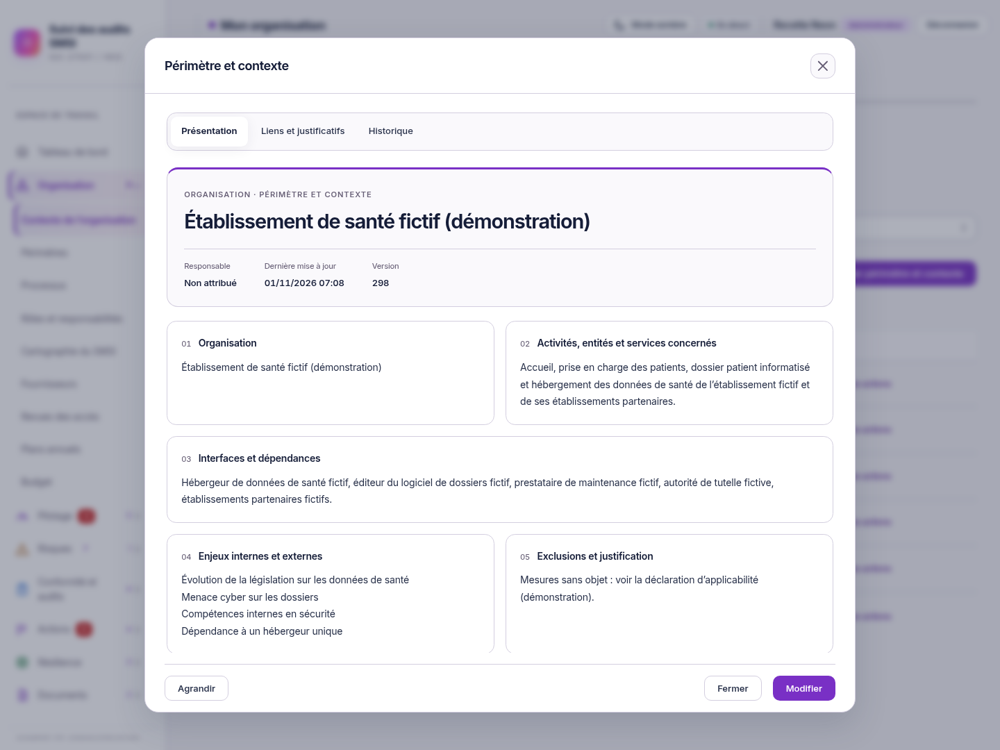
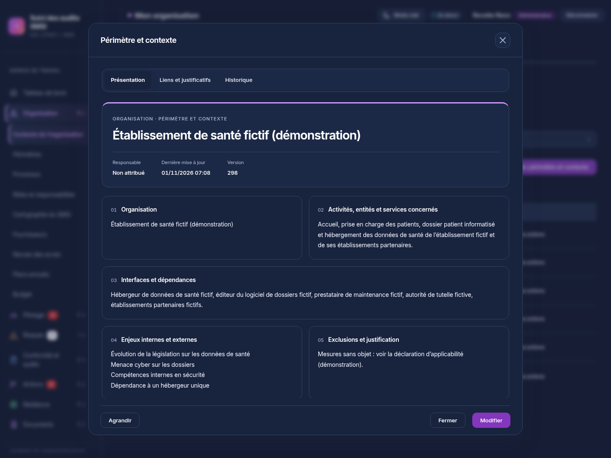

# Présenter le périmètre et le contexte en audit

01/11/2026, Europe/Paris. Session : Codex. Branche `codex/refonte-neon-main`, suite du lot fenêtres `466dc663f7e798d0e1600da905b452f32109fe0c`.

## Utilisation

Dans **Organisation → Contexte de l’organisation → Périmètre et contexte**, le bouton **Afficher** ouvre désormais une présentation des informations enregistrées, sans formulaire. Elle affiche l’intitulé, la description lorsqu’elle est renseignée, le responsable, la date de mise à jour et la version, puis cinq sections :

1. Organisation.
2. Activités, entités et services concernés.
3. Interfaces et dépendances.
4. Enjeux internes et externes.
5. Exclusions et justification.

Les textes gardent leurs retours à la ligne. Une donnée vide porte la mention « Non renseigné » ; aucune absence de contenu n’est interprétée comme une absence d’exclusion ou une preuve de conformité. Les onglets **Liens et justificatifs** et **Historique** restent consultables sous forme de listes, sans commande d’écriture.

**Agrandir** passe la présentation en plein écran avec des textes plus grands ; **Réduire** revient à la fenêtre. Le contenu défile indépendamment des commandes, également sur mobile. Les thèmes clair et sombre sont pris en charge.

**Modifier** ouvre le formulaire existant si la personne dispose du droit de modification et que la fiche reste modifiable. **Annuler** revient à la présentation sans enregistrer les champs du brouillon ; une nouvelle entrée en modification repart des valeurs enregistrées. **Enregistrer** utilise toujours la sauvegarde existante et ferme la fiche après succès. Les relations déjà enregistrées explicitement dans le formulaire gardent leur fonctionnement immédiat existant.

La création d’une nouvelle fiche ouvre directement le formulaire habituel. Les autres types de fiches ne changent pas de mode d’ouverture. Toutes les entrées dans une fiche Contexte existante, y compris un lien contextuel, ouvrent sa présentation.

## Portée du changement

`ContextPresentation.tsx` rend le document de consultation ; `RecordEditor.tsx` distingue présentation et édition pour le seul type `context`. `Registry.tsx` nomme son bouton Afficher. Le style reste centralisé dans `packages/ui/src/neon-fenetres.css`.

Aucun endpoint, schéma, stockage ou calcul métier ajouté ou modifié. Les requêtes de consultation utilisent les lectures existantes ; la sauvegarde, `If-Match`, les versions et les contrôles serveur sont conservés. Le graphique RETEX et le dépôt d’origine ne sont pas modifiés. Aucune nouvelle dépendance, fusion dans main ou mise en production.

## Vérifications réelles

Sur l’instance fictive isolée PostgreSQL 18/API réelle, avec Node 26.13.0 et Chromium :

- **217 tests unitaires web** et **243 tests UI** réussis, codes 0.
- TypeScript web, UI et e2e : codes 0 ; ESLint dépôt, formatage des fichiers modifiés et `git diff --check` : codes 0.
- Build web : code 0, avec les avertissements déjà connus sur le script externe `/update/client.js` et les chunks dépassant 900 ko.
- Deux parcours Playwright ajoutés et réussis : consultation sans formulaire ni écriture, agrandissement, onglets, annulation d’un brouillon, réouverture sans le brouillon, sauvegarde réelle avec incrément de version, réouverture de la valeur enregistrée, création toujours proposée sous forme de formulaire ; puis consultation mobile avec un compte réel limité à `pilotage:lire`, historique disponible, aucune commande Modifier/Enregistrer/Retirer et écriture refusée par le serveur avec HTTP 403.
- Au premier lancement, la préparation des deux tests attendait HTTP 201 alors que la route existante de création des objets renvoie HTTP 200. L’assertion a été corrigée pour vérifier le contrat réel, sans modification du serveur ; les assertions de données, de versions et de droits restent présentes. Les parcours ont ensuite réussi. Chaque parcours a également été rejoué après ses dernières assertions complémentaires.
- Huit captures : présentation à 1440 × 1080, 1024 × 768 et 390 × 844 dans les deux thèmes, plein écran et formulaire de modification.
- Axe WCAG 2 A/AA et 2.1 AA sur quatre vues de présentation : aucune violation détectée dans cet échantillon. Le parcours d’édition contrôle également axe.
- Pendant les huit captures et le parcours de consultation associé : aucune écriture d’objet ou de relation, aucune erreur JavaScript, violation de CSP stricte, réponse API en échec ou débordement horizontal de page.

Les scripts, sessions et résultats détaillés restent hors Git dans `/workspace/work/neon-instance` ; preuve visuelle complémentaire `validation-contexte-presentation.json`. Les tests réutilisables sont dans `tests/e2e/specs/zzzzzzzzzzzzzzzzzzzzzzzzzzz-contexte-presentation.spec.ts`. Aucun secret ni compte réel dans les captures publiées.

La recette humaine de présentation à l’auditeur, les cas de permissions exhaustifs et l’examen par lecteur d’écran restent à faire. Le point de retour de focus décrit dans [le lot fenêtres](FENETRES.md) n’est pas déclaré résolu par ce changement. Aucune référence visuelle de CI remplacée automatiquement.

## Captures pour validation

[Clair](captures-contexte/presentation-light-1440.png) · [Sombre](captures-contexte/presentation-dark-1440.png) · [Mobile](captures-contexte/presentation-light-390.png) · [Plein écran](captures-contexte/presentation-plein-ecran.png) · [Formulaire distinct de modification](captures-contexte/modification-light-1440.png)

Prochaine action : validation visuelle de cette présentation par le demandeur, sur la branche de refonte uniquement.
