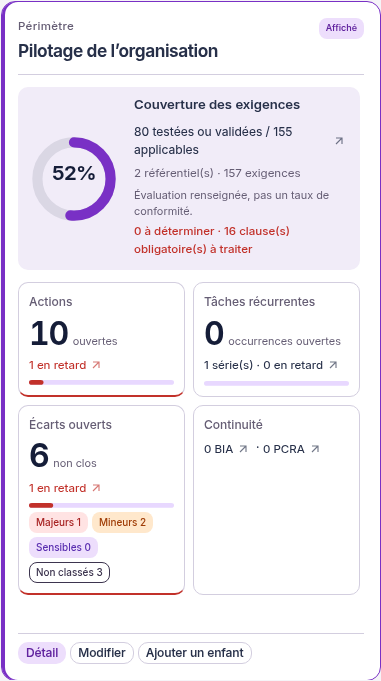
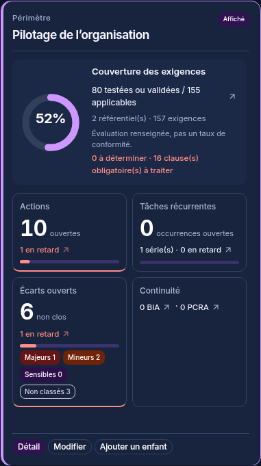

> Correction du 01/11/2026 : [dalles Biseau à hauteur naturelle, sans défilement interne](FENETRES-GLOBALES.md). Les captures et résultats ci-dessous conservent la preuve du lot précédent.

# Dalles des périmètres — vue Graphe

1er novembre 2026, Europe/Paris. Session Codex. Branche `codex/refonte-neon-main`.

Les dalles de la vue **Organisation → Périmètres → Graphe** ont été retravaillées dans la charte Neon. La présentation Liste, les identifiants, les calculs et les API restent inchangés.

## Présentation

- Dalle plus large, titre sur deux lignes, nature du périmètre et repère du périmètre actuellement affiché.
- Anneau de couverture : exigences testées ou validées parmi les applicables. La légende rappelle qu'il ne s'agit pas d'un taux de conformité. Sans référentiel effectif ou sans droit de lecture, « indisponible » reste affiché ; aucun zéro fictif.
- Tuiles de compteurs pour les actions, occurrences récurrentes et écarts, avec le nombre ouvert mis en avant. Les barres représentent la part en retard parmi les ouverts. Les séries récurrentes restent distinguées de leurs occurrences.
- BIA et PCRA conservent leurs liens séparés. Les classifications des écarts restent des liens filtrant le même périmètre.
- Sous-total parent/enfants regroupé dans un volet dépliable. Les valeurs viennent toujours du total dédupliqué fourni par le serveur, jamais de la somme des cartes.
- Bouton **Détail** ouvrant le panneau complet, dont les référentiels rattachés/hérités, les clauses à traiter et les périmètres exclus de l'agrégation.
- Pied de dalle toujours accessible pour Afficher, Modifier et Ajouter un enfant, selon les droits. Contenu dense défilant à l'intérieur de la dalle ; le graphe garde son défilement horizontal.
- Liens hiérarchiques orientés et fournisseurs extérieurs distincts. Pause du flux et mouvement réduit conservés.

Le tracé de l'anneau utilise l'accent contrasté dans le graphe : Chromium ne peint pas systématiquement un dégradé SVG dans un `foreignObject`. Le panneau de détail conserve son dégradé. La proportion représentée est identique.

## Vérifications réelles

Sur l'instance fictive isolée, Node 26 et PostgreSQL 18 :

- 217 tests frontend réussis, dont la disposition d'un arbre important avec les dimensions réelles des nouvelles dalles ; absence de chevauchement horizontal et vertical.
- Quatre tests de bout en bout existants du graphe réussis sur Chromium, sans modifier leurs assertions : création d'un enfant, total parent/enfants, modification du même périmètre, fournisseur extérieur, flèches, pause/reprise, classification et lien vers le registre filtré, accessibilité axe, mouvement réduit.
- Premier passage : trois tests réussis et un délai dépassé sur les liens de classification. Le contrôle visuel a révélé un héritage de `flex-wrap` faisant déborder les badges dans la tuile voisine. Correction du style des tuiles, puis les quatre tests ont réussi.
- Typage TypeScript web, ESLint et formatage réussis ; build réussi avec l'avertissement de taille de bundle déjà connu.
- Captures à 1440, 1024 et 390 px dans les deux thèmes, panneau de détail, fermeture avec Échap. Aucun débordement de la page ni erreur JavaScript. Le canevas du graphe reste volontairement défilant.

Aucune modification du backend, des schémas partagés, des données de production ou du graphique RETEX. Aucun remplacement automatique des références visuelles de CI et aucune validation humaine simulée.

## Captures pour validation visuelle

Captures de l'instance de recette et de ses données fictives ; présentation proposée, en attente de validation du demandeur.

| Dalle claire                                          | Dalle sombre                                          |
| ----------------------------------------------------- | ----------------------------------------------------- |
|  |  |

[Vue du graphe](captures-perimetres/graphe-clair.png) · [Détail sur mobile](captures-perimetres/detail-mobile.png).

## Ajustement typographique après retour visuel

Les compteurs n'utilisent plus le soulignement et la couleur violette des liens documentaires. Ils gardent leur navigation avec une flèche permanente, un survol de surface et un focus clavier visible. Cette exception est locale aux dalles et à leur panneau de détail ; le thème global des liens reste inchangé.

Hiérarchie Inter retravaillée : titre et libellés plus lisibles, chiffres agrandis et graisses moins fortes. Les dalles ne répètent plus le nombre ouvert dans la ligne du retard : le chiffre principal porte les ouverts, la ligne affiche les retards et, pour les récurrences, le nombre de séries. Le nom accessible du lien garde la formule complète, et le panneau de détail garde les valeurs complètes.

Le test e2e du compteur vérifie désormais le lien par son nom accessible complet, plutôt que par une répétition visible de la phrase. La valeur contrôlée et la cible restent les mêmes. Quatre tests e2e du graphe, dont navigation vers la liste filtrée et contrôle axe, réussis après cette modification ; six tests ciblés charte/disposition, typage, lint et build réussis. Captures renouvelées dans les deux thèmes.
