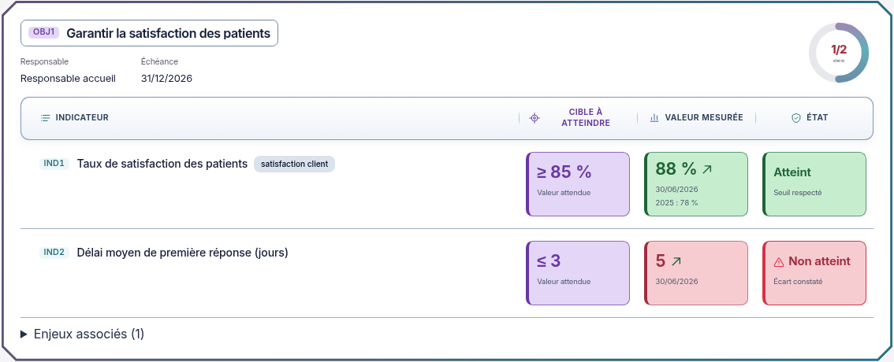

# Objectifs et indicateurs — en-têtes Dashboard intégrés

02/11/2026, Europe/Paris. Session : Codex. Branche `codex/refonte-neon-main`, copie indépendante de main.

**Accord explicite reçu : « Oui je valide ». La barre Dashboard est intégrée, contrôlée et illustrée ci-dessous. L'accord porte sur les en-têtes ; la DdA fera l'objet d'une proposition visuelle séparée, fondée sur les images originales fournies au début.**

## Résultat

Les tables détaillées et compactes des objectifs et indicateurs utilisent le bandeau validé : coins arrondis, contour visible, léger dégradé blanc/bleuté en clair et ardoise/bleu nuit en sombre. Les pictogrammes sont cyan, bleu et turquoise ; la cible garde son violet. Les libellés et les noms accessibles des colonnes restent identiques. Aucun tri ni action supplémentaire n'est ajouté.

La version B reste en place : blocs détaillés de 132 × 82 px à 1440 px, titres inchangés, fonds renforcés, cadre Biseau extérieur, warning et halo rouge sur Non atteint. Les colonnes de données restent centrées. Le mobile garde ses libellés internes et la hauteur naturelle des cartes.

Deux fichiers applicatifs évoluent : `apps/web/src/pilotage/ObjectifsProcessus.tsx` pour les pictogrammes décoratifs et `packages/ui/src/neon-objectifs.css` pour les variables et styles localisés. Calculs, valeurs, filtres, droits, formulaires, actions et endpoints conservés. Aucune dépendance ni modification de `apps/web/src/dda/Dda.tsx`.

## Captures réelles

Interface compilée, API et PostgreSQL isolés, données fictives existantes. Les images fixes utilisent le mouvement réduit.

[Sombre](captures-entetes-dashboard/dalle-dark-1440.png) · [Mobile clair](captures-entetes-dashboard/dalle-light-390.png) · [Mobile sombre](captures-entetes-dashboard/dalle-dark-390.png) · [Compacte claire](captures-entetes-dashboard/compacte-light-1440.png) · [Compacte sombre](captures-entetes-dashboard/compacte-dark-1440.png) · [Compacte mobile](captures-entetes-dashboard/compacte-dark-390.png) · [Page complète](captures-entetes-dashboard/objectifs-light-1440.png).

## Contrôles de ce lot

Node 26.13.0, dépendances déjà installées, Chromium système, même API réelle et PostgreSQL 18 isolés que la recette précédente. Rapports privés `validation-entetes-dashboard.json`, `e2e-entetes-dashboard-resultats/.last-run.json` et `logs/entetes-dashboard-build.log`, hors Git.

| Contrôle | Résultat vérifié |
| --- | --- |
| TypeScript web et ESLint du composant modifié | Code 0 |
| Charte graphique existante | 3 tests réussis, code 0 |
| Prettier des deux sources, compilation web et git diff --check | Code 0 ; avertissements de build existants sur update/client.js et taille des chunks |
| Scénario e2e Objectifs existant | Réussi : rattachements, planification, mesure à 95 %, état atteint, tendance, vues et filtres ; fixtures propres nettoyées |
| Collecte de 24 vues réelles | Objectifs, Indicateurs, Processus et Boîtes ; clair/sombre, 1440/1024/390 px ; aucun débordement horizontal de page |
| Dimensions et défilement | Blocs B conservés, titres inchangés, aucun ascenseur vertical interne détecté sur les chargements de pages mesurés |
| En-têtes | Centrage des colonnes de données conservé dans les deux vues et thèmes sur ordinateur |
| Axe sur 8 vues | Aucune violation WCAG 2 A/AA et 2.1 AA détectée dans cet échantillon |
| Animations | Pause, reprise et désactivation par préférence de mouvement réduit vérifiées |
| Console, CSP stricte et collecte visuelle | Aucune erreur JavaScript, aucune violation CSP, aucune écriture d'objectif ou d'indicateur pendant la collecte |

Commandes exécutées avec le binaire Node 26 de recette : TypeScript `node_modules/typescript/bin/tsc -p apps/web/tsconfig.json --noEmit`, ESLint `node_modules/eslint/bin/eslint.js apps/web/src/pilotage/ObjectifsProcessus.tsx --max-warnings 0`, Prettier `--check` des deux sources ; depuis `apps/web`, Vitest `run test/charte.test.ts` et Vite `build`. Playwright existant : depuis `tests/e2e`, `node_modules/@playwright/test/cli.js test --config=/workspace/work/neon-instance/playwright-entetes-dashboard.config.mjs --grep 'Objectifs : conserver'` ; recette visuelle privée `entetes-dashboard-visuel.mjs`.

Le premier rendu du bandeau utilisait des pseudo-éléments sur `thead`, ce qui déformait les largeurs de colonnes. Le contrôle des dimensions B l'a détecté. Le cadre est désormais porté par les cellules natives ; les pseudo-éléments du groupe ont été retirés, puis le build et la collecte complète ont réussi sans assouplir les assertions. Aucun test e2e ni snapshot de référence CI n'a été modifié.

Les 230 tests web de `03b6640` et les deux e2e de la version B restent historiques. Le scénario Pilotage historique, les suites API/UI complètes, Docker Windows, exploitation, exports, audit par lecteur d'écran et recette exhaustive des 79 rubriques n'ont pas été rejoués pour ce lot. La nouvelle DdA n'a été ni intégrée, ni compilée, ni testée. Pas d'attestation WCAG exhaustive.

[Maquette d'en-têtes approuvée](propositions/entetes-dashboard/README.md) · [Version B](OBJECTIFS-VERSION-B.md).
