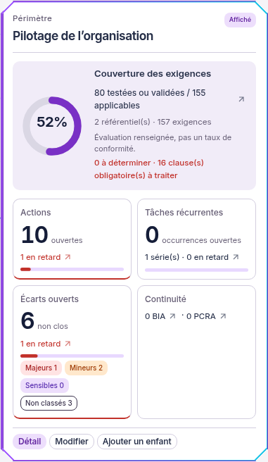
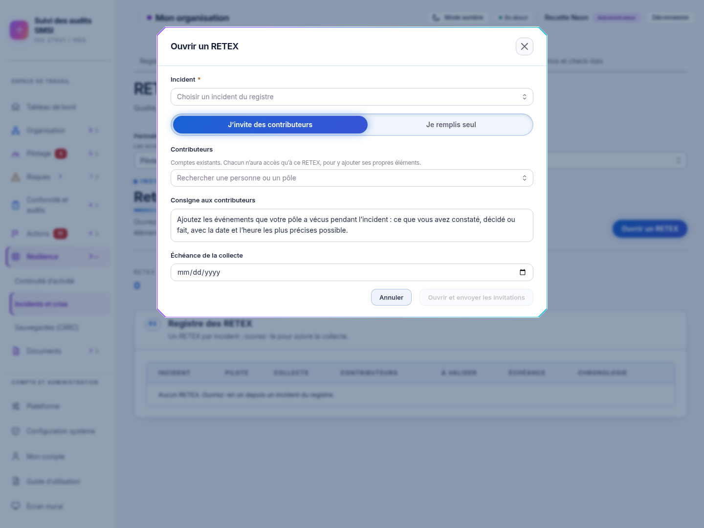

# Fenêtres Biseau et hauteur naturelle

01/11/2026, Europe/Paris. Session : Codex. Branche `codex/refonte-neon-main`, depuis `90f5bef`.

## Résultat

Le demandeur a validé Biseau et ses animations, puis demandé sa généralisation aux fenêtres ainsi que la suppression des barres de défilement internes. Le cadre à quatre angles coupés, violet/cyan, est appliqué aux modales, confirmations, panneaux latéraux et dalles du graphe Périmètres. Les libellés et boutons reprennent la typographie commune. La présentation du Contexte conserve son cadre SVG et ses cinq animations validés.

Les dalles Périmètres prennent la hauteur de leur contenu. Les titres restent entièrement lisibles ; tous les indicateurs et les actions sont présents. Ouvrir le total avec les sous-périmètres agrandit la dalle, décale le niveau suivant et recalcule les liaisons du graphe. `ResizeObserver` mesure le HTML ; le SVG utilise la plus grande hauteur de chaque niveau. Les 680 unités historiques servent seulement d’estimation avant la première mesure.

Le corps des fenêtres et leurs onglets n’ont plus de hauteur plafonnée ni de zone de défilement verticale. Une fiche qui dépasse l’écran fait défiler **le voile extérieur, au bord de l’écran**. Le titre et le bas du formulaire restent accessibles. Les petits dialogues gardent leur centrage ; les longs commencent en haut sans titre coupé. Le positionnement horizontal est fixé au bord de l’écran, ce qui corrige aussi les modales RETEX rendues sans portail.

Les listes déroulantes, les champs de texte multiligne et la navigation horizontale dans les graphes/tableaux gardent leurs interactions. La liste « Ajouter depuis la plateforme » en cartographie participe désormais à la hauteur naturelle de sa fenêtre, sans second ascenseur. Aucun champ, calcul, contrôle de droits, appel métier ou mécanisme de sauvegarde n’est remplacé. Aucun code de génération du graphique RETEX n’est modifié.

## Contrôles

Recette sur l’instance isolée PostgreSQL 18/API réelle, données fictives, Node 26.13.0, Chromium système et CSP stricte. Les scripts et rapports bruts sont hors Git, dans `/workspace/work/neon-instance`.

| Contrôle | Résultat |
| --- | --- |
| Vitest web | 223 tests, 29 fichiers, code 0 |
| Vitest UI | 243 tests, 4 fichiers, code 0 |
| TypeScript web et tests e2e | Code 0 |
| ESLint dépôt, formatage des fichiers modifiés et `git diff --check` | Code 0 |
| Build web | Code 0 ; avertissements existants sur `/update/client.js` et les chunks supérieurs à 900 ko |
| Graphe Périmètres, quatre tests e2e | Création, modification, compteurs, liens filtrés, fournisseurs, pause et accessibilité réussis. Assertions ajoutées sur la hauteur après dépliage et l’absence de chevauchement/défilement interne |
| Contexte, deux tests e2e | Consultation sans écriture, modification explicite, annulation, enregistrement et droits d’un lecteur réel réussis ; accès au bas du formulaire sur mobile depuis le voile extérieur |
| Dalles et Contexte, 1440 et 390 px, clair/sombre | Hauteurs mesurées, dépliage/repliage, absence d’ascenseur dans les dalles, corps et onglets ; bas du formulaire accessible à la souris |
| Administration, Action, document mobile, confirmation imbriquée, lien, menu mobile, RETEX et détail du dashboard | Ouverture/fermeture réussies, clic extérieur, 24 tabulations dans la fenêtre, Échap, téléchargement réel ; suppressions et créations externes annulées |
| RETEX à 1440, 1024 et 390 px, clair/sombre ; panneau Périmètre mobile et liste cartographique | Fenêtres centrées dans l’écran ; incident et contributeur sélectionnables ; dernière case de la liste accessible, sélection annulée |
| Axe sur neuf vues de dialogues, WCAG 2 A/AA et 2.1 AA | Aucune violation détectée dans cet échantillon |
| Console et CSP stricte de la recette principale | Aucune erreur JavaScript ou violation CSP détectée ; aucun débordement horizontal de page dans l’échantillon |

Rapports privés : `validation-globales.json`, `validation-globales-speciales.json`, `validation-dimensions.json`, `e2e-perimetres-resultats` et `e2e-contexte-resultats`.

## Captures réelles

Les images montrent le produit connecté à l’instance fictive. Elles ne remplacent aucune référence visuelle de CI.

| Dalle complète sans défilement interne | Fenêtre RETEX centrée |
| --- | --- |
|  |  |

[Dalle sombre](captures-globales/perimetre-dark-1440.png) · [Présentation Contexte](captures-globales/contexte-dark-1440.png) · [Modification](captures-globales/modification-light-1440.png) · [Bas du formulaire mobile](captures-globales/modification-bas-light-390.png) · [Document mobile](captures-globales/document-mobile.png) · [Confirmation mobile](captures-globales/confirmation-mobile.png).

## Limites et suite

L’habillage commun couvre les 95 déclarations de modales et les quatre panneaux Drawer de l’inventaire. Chaque fenêtre et combinaison de droits n’a pas été exercée individuellement. Les tests API complets, exports, audit par lecteur d’écran et recette humaine exhaustive ne sont pas exécutés dans ce lot. Le défaut historique de retour de focus documenté dans [le lot précédent](FENETRES.md) n’est pas déclaré corrigé.

Prochaine action : remplacer les fichiers de la copie Windows par ceux de cette branche, relancer le service web et valider les écrans représentatifs. Main, le dépôt d’origine et les données de production restent intacts ; aucune fusion ni aucun déploiement n’est effectué.
