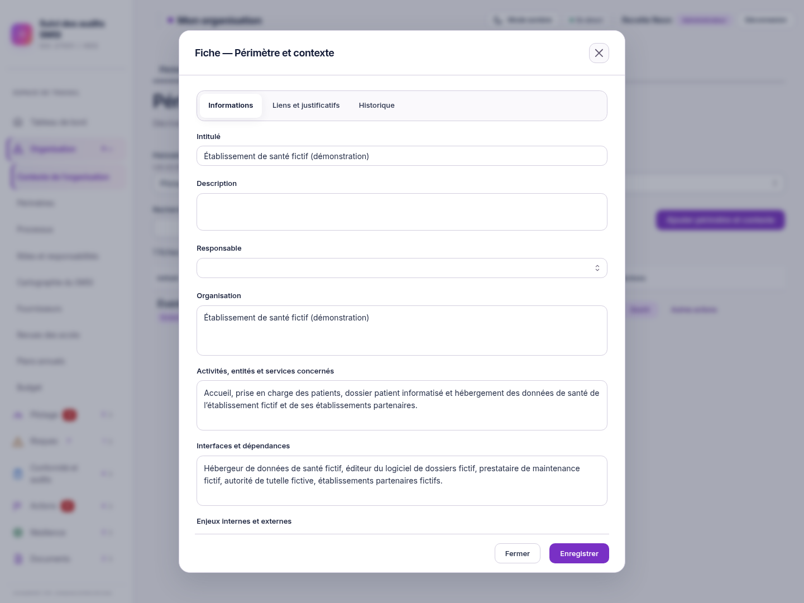
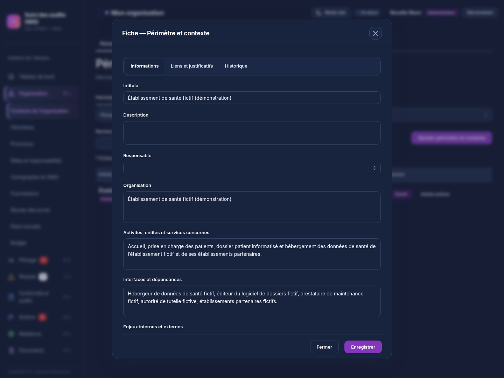

> Évolution suivante : [présentation du contexte séparée du formulaire de modification](CONTEXTE-PRESENTATION.md). Les captures ci-dessous conservent la preuve du lot précédent.

# Fenêtres et panneaux — finition Neon

01/11/2026, Europe/Paris. Session : Codex. Branche `codex/refonte-neon-main`, suite de `af34ebe6b1806ae2a72c06bc3aa5af138988f70f`.

## Changement graphique

Le style validé sur les dalles Périmètres est étendu aux fenêtres de l’application : Inter locale, titres sobres, libellés nets, champs arrondis, onglets en boutons de sélection et liens neutres avec une flèche permanente. Les grandes fiches disposent de davantage de largeur ; les confirmations gardent leur format compact. Les panneaux latéraux, le menu mobile et les fenêtres RETEX reprennent les mêmes titres et commandes de fermeture.

Dans la fiche générique des registres, dont « Périmètre et contexte », le contenu des onglets défile séparément : Fermer et Enregistrer restent visibles. Les autres formulaires gardent leur structure et leurs commandes existantes. Les textes longs peuvent revenir à la ligne, notamment l’empreinte des documents sur téléphone. Les champs désactivés et en erreur gardent leurs états ; les actions destructrices conservent leur couleur.

La feuille commune `packages/ui/src/neon-fenetres.css` couvre les 94 déclarations de modales (93 dans le web et une confirmation commune UI) et les quatre panneaux Drawer relevés dans les sources. Deux classes de présentation sont ajoutées à `RecordEditor`. Les boutons de fermeture sans libellé spécifique reçoivent un nom accessible par défaut ; les noms déjà définis restent prioritaires.

Aucun calcul, champ, schéma, endpoint, permission, validation métier, gestion de sauvegarde ou graphique RETEX modifié. Aucune dépendance ajoutée. Aucune modification du dépôt d’origine, de main ou des données de production. La feuille est statique et respecte la CSP existante.

## Contrôles exécutés

Instance isolée avec données fictives, PostgreSQL 18, API réelle, Node 26.13.0, Mantine 9.7.3 et Chromium système. Les scripts de recette et secrets restent dans `/workspace/work/neon-instance`, hors Git.

| Contrôle                                                                                                                   | Résultat                                                                                                                            |
| -------------------------------------------------------------------------------------------------------------------------- | ----------------------------------------------------------------------------------------------------------------------------------- |
| Tests unitaires web, `vitest run` dans `apps/web`                                                                          | 217 tests, 28 fichiers, code 0                                                                                                      |
| Tests unitaires UI, `vitest run` dans `packages/ui`                                                                        | 243 tests, 4 fichiers, code 0                                                                                                       |
| TypeScript web et UI, `tsc --noEmit`                                                                                       | Code 0                                                                                                                              |
| ESLint dépôt, `eslint . --max-warnings 0`                                                                                  | Code 0                                                                                                                              |
| Build web, `vite build`                                                                                                    | Code 0 ; avertissements existants sur `/update/client.js` et les chunks de plus de 900 ko                                           |
| Quatre tests Playwright existants du graphe des périmètres, sans changement d’assertion                                    | 4 réussis ; création, modification, compteurs, liens, fournisseurs, accessibilité et mouvement réduit                               |
| Fiche Contexte à 1440 × 1080, 1024 × 768 et 390 × 844, clair et sombre                                                     | Six vues ; actions visibles, intitulé obligatoire, défilement, trois onglets, sélection du responsable, fermeture et Échap vérifiés |
| Modification de la description, enregistrement et réouverture                                                              | Valeur relue depuis l’API ; description initiale rétablie et enregistrée                                                            |
| Administration, fiche Action, document mobile, confirmation imbriquée et ajout de lien                                     | Ouverture, contenu et fermeture vérifiés ; suppression annulée, aucun compte ou lien créé                                           |
| Axe WCAG 2 A/AA et 2.1 AA sur sept vues de dialogues                                                                       | Aucune violation détectée dans cet échantillon                                                                                      |
| Menu mobile, maintien du focus pendant 24 tabulations, ouverture RETEX, chronologie en plein écran et panneau du dashboard | Contrôles réussis ; seule l’ouverture de la chronologie existante est vérifiée, aucun événement ajouté                              |
| Console navigateur, CSP stricte et réponses API de la recette principale                                                   | Aucune erreur JavaScript, violation CSP ou réponse API en échec ; aucun débordement horizontal de page dans l’échantillon           |

Les preuves de recette brutes restent hors Git : `validation-fenetres.json`, `validation-fenetres-specialisees.json` et `validation-focus-comparaison.json`. Les captures ci-dessous sont des rendus réels du produit connecté à l’instance fictive ; aucun écran n’a été dessiné pour remplacer une capture.

Après la finition des commandes de téléchargement, le document mobile a été revérifié : lien neutre avec flèche, téléchargement réel du fichier attendu, aucune violation axe et description Contexte restaurée. Preuve complémentaire hors Git : `validation-document-final.json`.

### Limites constatées

Un contrôle supplémentaire du retour de focus au bouton Ouvrir après fermeture de la fiche Contexte échoue : le bouton ne reprend pas le focus. Le maintien du focus à l’intérieur du dialogue et sa fermeture passent. Ce comportement est également observé en retirant la nouvelle feuille de styles du rendu ; le montage de l’éditeur n’a pas été modifié. Il reste à traiter séparément et n’est pas déclaré validé.

L’habillage est commun à toutes les déclarations ; chaque fenêtre et chaque combinaison de permissions n’ont pas été exercées individuellement. Les tests API complets, exports, opérations d’exploitation, revue par lecteur d’écran et recette humaine exhaustive ne sont pas exécutés dans ce lot. Aucune référence visuelle de CI n’a été remplacée automatiquement. Aucune fusion ni déploiement de production.

## Captures pour validation visuelle

[Fiche Contexte claire](captures-fenetres/contexte-light-1440.png) · [Fiche Contexte sombre](captures-fenetres/contexte-dark-1440.png) · [Fiche Contexte sur mobile](captures-fenetres/contexte-light-390.png)

| Autres fenêtres                                     | Capture                                             |
| --------------------------------------------------- | --------------------------------------------------- |
| Compte d’administration, formulaire vide            | [Voir](captures-fenetres/administration-claire.png) |
| Fiche Action et liens discrets                      | [Voir](captures-fenetres/action-claire.png)         |
| Document sur mobile                                 | [Voir](captures-fenetres/document-mobile.png)       |
| Confirmation sur mobile, annulée pendant la recette | [Voir](captures-fenetres/confirmation-mobile.png)   |
| Ouverture d’un RETEX, sans enregistrement           | [Voir](captures-fenetres/retex-fenetre-claire.png)  |

Prochaine action : validation visuelle du demandeur sur cette branche. Pour tester sous Docker Desktop, reprendre la même archive de la branche et reconstruire les services du projet de test en conservant ses dossiers de données. La branche main et les images de production restent inchangées.
