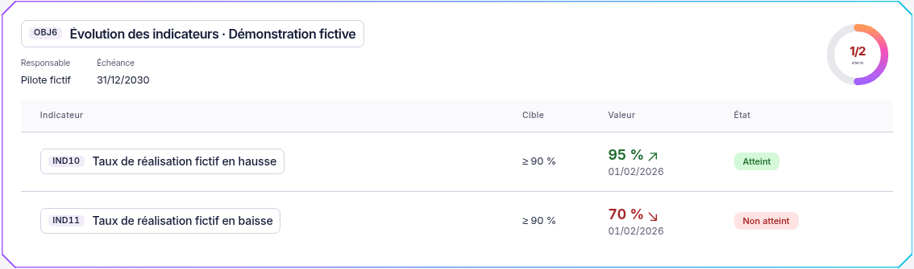
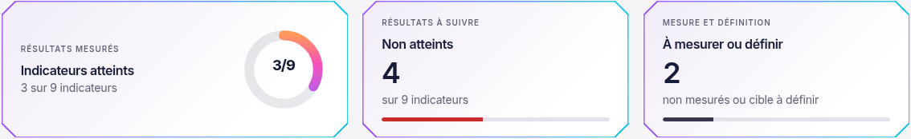
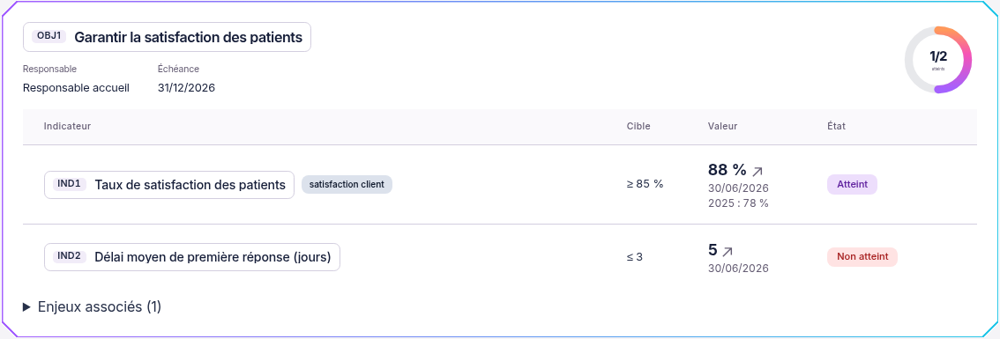

# Objectifs et indicateurs — présentation Neon

01/11/2026, Europe/Paris. Session : Codex. Branche `codex/refonte-neon-main`, depuis `31d580a`.

## Couleurs d’atteinte et de tendance — complément du 01/11/2026

Suite au retour du demandeur, les chiffres et les flèches sont colorés dans les quatre vues :

- Flèche de hausse verte, flèche de baisse rouge ; une tendance stable reste neutre, et aucune flèche n’est ajoutée sans tendance connue.
- Valeur verte si la cible est atteinte, rouge si elle ne l’est pas, orange si la cible reste à définir, grise si la valeur n’est pas mesurée. Les badges suivent les mêmes couleurs, localement à ce module.
- Chiffres de synthèse et centre des anneaux colorés. Le centre d’un anneau d’objectif reprend l’état le plus défavorable de ses indicateurs, comme les boîtes existantes ; les fractions restent inchangées.

La flèche décrit l’évolution numérique ; le sens de la cible (`≥`, `≤`, `=`) continue à déterminer l’état de la valeur. Une courte légende distingue ces deux lectures. Les libellés d’état et les noms accessibles des flèches sont conservés. Les nuances du mode sombre sont renforcées pour que le vert et le rouge restent visibles. Aucun calcul métier, donnée ou mécanisme d’écriture modifié.

Captures réelles d’une fiche fictive créée pour présenter une hausse et une baisse. Ces objets de recette ont ensuite été nettoyés ; les données de démonstration existantes n’ont pas été modifiées pour obtenir les couleurs.

[Mode sombre](captures-objectifs/couleurs/dalle-dark-1440.png) · [Mobile](captures-objectifs/couleurs/dalle-light-390.png) · [Synthèse sombre](captures-objectifs/couleurs/synthese-dark-1440.png).

Contrôles de ce complément : trois tests de charte réussis ; TypeScript web, ESLint, formatage, `git diff --check` et build réussis ; les deux scénarios e2e Objectifs/Pilotage réussis. Quatre vues à 1440 et 390 px, clair/sombre : couleurs calculées contrôlées, aucune erreur JavaScript, violation CSP, écriture lors de la consultation ou violation axe WCAG 2 A/AA et 2.1 AA. Les vues Par processus, Vue compacte et Boîtes de pilotage ont également été ouvertes. Preuve privée : `/workspace/work/neon-instance/validation-objectifs-couleurs.json`. Les 230 tests web cités plus bas restent ceux du lot précédent ; ils ne sont pas déclarés rejoués pour cette finition. Les règles de calcul et la suite API complète ne sont pas modifiées ni réévaluées par ce contrôle de couleurs.

Les captures et vérifications du lot de présentation initial sont conservées ci-dessous.

## Présentation proposée

Les pages **Objectifs par processus**, **Objectifs** et **Indicateurs** du pilotage commun reprennent le cadre Biseau et la typographie neutre validés pour la refonte. Une synthèse graphique présente les indicateurs atteints, non atteints, et non mesurés ou sans cible. Les chiffres viennent de `indicateursSynthese`, sans nouvelle règle métier. Les anneaux par objectif montrent le nombre d’indicateurs atteints sur le nombre rattaché à cet objectif ; le cas sans indicateur affiche un tiret.

Les cartes séparent titre, identifiant, responsable, échéance et résultats. Les indicateurs présentent leur cible, leur valeur, leur source/date et leur état. L’identifiant de l’indicateur accompagne désormais son nom dans la commande d’ouverture, même lorsque l’ancienne colonne Code était masquée. Les tendances conservent leur direction ; un SVG accessible remplace le caractère typographique qui pouvait manquer dans la police.

Les quatre vues existantes restent disponibles : **Par processus**, **Par objectif**, **Vue compacte** et **Boîtes de pilotage**. Sur téléphone, les lignes des tableaux deviennent des cartes avec leurs libellés, cibles et valeurs ; les responsables et échéances de la vue compacte sont conservés. Les filtres continuent à porter sur les listes d’indicateurs, les compteurs globaux gardent leur périmètre existant.

Les fiches sont découpées en rubriques : identité/périmètre et rattachements pour un processus ; responsabilité, enjeux, planification et indicateurs pour un objectif ; définition/cible, surveillance, valeurs mesurées et plan d’action pour un indicateur. Les champs gardent leurs valeurs, validations, états désactivés et actions. Les fenêtres conservent leur hauteur naturelle, avec défilement du voile extérieur si nécessaire.

Aucune route, aucun calcul de valeur ou d’état, aucun droit, aucune règle de sauvegarde ni schéma n’est modifié. Les mesures manuelles continuent à passer par Ajouter la mesure ; un indicateur calculé conserve son calcul automatique et son interdiction de saisie manuelle. Les suppressions et confirmations restent en place. La feuille `neon-objectifs.css` reste dans `packages/ui` ; le cadre Biseau commun dispose d’une classe réutilisable. Aucune dépendance ajoutée.

## Captures réelles

Produit connecté à l’instance fictive isolée, avec le jeu de démonstration et les objets fictifs ajoutés pour les tests. Les totaux dépendent de ce jeu, ils ne sont pas intégrés au code. Présentation proposée pour validation visuelle du demandeur.

[Carte sombre](captures-objectifs/dalle-dark-1440.png) · [Carte sur mobile](captures-objectifs/dalle-light-390.png) · [Page Objectifs](captures-objectifs/objectifs-light-1440.png) · [Par processus](captures-objectifs/processus-light-1440.png) · [Vue compacte sombre](captures-objectifs/indicateurs-dark-1440.png) · [Boîtes de pilotage](captures-objectifs/boites-dark-1440.png).

[Fiche Objectif](captures-objectifs/fiche-objectif-1440.png) · [Fiche Indicateur](captures-objectifs/fiche-indicateur-1440.png) · [Bas de fiche sur mobile](captures-objectifs/fiche-bas-indicateur-390.png).

## Vérifications exécutées

Instance isolée PostgreSQL 18/API réelle, Node 26.13.0, Chromium système. Aucun déploiement. Rapports privés dans `/workspace/work/neon-instance` : `validation-objectifs.json`, `validation-objectifs-lecteur.json` et `e2e-objectifs-resultats`.

| Contrôle | Résultat |
| --- | --- |
| Vitest web | 230 tests, 30 fichiers, code 0 |
| TypeScript web et tests e2e | Code 0 |
| ESLint dépôt, formatage des sources modifiées et `git diff --check` | Code 0 |
| Build web | Code 0 ; avertissements existants sur `/update/client.js` et la taille des chunks |
| Nouveau scénario e2e Objectifs | Création de processus/objectif/indicateur fictifs, modification de la planification et relecture API, conservation des rattachements et champs, ajout de mesure à 95 %, état atteint et tendance, quatre vues, filtre sur mobile ; objets créés nettoyés à la fin |
| Scénario e2e Pilotage historique existant | Synthèse, DdA, objectifs/vue compacte et plans : réussi, assertions existantes conservées |
| 24 vues réelles | Trois pages et Boîtes de pilotage à 1440, 1024 et 390 px, clair/sombre ; aucun débordement horizontal de page |
| Huit ouvertures de fiches | Processus, objectif, indicateur manuel et automatique à 1440 et 390 px ; aucun défilement vertical interne, accès aux commandes du bas, saisie manuelle absente pour l’indicateur calculé |
| Axe sur 12 vues, WCAG 2 A/AA et 2.1 AA | Aucune violation détectée dans cet échantillon |
| Lecteur réel sur mobile | Objectif, indicateur manuel et automatique consultables ; champs désactivés, commandes d’écriture absentes, tentative PATCH refusée par le serveur avec 403 |
| Console, CSP stricte et consultation | Aucune erreur JavaScript, violation CSP ou écriture d’objectif/indicateur lors de la collecte visuelle |

L’inspection visuelle a relevé des champs trop étroits après passage en grille : les contraintes de largeur héritées de Group ont été neutralisées dans ces fiches, puis la recette et les captures ont été renouvelées. Les captures attendent la disponibilité de la police et la peinture des champs ; la valeur de cible est également vérifiée avant capture.

## Périmètre et suite

Ce lot concerne la présentation historique du **pilotage commun**. Les autres périmètres continuent à utiliser le registre générique existant. Les tests API complets, exports, suppression effective des données de démonstration, audit par lecteur d’écran et recette de chaque combinaison de permissions ne sont pas exécutés. Aucune référence visuelle de CI remplacée, aucune validation humaine simulée.

Prochaine action : valider les captures puis tester cette version dans la copie Docker Windows. La publication vise uniquement la branche de refonte ; aucune fusion ni aucun déploiement n’est effectué.
