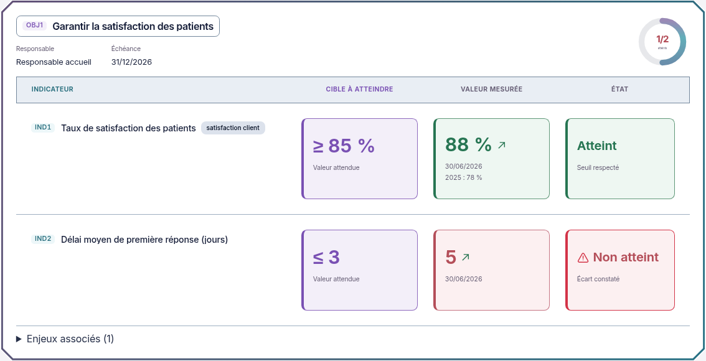

# Présentation validée intégrée — Objectifs et indicateurs

02/11/2026, Europe/Paris. Session : Codex. Copie de main sur `codex/refonte-neon-main`, sans fusion ni déploiement.

**Accord explicite reçu sur la présentation et les contours, avec demande supplémentaire de centrage des trois en-têtes. Intégration et contrôles de ce lot terminés.** Le retour ultérieur sur les carrés trop pâles fait l'objet d'une [nouvelle proposition de couleurs plus soutenues](propositions/couleurs-soutenues/README.md), encore à valider avant application de ces nuances.

## Présentation intégrée

Les vues Par objectif et Par processus affichent Cible / Mesuré / État dans trois encadrés de même format, avec noms de colonnes centrés au-dessus : **Cible à atteindre**, **Valeur mesurée**, **État**. Cible violette, titres neutres, repères cyan, bordures et barres plus visibles, grand cadre Biseau de 3 px. Les jauges reprennent le bleu et le cyan.

La Vue compacte affiche une ligne par indicateur, regroupée par objectif. Les responsables, processus rattachés, échéances et proportions d'atteinte sont conservés dans l'en-tête du groupe ; les dates/sources et historiques restent accessibles dans la dernière colonne. Les indicateurs manuels et calculés gardent leurs valeurs et sources existantes. Les filtres portent sur les indicateurs comme auparavant, les compteurs gardent leur périmètre existant et les objectifs sans ligne correspondant au filtre restent identifiables. Sur téléphone les trois encadrés restent sur une même ligne sous le nom de l'indicateur.

Non atteint garde son texte et reçoit un triangle warning et un halo rouge animé, dans les deux vues. Les flèches montent en vert et descendent en rouge selon la tendance numérique existante ; la valeur reste colorée selon la comparaison à la cible. Non mesuré et Cible à définir sont conservés et différenciés. Un bouton Pause animations / Activer les animations agit seulement sur la présentation. La préférence système de mouvement réduit neutralise les mouvements ; le contour rouge et le pictogramme restent visibles.

La hauteur des dalles et des tables vient du contenu, sans ascenseur interne. Les actions d'ouverture et les formulaires sont conservés. Les calculs partagés, endpoints, droits, schémas, sauvegardes et données n'ont pas été modifiés. Toutes les couleurs et dimensions sont définies dans `packages/ui/src/neon-objectifs.css` ; aucune dépendance ajoutée.

## Captures réelles de l'application

Produit connecté à l'API et à PostgreSQL isolés, avec données fictives, sans données recopiées depuis les maquettes.

[Version sombre](captures-objectifs-valides/dalle-dark-1440.png) · [Mobile clair](captures-objectifs-valides/dalle-light-390.png) · [Mobile sombre](captures-objectifs-valides/dalle-dark-390.png) · [Vue compacte claire](captures-objectifs-valides/compacte-light-1440.png) · [Vue compacte sombre](captures-objectifs-valides/compacte-dark-1440.png) · [Vue compacte mobile](captures-objectifs-valides/compacte-dark-390.png) · [Page complète](captures-objectifs-valides/objectifs-light-1440.png).

[Animation réelle, GIF](captures-objectifs-valides/animations-application.gif) · [Vidéo MP4](captures-objectifs-valides/animations-application.mp4). Quatre secondes des véritables images clés CSS de l'application, à vitesse normale, cadrées sur OBJ1 ; pas une animation de maquette. Les images fixes utilisent le mouvement réduit. La capture de la grande vue compacte porte sur la page entière puis son rectangle de contenu, pour éviter le recouvrement par l'en-tête fixe.

## Contrôles exécutés

Node **26.13.0**, dépendances déjà installées et figées, Chromium système, API réelle et PostgreSQL 18 isolés. Tests et rapports privés dans `/workspace/work/neon-instance` ; aucun secret publié. Assertions existantes non modifiées, aucune référence visuelle CI remplacée.

| Contrôle | Résultat |
| --- | --- |
| Tests web existants | 230 réussis, 30 fichiers, code 0 |
| TypeScript web | Code 0 |
| ESLint sur le composant modifié | Code 0 |
| Prettier sur les deux sources modifiées et git diff --check | Code 0 |
| Compilation web | Code 0 ; avertissements existants sur update/client.js et taille des chunks |
| E2E Objectifs existant | Réussi : création de fixtures, planification/rattachements conservés, nouvelle mesure à 95 %, état atteint, tendance, quatre vues et filtre mobile ; fixtures créées par ce scénario nettoyées |
| E2E Pilotage historique existant | Réussi : DdA, objectifs/vues et plans ; deux scénarios réussis en 14,4 s |
| 24 vues réelles | Trois pages et Boîtes de pilotage, 1440/1024/390 px et clair/sombre ; aucun débordement horizontal de page |
| Défilement des dalles et tables | Aucun conteneur vertical défilant détecté dans le module lors des 18 chargements de pages |
| En-têtes | Trois colonnes centrées dans les deux vues et les deux thèmes sur ordinateur |
| Axe sur 8 vues | Aucune violation WCAG 2 A/AA et 2.1 AA détectée dans l'échantillon |
| Animations réelles | Halo actif, Pause puis reprise, désactivation par mouvement réduit vérifiés |
| Console et CSP stricte | Aucune erreur JavaScript ni violation CSP pendant la collecte |
| Collecte visuelle | Aucune écriture d'objectif ou d'indicateur |

Le premier passage Axe a signalé deux étiquettes de légende insuffisamment contrastées en clair. Leur fond a été aligné sur celui des encadrés ; les huit analyses ont ensuite réussi. Les premiers lancements via le wrapper pnpm générique de l'environnement n'ont pas exécuté les contrôles attendus ; les binaires déjà installés ont été appelés explicitement avec Node 26. Après redémarrage de l'environnement cloud, le premier lancement e2e a échoué avant les scénarios faute de session de recette valide ; session rafraîchie, puis les deux scénarios sont passés sans modification de leurs assertions.

Les suites API complètes, un nouveau test dédié du rôle lecteur, les opérations d'exploitation, exports et la recette des 79 rubriques n'ont pas été rejoués dans ce lot. Les gardes existantes n'ont pas été modifiées ; aucune conformité WCAG exhaustive revendiquée.

## Suite

La présentation autorisée est intégrée. Les fonds plus soutenus demandés ensuite restent dans leur maquette jusqu'à validation explicite ; ils feront l'objet de contrôles ciblés et de nouvelles captures après application. Aucune autre autorisation n'est nécessaire pour les travaux déjà validés.
