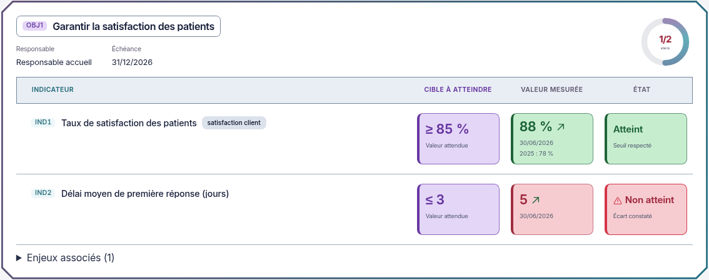

# Objectifs et indicateurs — version B intégrée

02/11/2026, Europe/Paris. Session : Codex. Copie de main sur `codex/refonte-neon-main`, sans fusion ni déploiement.

**Choix explicite du demandeur : « Version B, tu peux implémenter ». La version B et ses fonds renforcés sont intégrés et vérifiés. Aucune nouvelle validation préalable n'est attendue pour ce lot.**

## Modification réalisée

Les blocs Cible / Mesuré / État sont plus petits, les chiffres moins imposants, les marges des lignes resserrées. Sur ordinateur à 1440 px, les blocs détaillés mesurent **132 × 82 px**, avec chiffres de 21 px. La vue compacte utilise des encadrés plus courts, d'une hauteur minimale de 32 px à la taille de police racine de référence. Les dimensions restent adaptées à la typographie responsive existante ; les contenus longs peuvent agrandir naturellement les blocs.

Les titres des objectifs gardent exactement leurs déclarations de taille, police et graisse précédentes. Le contrôle visuel confirme leur adaptation existante : 16 px à 1440 px, 15,248 px à 1024 px et 12,25 px à 390 px, selon la police racine fluide du produit. La variante A, qui agrandissait les titres, n'a pas été intégrée.

Les fonds violet, vert et rouge sont plus soutenus en clair et en sombre. Les textes de dates et d'explication utilisent une nuance adaptée au contraste de ces fonds. Les en-têtes restent centrés. Cadre Biseau, contours des barres, triangle warning, halo rouge, flèches de tendance, Pause / Activer et préférence de mouvement réduit sont conservés.

Le changement applicatif porte uniquement sur `packages/ui/src/neon-objectifs.css`. Aucun composant React, calcul partagé, source de valeur, droit, endpoint, formulaire, écriture ou schéma n'est modifié. Les états Non mesuré et Cible à définir restent différenciés. Aucune dépendance ajoutée.

## Captures réelles

Application compilée, connectée à l'API et à PostgreSQL isolés avec données fictives. Aucun chiffre de maquette injecté dans les données.

[Version sombre](captures-objectifs-version-b/dalle-dark-1440.png) · [Mobile clair](captures-objectifs-version-b/dalle-light-390.png) · [Mobile sombre](captures-objectifs-version-b/dalle-dark-390.png) · [Vue compacte claire](captures-objectifs-version-b/compacte-light-1440.png) · [Vue compacte sombre](captures-objectifs-version-b/compacte-dark-1440.png) · [Vue compacte mobile](captures-objectifs-version-b/compacte-dark-390.png) · [Page complète](captures-objectifs-version-b/objectifs-light-1440.png).

[Animation réelle — GIF](captures-objectifs-version-b/animations-application.gif) · [Vidéo MP4](captures-objectifs-version-b/animations-application.mp4). Quatre secondes des véritables images clés CSS du produit, à vitesse normale, cadrées sur OBJ1. Les images fixes utilisent le mouvement réduit pour être stables.

## Contrôles exécutés pour ce lot

Node 26.13.0, dépendances déjà installées, Chromium système, API réelle et PostgreSQL 18 isolés. Rapports privés : `validation-objectifs-version-b.json`, `e2e-objectifs-version-b-resultats` et `logs/objectifs-version-b-build.log`, hors Git.

| Contrôle | Résultat |
| --- | --- |
| Charte graphique existante | 3 tests réussis, code 0 |
| Prettier sur la feuille modifiée, compilation web et git diff --check | Code 0 ; avertissements de build existants sur update/client.js et taille des chunks |
| E2E Objectifs existant | Réussi : rattachements et planification conservés, ouverture de fiches, mesure à 95 %, état atteint et tendance, quatre vues, filtre mobile ; fixtures créées nettoyées |
| E2E Pilotage historique existant | Réussi : DdA, objectifs/vues et plans ; les deux scénarios passent en 15,2 s |
| 24 vues réelles | Trois pages et Boîtes de pilotage, clair/sombre, 1440/1024/390 px ; aucun débordement horizontal de page |
| Défilement des dalles et tables | Aucun ascenseur vertical interne détecté sur les 18 chargements de pages mesurés |
| Titres et dimensions | Déclarations des titres identiques à la référence ; tailles calculées selon la racine responsive ; blocs 132 × 82 px à 1440 px |
| En-têtes des colonnes | Centrés dans les deux vues et les deux thèmes sur ordinateur |
| Axe sur 8 vues | Aucune violation WCAG 2 A/AA et 2.1 AA détectée dans cet échantillon |
| Animations | Halo actif, Pause puis reprise, désactivation par mouvement réduit vérifiés |
| Console et CSP stricte | Aucune erreur JavaScript ni violation CSP pendant la collecte |
| Collecte visuelle | Aucune écriture d'objectif ou d'indicateur |

Le premier contrôle privé de taille des titres supposait une racine fixe de 16 px et a été interrompu à 1024 px. Les déclarations d'origine ont été comparées et sont strictement identiques ; le contrôle a ensuite utilisé leur valeur en rem et la racine responsive réelle, puis a réussi à toutes les largeurs. Aucune assertion des deux tests e2e existants ni référence visuelle CI n'a été modifiée.

Les 230 tests web de l'intégration précédente restent un résultat historique au commit `03b6640` ; ils n'ont pas été relancés pour ce lot limité au CSS. Pas de nouvelle suite API complète, recette Docker Windows, exploitation, export, audit par lecteur d'écran ni recette des 79 rubriques dans ce lot. Aucune attestation WCAG exhaustive.

## État final

Version B choisie, appliquée et contrôlée, captures réelles disponibles. Les autres maquettes restent conservées comme historique. [Comparatif A/B d'origine](propositions/comparatif-titres-blocs/README.md).
