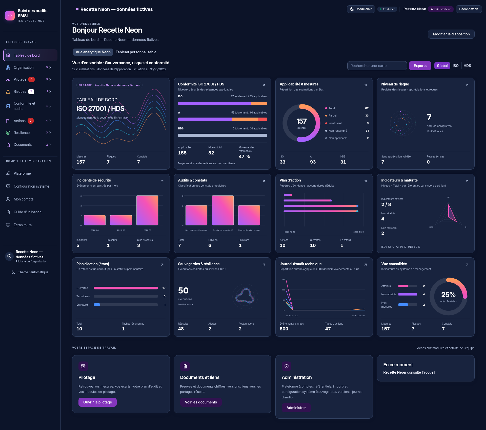
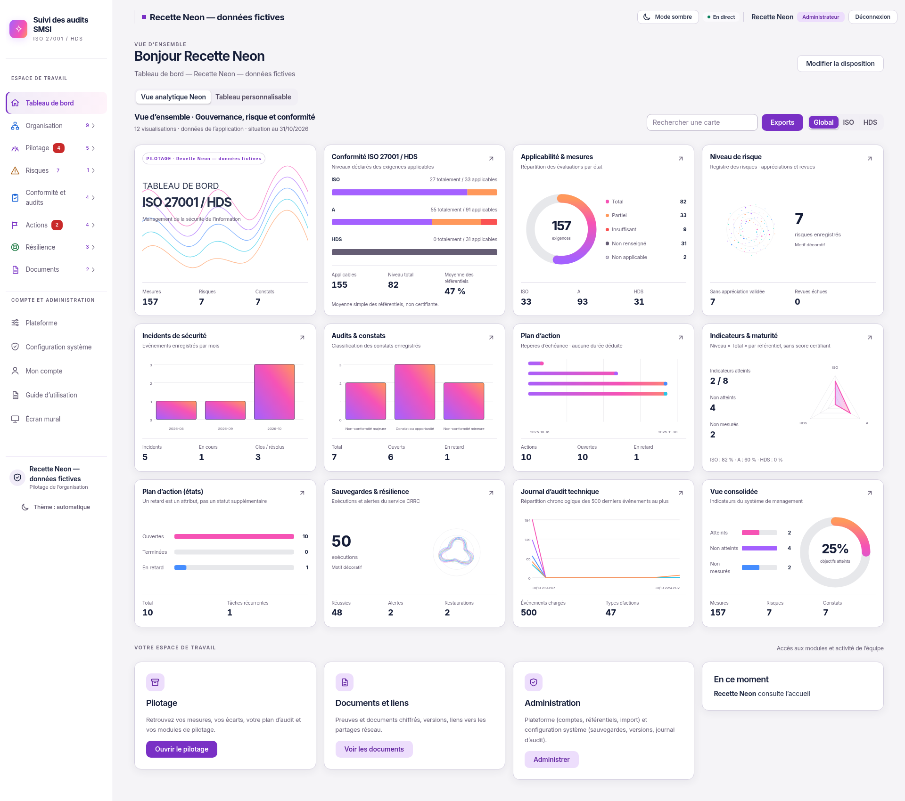

# Intégration des graphiques et menus du prototype

31 octobre 2026, Europe/Paris. Session Codex. Référence complémentaire : `index.html` fourni et les captures sombre/clair du demandeur.

Le premier lot remplaçait principalement le thème. Ce lot intègre les compositions et les graphiques du prototype dans les composants React, sans importer ses données embarquées ni exécuter ses scripts. Aucun changement de dépendance, de contrat API, de migration ou de règle métier. Le graphique et les sources RETEX restent inchangés.

## Navigation et présentation

- Marque en tête du menu, navigation latérale sombre ou claire, entrées actives violettes, compte des destinations réellement accessibles. Les familles, destinations, rubriques, droits, alertes et déplacements au clavier/souris sont conservés.
- Bascule clair/sombre dans l'en-tête, avec le mécanisme existant des préférences de compte ; le choix automatique reste accessible dans le menu.
- Vue analytique Neon de 12 cartes par défaut sans disposition enregistrée. Une disposition personnelle, partagée ou d'organisation reste affichée par défaut si elle existe. Les deux présentations sont sélectionnables sans écrire ni effacer une disposition.
- Recherche explicitement limitée aux cartes, filtre des référentiels ISO/HDS, accès à l'écran d'exports existant selon les droits, tiroirs de détail et liens vers les registres correspondants.
- L'éditeur de disposition, ses seuils, ses visualisations, le partage et les opérations existantes sont préservés.

## Correspondance avec le prototype

| Carte                     | Présentation                                | Données réelles                                                                 |
| ------------------------- | ------------------------------------------- | ------------------------------------------------------------------------------- |
| Tableau de bord           | Vagues décoratives et compteurs             | Synthèse `/api/mur/synthese`                                                    |
| Conformité                | Barres segmentées par référentiel           | `conformite`, niveaux et applicables                                            |
| Applicabilité et mesures  | Anneau dégradé, légende chiffrée            | Exigences et niveaux Total/Partiel/Insuffisant/Non renseigné/Non applicable     |
| Risques                   | Particules décoratives, total et revues     | Total, appréciations non validées et revues échues de la synthèse               |
| Incidents                 | Colonnes dégradées par mois                 | `/api/incidents`, dates et états enregistrés                                    |
| Audits et constats        | Colonnes par classification                 | `ecarts.parType`, compteurs de la synthèse                                      |
| Plan d'action             | Échéancier à repères, dégradé et points     | Échéances datées de la synthèse, sans durée inventée                            |
| Indicateurs et maturité   | Radar par référentiel et chiffres           | Niveaux Total / applicables ; indicateurs atteints, non atteints et non mesurés |
| Actions par état          | Barres horizontales                         | Actions ouvertes, terminées et en retard, récurrences                           |
| Sauvegardes et résilience | Orbite décorative et compteurs              | `/api/crrc`, exécutions, restaurations et alertes                               |
| Journal technique         | Courbes chronologiques par famille d'action | `/api/admin/audit?limit=500`, si autorisé                                       |
| Vue consolidée            | Anneau et barres d'indicateurs              | Indicateurs et compteurs réels de la synthèse                                   |

Les anneaux et histogrammes communs aux autres pages reçoivent aussi des dégradés dans leur teinte sémantique existante ; leurs valeurs, légendes et alternatives tabulaires ne changent pas. Les nouveaux SVG ont des libellés et alternatives chiffrées. Aucun style en ligne ni script injecté (CSP existante conservée).

## Écarts volontaires pour préserver le fonctionnel

- Le taux global reste la moyenne simple existante des référentiels. La somme pondérée illustrative du HTML n'est pas reprise : les mêmes données de test affichent 47 % selon la règle existante, au lieu des 53 % illustratifs.
- Aucune durée d'action n'est déduite de la seule échéance. L'échéancier n'est pas présenté comme un Gantt de durées connues.
- Les motifs de particules, vagues et orbites sont décoratifs et signalés comme tels. Ils ne représentent ni une criticité inconnue ni une mesure de sauvegarde inventée.
- Le radar ne dessine pas une valeur inconnue comme zéro ; sans trois axes renseignés, il garde ses libellés plutôt qu'une surface trompeuse.
- Le journal porte sur les 500 derniers événements accessibles au plus. L'échelle temporelle est déduite des dates chargées et ne copie pas les heures de la démonstration.
- Les panneaux protégés n'appellent leurs API que lorsque le droit de lecture correspondant existe ; les serveurs restent seuls juges des accès et du filtrage des données.

## Validation

- UI : 243 tests réussis. Web : 217 tests réussis. Les 7 tests complémentaires couvrent les dates et valeurs invalides, le radar incomplet, l'anneau sans dénominateur, les mois avec année et la conservation des événements dans les groupes chronologiques.
- Typage UI et web, ESLint et formatage des fichiers modifiés : réussis.
- Build web : réussi, avec les avertissements de bundle déjà recensés.
- Instance réelle isolée : huit captures (1920, 1440, 1024 et 390 px, clair/sombre), sans débordement, erreur JavaScript ni réponse API en erreur. Recherche de cartes, tiroir de détail au clavier, filtre ISO/HDS et accès à la personnalisation vérifiés.
- Les 79 rubriques ont aussi été rouvertes avec une session authentifiée après intégration du menu et des graphiques communs : aucune erreur JavaScript ni débordement horizontal à 1440 px.
- Aucune référence visuelle de CI approuvée ou remplacée automatiquement. La validation visuelle humaine et la recette exhaustive de toutes les mutations ne sont pas déclarées réalisées.

Contrôles complémentaires : bascule clair/sombre enregistrée puis relue après rechargement ; absence d'appels incidents, CRRC et journal dans une session d'interface simulée sans ces droits ; document servi avec la CSP stricte du frontal de production, aucune violation relevée. Le contrôle simulé du menu ne remplace pas les gardes serveur, qui ne sont pas modifiées.

## Captures réelles de l'instance fictive

[Capture mobile, 390 px](captures-prototype/mobile-390.png).

## Tester sous Windows

La branche reste `codex/refonte-neon-main`. Avec un téléchargement ZIP, récupérer de nouveau l'archive de cette branche pour obtenir ce complément : une ancienne extraction ne se met pas à jour automatiquement. Garder les données et secrets de recette `.donnees-dev` ; ne pas les supprimer pour une mise à jour graphique. Les commandes Docker et le projet `neon-refonte-test` restent ceux de la procédure précédente. Si une disposition a déjà été enregistrée, choisir « Vue analytique Neon » en haut de l'accueil pour afficher la nouvelle composition.
