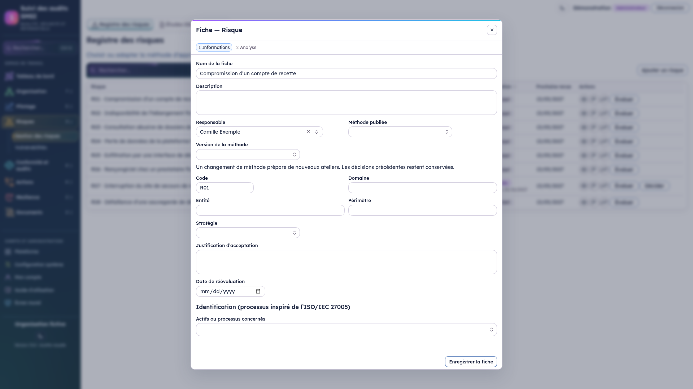
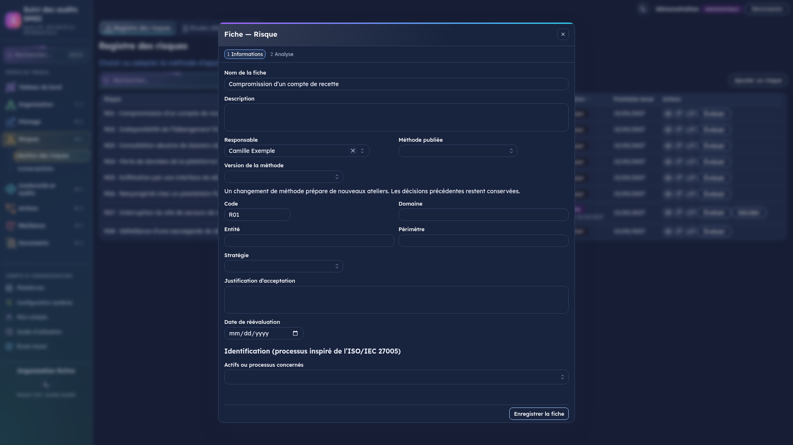

# Dossier d’implémentation — interface Neon compacte

Préparé le 21 novembre, remis le 22 novembre 2026, Europe/Paris — session « Codex » (`01a193c1-316c-7677-831f-2f31592aa052`).

**Point d’entrée pour l’IA qui code.** Lire ensuite [PROMPT-IA.md](PROMPT-IA.md), les [règles visuelles](REGLES-UI.md)
et le [guide d’intégration et de recette](INTEGRATION-ET-RECETTE.md). Le [résumé technique](RESUME-TECHNIQUE.md)
indique les fichiers modifiés, les invariants et le reste à faire. Ce dossier concerne la densité, les outils communs,
les proportions des fiches, leur présentation sans défilement vertical et les boutons transparents.

La version actuellement utilisée par le RSSI peut différer de cette branche. **Comparer l’existant avant de reporter le
code.** Les images sont des captures du vrai frontend avec API interceptée et données fictives ; elles ne représentent
ni les données réelles ni une validation humaine.

## État à la remise

| Lot | Source / état |
| --- | --- |
| Densité et en-tête | Implémentés sur cette branche ; [dossier et comparaison avant/après](../densite-2026-11-21/README.md). |
| Vues, recherche, filtres, cadre des fenêtres | Implémentés ; [inventaire, architecture, preuves](../harmonisation-plateforme-2026-11-21/README.md). |
| Alignements et champs proportionnés | Commit `2742e16`, [complément détaillé](../proportions-fenetres-2026-11-21/README.md). Il précède la demande de mini-menu sans défilement. |
| Fiches longues en parties | Prototype d’intégration fourni dans le code, à recetter dans la version réellement reprise. Les champs restent montés et dans leur formulaire. |
| Boutons transparents bleu/cyan | Implémentation de départ fournie, fondée sur l’exemple du RSSI : contour, Annuler discret, couleur explicite des actions sensibles conservée. |
| Livraison sur le serveur | **Non effectuée.** Aucune fusion, publication d’image ou validation humaine simulée. |

Le socle recensait 127 déclarations de fenêtres, dont le tiroir de navigation qui reste distinct. L’inventaire des saisies
compte 710 déclarations dans 136 fichiers, dont 302 sélecteurs. **Ces inventaires ne sont pas un test individuel de chaque
fenêtre et de chaque menu.** Les résultats et limites des campagnes sont dans les preuves de leurs dossiers respectifs.

## Fichiers à examiner en priorité

- `packages/ui/src/tokens.ts` : densités et variables communes. Ne pas ajouter un second système de tailles.
- `apps/web/src/components/BarreOutils.tsx` et `BarreFiltres.tsx` : boîte commune et raccordement des contrôles existants.
- `packages/ui/src/proportions-champs.ts`, `theme.ts`, `neon-harmonisation.css`, `neon-ergonomie.css`, `neon-fenetres.css` :
  ordre des aides, dimensions, alignements, fenêtres et listes de choix.
- `apps/web/src/components/FichesSansDefilement.tsx` : détection des fiches longues, navigation, suivi du focus, des
  erreurs et des changements de taille. **Prototype à confronter aux structures de la version reprise.**
- `packages/ui/src/neon-fiches-pages.css` : présentation en parties, maintien des actions en bas, champs/groupes cohérents,
  fragmentation des tableaux et commandes transparentes.
- `apps/web/src/main.tsx` et `packages/ui/package.json` : installation unique du composant et export/import du CSS.
- `apps/web/test/proportions-champs.test.ts` : contrats accessibles, saisies, boutons et soumission.

## Règle pour poursuivre

L’IA doit établir une matrice **présent / partiel / absent / différent**, conserver ce qui fonctionne déjà et compléter les
écarts. Ne pas remplacer aveuglément des fichiers complets ou une branche plus récente. Ne pas intégrer de fixtures, de
fausse session ou de contournement de connexion dans le code utilisé réellement.

Conserver les refontes retenues du Dashboard, SWOT, PESTEL, DDA, périmètres, objectifs, planning et assistant RSSI.
La génération automatique et le dessin de la cartographie SMSI restent préservés. Les permissions, champs métier,
références, versions, preuves, exports, calculs et écritures serveur ne font pas partie de ce changement visuel.

Le mini-menu et les nouveaux boutons sont issus des derniers retours ; leurs captures doivent encore être validées par
le RSSI. Les tests du client n’autorisent pas à déclarer la recette Docker/API réelle terminée. La prochaine IA dispose du
code et d’une recette de départ ; elle reste responsable de vérifier l’intégration dans son état réel de l’application.

## Références des lots précédents

Ces rapports sont historiques. Leurs décisions remplacées ne priment pas sur les règles de ce dossier : filtres repliés,
fiches sans défilement, commandes en contour, tailles différenciées et noms accessibles des fermetures.

- [Menu et Dashboard](../LOT-1-MENU-DASHBOARD.md), [fenêtres et lignes](../LOT-2-FENETRES-LIGNES.md).
- [Périmètres et objectifs](../LOT-3-PERIMETRES-OBJECTIFS.md), [parties intéressées et processus](../LOT-3-LECTURE-PARTIES-PROCESSUS.md).
- [DDA, bibliothèque et fournisseurs](../LOT-4-DDA-BIBLIOTHEQUE-FOURNISSEURS.md), [SWOT et PESTEL](../LOT-5-SWOT-PESTEL.md).
- [Timeline](../LOT-6-TIMELINE.md), [assistant RSSI et harmonisation](../LOT-7-8-ASSISTANT-HARMONISATION.md).
- [Maintenance](../MAINTENANCE-LOT-1.md), [typographie](../TYPOGRAPHIE-LEXEND.md), [matrice de compatibilité historique](../MATRICE-COMPATIBILITE.csv).

## Proposition graphique suivante — 22 novembre

Le RSSI a demandé le style de la page de maintenance pour les fenêtres. Une [proposition clair/sombre des sept variantes](../propositions/fenetres-maintenance-2026-11-22/README.md)
est disponible avec des détails HD, les écrans complets et le CSS isolé. **À valider visuellement avant généralisation** ;
elle ne remplace pas les règles fonctionnelles et ne corrige pas à elle seule les limites du découpage des fiches.

La palette du cube cyan/bleu/lavande a été **refusée**. La proposition claire sobre a reçu « Top » du RSSI.
L’[intégration React et CSS du style sobre](../integration-fiches-sobres-2026-11-22/README.md) devient la référence de code
pour l’habillage et les aides contextuelles. Lire ses preuves et limites ; la déclinaison sombre reste à valider visuellement.
Le script de décoration DOM des aperçus n’est pas une implémentation produit.

## Images et preuves de cette remise

[Galerie des neuf captures natives](captures/README.md), en clair et sombre, avec exemples en normal et compact.
Les images exposent l’état du prototype ; elles ne valent pas approbation du RSSI. **Le découpage automatique doit encore
être corrigé** : certaines parties sont trop peu remplies, des intitulés sont génériques ou répétés et des groupes
peuvent être coupés aux limites de partie. Ne pas généraliser ce mécanisme comme une solution terminée.

- [Contrôles du code](preuves/controles-code.json) : 936 tests web et 285 UI réussis, soit **1 221 tests distincts**.
  TypeScript web/UI, format, lint et build contrôlés ; l’échec TypeScript initial corrigé reste tracé.
- [Recette du client](preuves/recette-client.json) : **11 cas de pages, 27 ouvertures, 7 variantes**, sans erreur JavaScript,
  route imprévue ni mutation métier. Les mesures géométriques ne remplacent pas la vérification visuelle de chaque champ.
- [Empreintes des sources](preuves/sources-controlees.json) et [des captures](preuves/captures.json).

Les finitions CSS ont été reconstruites et les dernières campagnes exécutées sur le frontend compilé. La recette serveur,
la validation humaine, l’ajout/retrait interactif des longues listes et le parcours exhaustif des fenêtres restent à faire.

Exemple clair et sombre (ouvrir les fichiers pour leur résolution native) :

