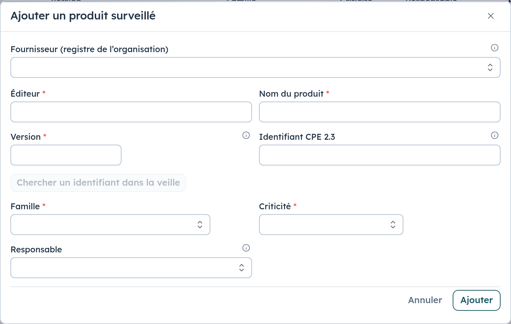
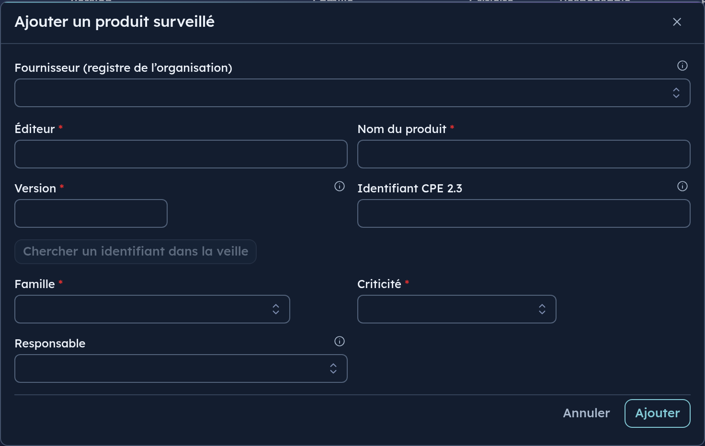

# Intégration du style de fiche sobre

22/11/2026, Europe/Paris. Session « Codex » (`01a193c1-316c-7677-831f-2f31592aa052`).

Le RSSI a répondu **« Top »** à la [proposition claire sobre](../propositions/fenetres-epurees-2026-11-22/README.md).
Cette direction est retenue et intégrée au code de la branche de refonte. La déclinaison sombre utilise la même composition ;
sa validation graphique reste à recueillir. Aucune fusion, image publiée, mise en production ou recette serveur n’est déclarée.

## Résumé technique pour l’IA

- `packages/ui/src/DescriptionChamp.ts` : composant React natif, installé par `InputWrapper.defaultProps.descriptionProps.component`.
  Le texte, l’identifiant de description et le formulaire propriétaire sont conservés. La commande d’aide est un bouton
  `type="button"`, avec `aria-controls`, `aria-expanded` et rappel du libellé du champ. Hors fiche, le texte reste affiché.
- `packages/ui/src/theme.ts` : raccordement par l’API publique Mantine et variables CSS du nouveau jeu de jetons.
- `packages/ui/src/tokens.ts` : palette `FICHES` claire et sombre centralisée. Aucune couleur nouvelle dans les pages métier.
- `packages/ui/src/neon-fiches-sobres.css` : surfaces opaques sobres, contour discret, petite signature cyan/violet,
  alignements et champs rectangulaires ; états métier explicites protégés de la couleur neutre.
- `packages/ui/package.json` et `apps/web/src/main.tsx` : export et import final du CSS commun, sans dépendance supplémentaire.
- `apps/web/src/vulnerabilites/ProduitsSurveilles.tsx` : bouton Annuler React utilisant le même état de fermeture que la croix,
  inactif pendant l’enregistrement ; aucune autre modification de la sauvegarde ou de l’API.
- `apps/web/test/proportions-champs.test.ts` : contrat supplémentaire de conservation du texte, des identifiants, de la
  valeur et du type de bouton, sans soumission supplémentaire.

Le thème étant lu directement par Node pour produire les variables statiques, `DescriptionChamp.ts` utilise `createElement`.
Un premier fichier TSX ne pouvait pas être lu par ce générateur ; il a été remplacé sans ajout de transpileur. La génération
statique et le build ont ensuite été rejoués. Le script DOM de la proposition **n’est pas utilisé dans le produit**.

Le flux du `Stack` principal devient un flux bloc **uniquement dans les fiches paginées**, avec les mêmes espacements.
Cela corrige le cas Risque compact où le pied fixe recouvrait « Liens et preuves ». Les sections fermées ne se fragmentent
plus au milieu de leur ligne. Le reste des limitations du découpage reste explicitement à recetter.

## Aides et clavier

Le texte reste dans le composant Mantine d’origine. Le CSS replie seulement les descriptions des champs de fiche portant
le composant d’aide. Les descriptions courantes des pages et les rendus personnalisés restent ordinaires. Les erreurs
restent visibles ; aucun champ n’est retiré pour réduire la hauteur.

Quand le bouton d’aide est ouvert et reçoit Échap, l’attribut public `data-mantine-stop-propagation` indique à Mantine de
ne pas fermer la fenêtre ; le gestionnaire local referme l’aide. Aucun intercepteur global de clavier n’a été ajouté.
Les descriptions référencées par `aria-describedby` gardent leur identifiant et leur texte, même lorsqu’elles sont repliées.

## Contrôles et portée

[Contrôles du code](preuves/controles-code.json), [recette de présentation](preuves/recette-client.json) et
[empreintes des sources](preuves/sources.json) distinguent les contrôles effectués de la validation humaine.
La suite web compte 937 tests et UI 285, soit **1 222 tests distincts réussis**. TypeScript web/UI, lint, format,
génération des variables et build sont vérifiés. Les dernières finitions CSS de préservation des états métier sont reconstruites.

Les captures utilisent le frontend compilé, une API interceptée et des données fictives. Les aides sont vérifiées au clavier,
avec leur description visible à l’ouverture ; Annuler ferme réellement la fiche Produit sans écriture. Les inventaires
historiques 127 déclarations de fenêtres / 710 saisies ne représentent pas une recette individuelle de toutes les fiches.

Le découpage automatique `FichesSansDefilement` conserve ses limites documentées : groupes coupés aux frontières, intitulés
répétés et parties peu remplies dans certains agencements. Ce lot intègre **l’habillage et les aides**, sans déclarer la
refonte du découpage terminée. Documents intégrés, structures atypiques et longues listes dynamiques restent à recetter.
Pas de tests API/base/Docker, E2E serveur ou approbation automatique des captures de CI.

## Reprise

Le [dossier d’implémentation et son prompt](../implementation-interface-2026-11-21/README.md) restent le point d’entrée.
Comparer l’existant avant de reporter ce code dans une autre branche, puis vérifier les familles de fiches et leurs
permissions. Garder les API, calculs, champs, sauvegardes, cartographie SMSI, génération et refontes déjà retenues.
La palette du cube a été refusée : ne pas l’intégrer. La proposition DOM est historique : reprendre ce composant React.

## Captures après intégration

[Produit clair HD](captures/produit-clair-hd.png) et [produit sombre HD](captures/produit-sombre-hd.png).
Ces détails proviennent du navigateur à un rapport de pixels de 2 ; les écrans complets ci-dessous sont en résolution native.





| Fenêtre, normal 1920×1080 | Clair | Sombre |
| --- | --- | --- |
| Créer un risque | [clair](captures/risques-creation-clair-1920.png) | [sombre](captures/risques-creation-sombre-1920.png) |
| Fiche de risque | [clair](captures/risques-fiche-clair-1920.png) | [sombre](captures/risques-fiche-sombre-1920.png) |
| Liens et preuves | [clair](captures/risques-liens-clair-1920.png) | [sombre](captures/risques-liens-sombre-1920.png) |
| Créer un fournisseur | [clair](captures/fournisseurs-creation-clair-1920.png) | [sombre](captures/fournisseurs-creation-sombre-1920.png) |
| Fiche fournisseur | [clair](captures/fournisseurs-fiche-clair-1920.png) | [sombre](captures/fournisseurs-fiche-sombre-1920.png) |
| Évaluation fournisseur | [clair](captures/fournisseurs-evaluation-clair-1920.png) | [sombre](captures/fournisseurs-evaluation-sombre-1920.png) |
| Créer un produit | [clair](captures/produits-creation-clair-1920.png) | [sombre](captures/produits-creation-sombre-1920.png) |

Exemples compacts 1280×720 : risque [clair](captures/risque-clair-compact-1280.png) / [sombre](captures/risque-sombre-compact-1280.png),
produit [clair](captures/produit-clair-compact-1280.png) / [sombre](captures/produit-sombre-compact-1280.png).
La campagne finale couvre **14 cas de pages, 30 ouvertures, 7 variantes**, sans erreur JavaScript, route imprévue ou mutation métier.
Les campagnes antérieures avec le recouvrement compact ne sont pas déclarées réussies ; le défaut et sa correction sont tracés.

Outil de reproduction : [capturer.py](outils/capturer.py), avec les fixtures fictives du dossier de proposition précédent.
Exemple depuis le dépôt, frontend compilé servi sur le port choisi :

```bash
python3 docs/refonte-neon/integration-fiches-sobres-2026-11-22/outils/capturer.py --base http://127.0.0.1:5179 --stage apres --out /tmp/recette-fiches-sobres --pages risques,fournisseurs,produits --sizes 1920x1080,1280x720 --themes clair,sombre --densities normale,compacte --fenetres
```
