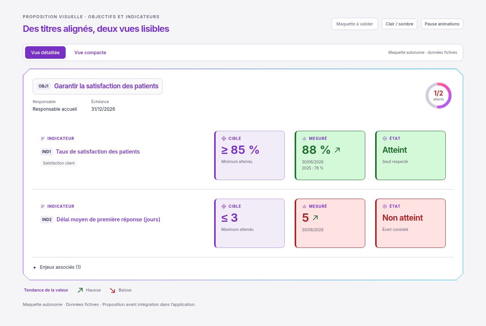
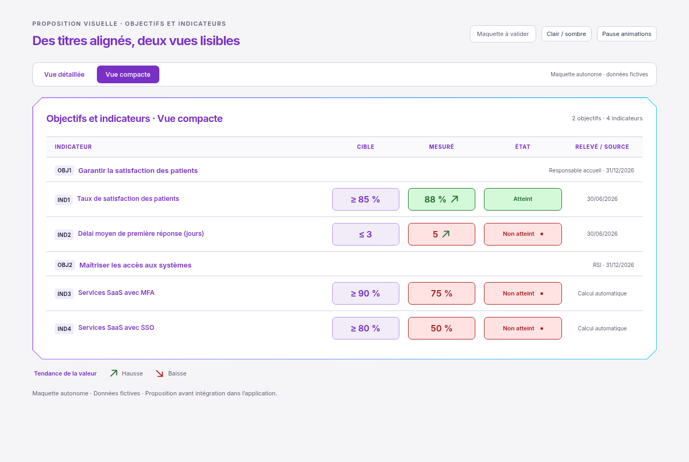

# Titres alignés, animations et vue compacte

01/11/2026, Europe/Paris. Session : Codex. Référence applicative inchangée : `34921129f6117b8093e3d63216f827c76abbec4c`.

**Statut : maquette indépendante à valider. Aucune intégration, aucun build et aucun test applicatif exécuté pour cette proposition.**

Le demandeur a précisé que « annulé » signifiait **animer** : la mention **Non atteint** et les flèches restent présentes.

- Titres Indicateur / Cible / Mesuré / État alignés ; même typographie, même violet dans les deux thèmes. Les titres des objectifs et indicateurs reprennent ce violet.
- Vue détaillée : trois encadrés de même hauteur, cible violette et mesure/état selon l'atteinte. Les intitulés en double sont retirés.
- Vue compacte : une ligne par indicateur, regroupement par objectif, cible / mesure / état dans des encadrés courts de même hauteur ; date ou source conservée. Sur mobile, ces trois repères restent sur une même ligne.
- Flèches conservées : léger déplacement dans leur direction, hausse verte et baisse rouge. La couleur de la mesure reste indépendante de la tendance, selon sa comparaison à la cible. Les deux directions figurent dans la légende animée ; seuls les deux indicateurs ayant une tendance connue dans la maquette affichent une flèche.
- Non atteint : lueur intérieure et pictogramme qui pulse en vue détaillée ; point rouge animé en vue compacte. Le texte reste stable et lisible. Commande Pause / Lire ; animations désactivées lorsque le système demande moins de mouvements.
- Cadre Biseau et hauteur naturelle : aucun ascenseur interne ajouté aux dalles.

Les exemples sont fictifs. La vue détaillée illustre 88 % face à ≥ 85 %, et 5 face à ≤ 3 jours. La vue compacte ajoute deux exemples automatiques de services SaaS. Ce rendu n'ajoute aucun calcul ni aucune donnée au produit. Les états existants Non mesuré et Cible à définir, les sources, commandes et droits devront être conservés lors d'une éventuelle intégration validée.

[Voir les animations — vidéo MP4 de 12 secondes](animations.mp4) · [Aperçu GIF animé](animations.gif) · [Maquette HTML autonome](index.html).

| Vue | Sombre | Mobile clair | Mobile sombre |
| --- | --- | --- | --- |
| Détaillée | [1280 px](detail-dark-1280.png) | [390 px](detail-light-390.png) | [390 px](detail-dark-390.png) |
| Compacte | [1280 px](compact-dark-1280.png) | [390 px](compact-light-390.png) | [390 px](compact-dark-390.png) |

Le fichier HTML comprend Inter et sa licence SIL OFL. Il s'ouvre localement après téléchargement ; ses commandes changent seulement la présentation de la maquette. Les PNG sont des rendus du prototype avec mouvement réduit. La vidéo et le GIF montrent ses véritables images clés CSS, échantillonnées à 10 images par seconde à vitesse normale, avec six secondes par vue. Aucune application ni API n'a été chargée pour produire ces éléments. Ce sont des propositions, pas des captures de l'application intégrée.

Seules la documentation et la maquette évoluent. Aucun fichier de `apps/`, `packages/` ou des tests applicatifs n'est modifié. La règle reste : **visuel → validation explicite → intégration et tests → nouveau visuel réel**.

**Prochaine action : attendre la validation explicite de ces deux vues et des animations, puis intégrer dans la copie Codex, exécuter les contrôles pertinents et fournir de nouvelles captures réelles.**

[Proposition précédente à trois encadrés](../cible-mesure-etat/README.md), conservée pour référence.
