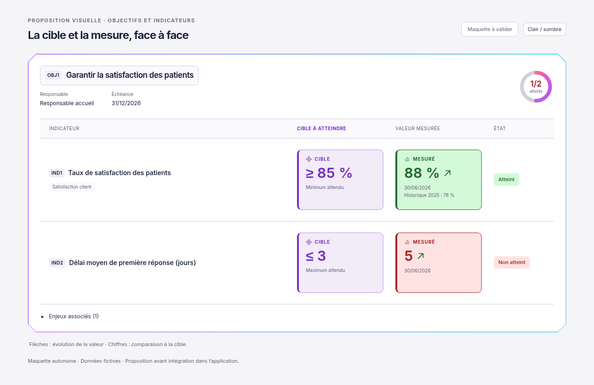

# Cible et valeur mesurée encadrées — proposition actualisée

01/11/2026, Europe/Paris. Session : Codex. Référence applicative inchangée : `34921129f6117b8093e3d63216f827c76abbec4c`.

**Statut : maquette à valider. Aucune intégration ni aucun test applicatif réalisé.**

À la demande du client, la valeur mesurée reçoit à son tour un encadré coloré, de même format que la cible. Le fond et la bordure sont verts pour la mesure atteinte et rouges pour la mesure non atteinte. Les deux encadrés sont alignés, avec des chiffres agrandis et un libellé explicite. La cible reste violette, accompagnée de son signe et de la mention Minimum attendu ou Maximum attendu. La comparaison côte à côte est conservée sur mobile.

Les flèches gardent leur code de hausse/baisse déjà demandé ; la couleur du panneau mesuré indique la comparaison à la cible. Les exemples restent fictifs : 88 % pour une cible ≥ 85 %, et 5 pour une cible ≤ 3 jours.

[Version sombre](proposition-dark-1280.png) · [Mobile sombre](proposition-dark-390.png) · [Maquette HTML autonome](index.html).

Cette proposition remplace visuellement [la première maquette de cible](../cible-visible/README.md), conservée pour référence. L'HTML est autonome, avec Inter et sa licence SIL OFL embarqués. Les images proviennent uniquement de son rendu navigateur, sans charger l'application ni appeler ses API.

Seuls les documents et la maquette ont été modifiés. Aucun fichier de `apps/` ou `packages/` touché, aucun build ni test applicatif lancé. La règle du demandeur reste : **proposition visuelle → validation explicite → intégration et tests → nouveau visuel réel**.

**Prochaine étape : attendre la validation de cette version avant toute modification de l'application.**
