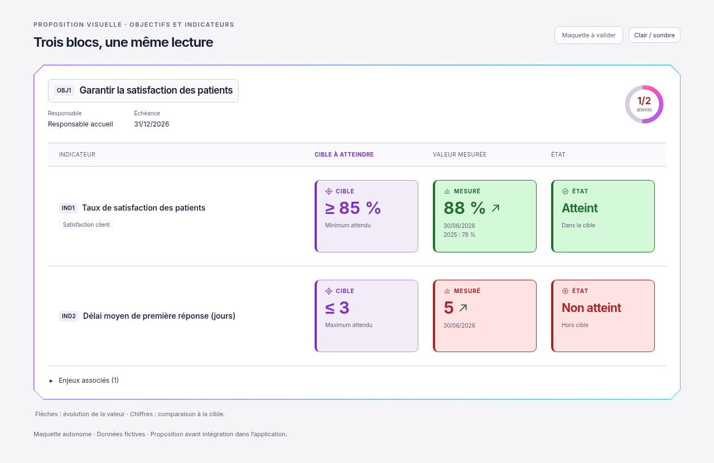

# Cible, mesuré et état — trois encadrés uniformes

01/11/2026, Europe/Paris. Session : Codex. Référence applicative inchangée : `34921129f6117b8093e3d63216f827c76abbec4c`.

**Statut : proposition visuelle à valider. Aucune intégration ni aucun test applicatif réalisé.**

Le demandeur souhaite étendre à l’état le même traitement que la cible et la mesure. Cette troisième proposition présente trois encadrés de même format : **Cible** en violet, **Mesuré** et **État** en vert ou rouge selon l’atteinte. Libellé, icône, valeur ou résultat et explication courte occupent les mêmes positions. Les encadrés sont alignés sur ordinateur et restent côte à côte sur mobile, avec une typographie adaptée.

L’état affiche Atteint / Dans la cible ou Non atteint / Hors cible, avec un symbole distinct. Les flèches continuent à représenter la hausse/baisse numérique. Les exemples sont fictifs : 88 % face à ≥ 85 %, et 5 face à ≤ 3 jours. Les autres états existants resteront à conserver lors d’une éventuelle intégration validée.

[Version sombre](proposition-dark-1280.png) · [Mobile sombre](proposition-dark-390.png) · [Maquette HTML autonome](index.html).

[Proposition précédente : cible et mesuré](../cible-et-mesure/README.md), conservée pour référence. Le fichier HTML est autonome, avec Inter et sa licence SIL OFL embarqués. Les images sont uniquement des rendus de cette maquette indépendante : aucune application chargée, aucun appel API et aucun contrôle applicatif exécuté.

Seules la maquette et la documentation évoluent. Aucun fichier de `apps/` ou `packages/` modifié, aucun build ni test lancé. La règle reste : **proposition visuelle → validation explicite → intégration et tests → nouveau visuel réel**.

**Prochaine action : attendre la validation de cette présentation à trois encadrés avant toute intégration dans l’application.**
