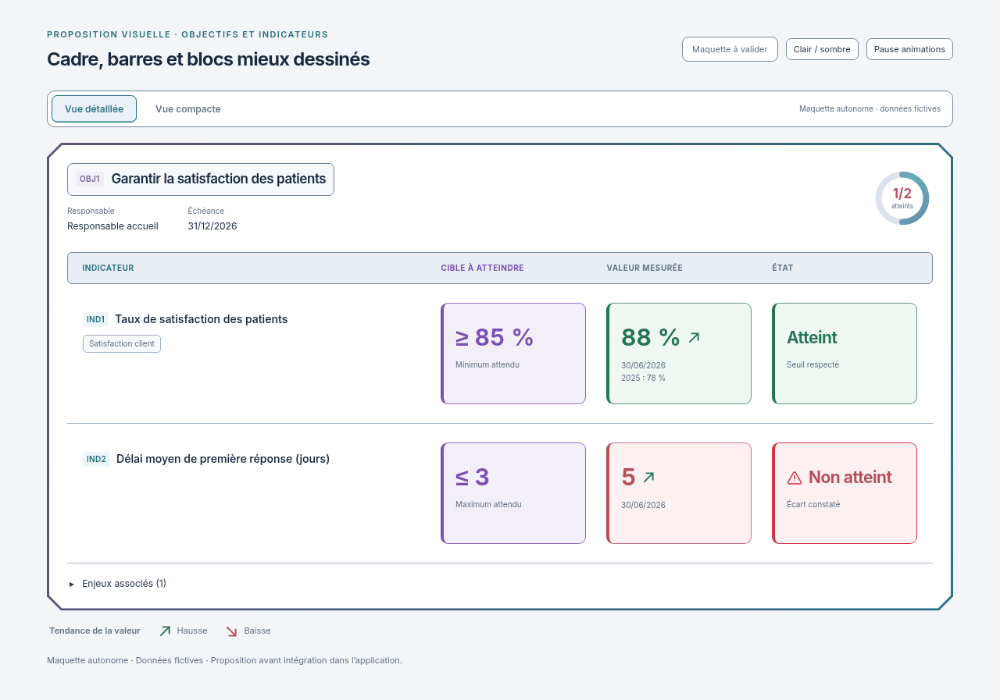

# Contours des barres, onglets et blocs harmonisés

01/11/2026, Europe/Paris. Session : Codex. Référence applicative inchangée : `34921129f6117b8093e3d63216f827c76abbec4c`.

**Statut : maquette indépendante en attente de validation explicite. Aucune intégration, aucun build et aucun test applicatif exécuté pour ce lot.**

À la demande « et le contour de barre etc », le renforcement porte aussi sur les éléments intérieurs de la proposition Objectifs et indicateurs :

- Barre de choix des vues, onglet actif, boutons et en-tête de l'objectif : contours plus foncés et continus ; l'onglet actif est encadré en cyan.
- Barres des noms de colonnes : encadrement complet, fond ardoise clair ou bleu sombre et alignement des libellés conservé.
- Encadrés Cible / Mesuré / État : bordures plus contrastées selon leur couleur ; cible violette et états vert/rouge.
- Séparations entre lignes, groupes d'objectifs de la vue compacte et étiquette de catégorie : traits plus nets.

Le grand cadre Biseau conserve son trait de 3 px. Les contours intérieurs plus fins conservent la hiérarchie de lecture. Le halo rouge animé et le triangle warning de Non atteint, les flèches de tendance, Pause / Lire et le mouvement réduit restent dans le HTML. La disposition, les dimensions et les exemples fictifs sont conservés ; aucun ascenseur interne ajouté.

[Vue détaillée sombre](detail-dark-1280.png) · [Vue compacte claire](compact-light-1280.png) · [Vue compacte sombre](compact-dark-1280.png) · [Mobile détaillé](detail-light-390.png) · [Mobile compact](compact-dark-390.png) · [Maquette HTML autonome](index.html).

Les huit PNG sont des rendus de la maquette uniquement, avec mouvement réduit, dans les deux vues, les deux thèmes et aux largeurs 1280/390 px. Aucun appel API ni chargement de l'application. Inter et sa licence SIL OFL restent embarqués. Aucun nouveau contrôle applicatif ni nouvelle validation des animations n'est revendiqué dans ce lot.

Seuls la documentation et les supports de proposition évoluent ; aucun fichier de `apps/`, `packages/` ou des tests applicatifs n'est modifié.

**Prochaine action : attendre la validation explicite de cette présentation avant intégration dans la copie Codex, puis effectuer les contrôles pertinents et fournir les nouveaux visuels réels.**

[Proposition précédente : cadre extérieur renforcé](../contours-renforces/README.md), conservée pour référence. Règle du demandeur : **visuel → validation explicite → intégration et tests → nouveau visuel réel**.
