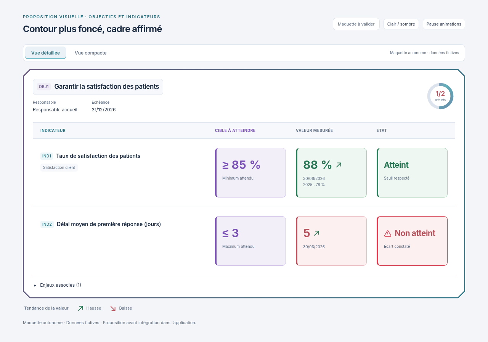

# Contours Biseau plus visibles et plus foncés

01/11/2026, Europe/Paris. Session : Codex. Référence applicative inchangée : `34921129f6117b8093e3d63216f827c76abbec4c`.

**Statut : proposition indépendante à valider. Aucune intégration, aucun build et aucun test applicatif exécuté pour ce lot.**

Le demandeur souhaite accentuer et foncer les contours de la fenêtre. La modification porte sur le grand cadre extérieur Biseau : liseré plein de **3 px**, dégradé ardoise/mauve désaturé vers bleu pétrole, opacité pleine et épaisseur régulière jusque dans les angles coupés. En clair le cadre est nettement plus foncé ; en sombre son contraste et son épaisseur le rendent plus visible. Le même traitement couvre les vues détaillée et compacte ainsi que le mobile.

La palette intérieure, la cible violette, les noms des colonnes, le triangle d'avertissement et le halo rouge animé de Non atteint restent ceux de la proposition précédente. Les données fictives, les dimensions et les défilements restent identiques ; aucun ascenseur interne ajouté. Les animations, leur commande Pause / Lire et la préférence système de mouvement réduit restent dans le HTML autonome.

[Cadre renforcé sombre](detail-dark-1280.png) · [Vue compacte claire](compact-light-1280.png) · [Vue compacte sombre](compact-dark-1280.png) · [Mobile clair](compact-light-390.png) · [Mobile sombre](compact-dark-390.png) · [Maquette HTML autonome](index.html).

Les huit PNG sont des rendus de la seule maquette, dans les deux vues, les deux thèmes et aux largeurs 1280/390 px. Ils utilisent le mouvement réduit pour des images fixes. Aucune application ni API chargée pour ces rendus. Inter et sa licence SIL OFL sont embarqués dans le HTML. Aucun nouveau contrôle applicatif ni nouvelle validation des animations n'est revendiqué dans ce lot.

Seuls la documentation et les supports de proposition changent ; aucun fichier de `apps/`, `packages/` ou des tests applicatifs n'est modifié.

**Prochaine action : attendre la validation explicite du cadre et de la présentation actuelle avant intégration dans la copie Codex, puis réaliser les contrôles pertinents et fournir de nouveaux visuels réels.**

[Proposition précédente avec alerte animée](../cible-violette-alerte/README.md), conservée pour référence. Règle du demandeur : **visuel → validation explicite → intégration et tests → nouveau visuel réel**.
