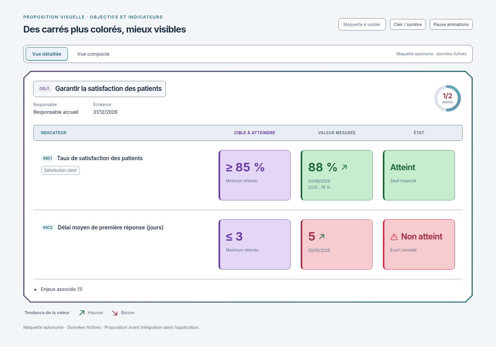

# Carrés violet, vert et rouge plus soutenus

02/11/2026, Europe/Paris. Session : Codex.

**Statut : nouvelle proposition visuelle à valider avant application de ces nuances.** La présentation et les contours précédents ont reçu l'accord du demandeur, avec centrage des trois en-têtes. Leur intégration et leurs contrôles sont un lot distinct, déjà autorisé.

Le demandeur souhaite retrouver des carrés moins pâles. Cette variante renforce les fonds des encadrés **Cible**, **Mesuré** et **État** dans les vues détaillée et compacte. En clair : lavande plus dense, vert plus présent et rouge plus marqué. En sombre : fonds violets, verts et rouges plus soutenus et textes plus lumineux. Les autres accents restent atténués pour conserver la hiérarchie demandée.

Les trois en-têtes sont centrés au-dessus de leur colonne. Contours du cadre et des barres, géométrie des blocs, triangle warning, halo rouge, flèches animées, commande Pause / Lire et mouvement réduit sont conservés. Les exemples restent fictifs, aucune valeur de cette maquette n'est recopiée dans les données du produit.

[Version sombre](detail-dark-1280.png) · [Vue compacte claire](compact-light-1280.png) · [Vue compacte sombre](compact-dark-1280.png) · [Mobile clair](detail-light-390.png) · [Mobile sombre](detail-dark-390.png) · [Maquette HTML autonome](index.html).

Les huit PNG rendent uniquement ce fichier HTML autonome avec mouvement réduit, en deux vues, deux thèmes et aux largeurs 1280/390 px. Inter et sa licence SIL OFL restent embarqués. Aucun code applicatif, build ni test n'a été exécuté pour appliquer ou vérifier **ces nouvelles nuances**. Les travaux d'intégration et de contrôle de la présentation précédemment validée sont poursuivis séparément, conformément à l'autorisation reçue.

**Prochaine action : validation explicite de ces fonds plus soutenus, puis application des nuances dans la présentation intégrée, contrôles pertinents et nouvelles captures réelles.**

Règle du demandeur : **visuel → validation explicite → intégration et tests → nouveau visuel réel**.
