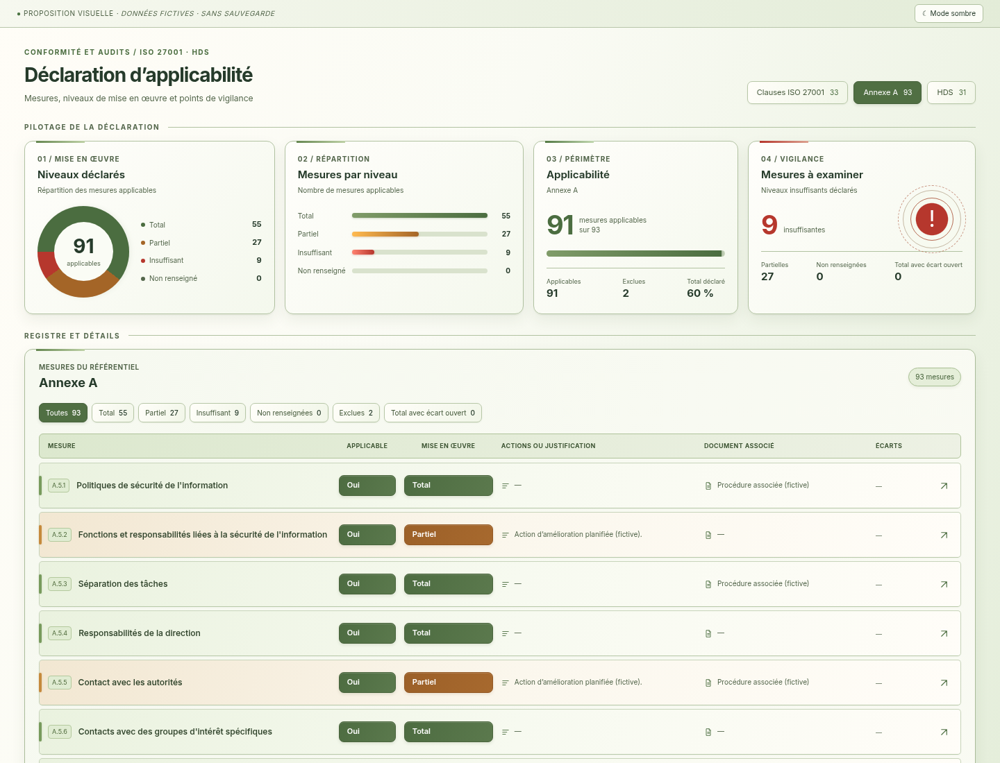

# DdA — blanc cassé et vert sauge

04/11/2026, Europe/Paris. Session : Codex (01a193c1-316c-7677-831f-2f31592aa052). Rendus préparés le 03/11/2026, repris et inspectés le 04/11/2026.

Le demandeur écarte le gris et préfère « un blanc, ou blanc cassé et un côté classe vert sauge ». Cette proposition remplace la palette bleu-gris du clair par un fond blanc cassé en léger dégradé vers le sauge, des dalles ivoire, des textes vert profond et des contours sauge fins. Les sélecteurs utilisent un vert sauge soutenu, un ambre chaud pour Partiel et du rouge pour les insuffisances et exclusions.

**Maquette autonome à valider avant intégration.** L'application reste au commit `4a1304b`, aucun code applicatif modifié, aucun build ou test applicatif exécuté pour cette nouvelle palette. La règle du demandeur reste : proposition visuelle, validation explicite, intégration et contrôles, nouvelles captures réelles.

[Aperçu 4K](clair-apercu-4k.png) · [Page intégrale HD, 93 mesures](clair-integrale-hd.png) · [Détail des lignes](lignes-clair-1440.png) · [Insuffisantes](alertes-clair-1440.png) · [Applicabilité Non](applicabilite-clair-1440.png) · [Mobile](clair-390.png) · [Lignes mobiles](lignes-clair-390.png).

La maquette conserve le format en lignes, les quatre dalles, les menus sans chevron, les dimensions et les données fictives. Le CSS ajouté ne cible que le thème clair. Scripts et données identiques à la proposition précédente ; aucune API ni application chargée. Huit rendus Chromium directs, sans retouche : captures de 1440 et 390 px, aperçu 3840 × 2160 et page complète 3840 × 14698. Police Inter embarquée, mouvement réduit. [Dimensions des huit captures](captures.json).

Commande du rendu autonome, code 0 : `node /workspace/work/neon-instance/dda-clair-sauge/rendre.mjs` avec Node 26 et Chromium système. Images d'ensemble et de lignes inspectées ; égalité des scripts et des données contrôlée. Aucun résultat de test applicatif historique n'est attribué à cette proposition.

Après validation : intégrer uniquement la palette claire de la DdA, effectuer les contrôles pertinents et présenter les nouveaux visuels réels. [Précédente proposition glacier/ivoire](../dda-clair-contraste/README.md) · [Dernière intégration applicative](../../DDA-INTEGREE.md).
