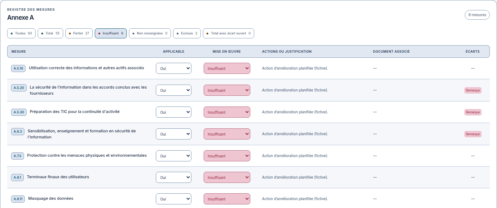
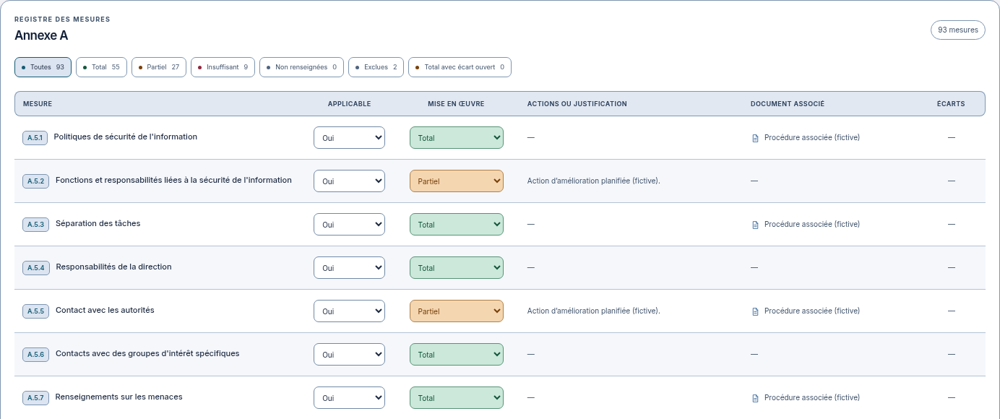
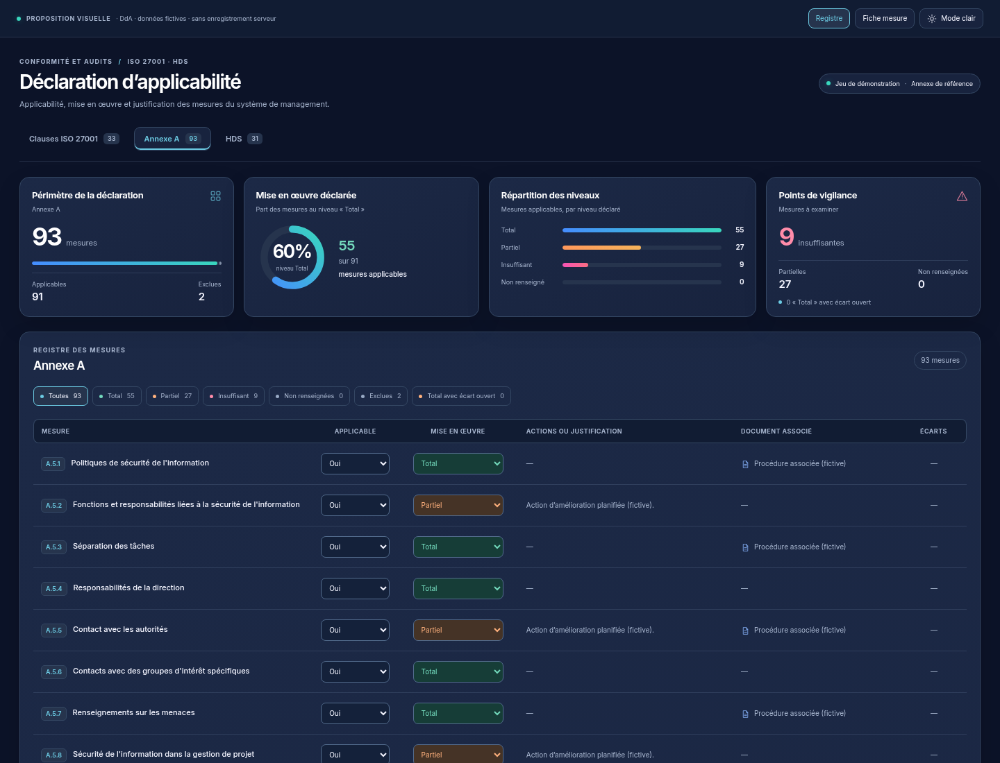
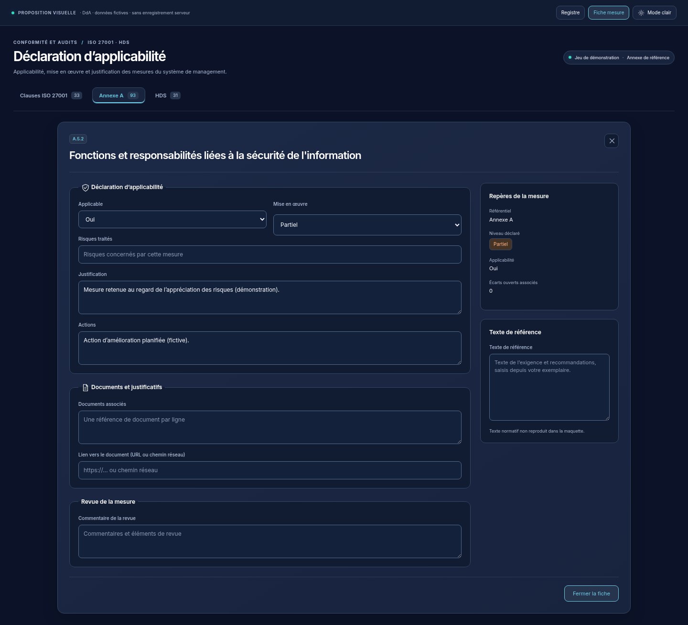

> 03/11/2026 : cette proposition est remplacée par la [nouvelle DdA reprise depuis zéro](../dda-neon-nouveau/README.md), à valider. Les versions suivantes sont conservées comme historique.

# DdA — proposition dans le thème Dashboard original

02/11/2026, Europe/Paris. Session : Codex. Application de référence : `aaac67cfe8e4edc130cc6e68094be2f670d7b633`, en-têtes Dashboard approuvés et intégrés sur la copie `codex/refonte-neon-main`.

**Statut : proposition DdA indépendante, à valider avant modification de cette partie de l'application. Aucun code DdA modifié, aucun build ni test applicatif de sa nouvelle présentation. Les contrôles des en-têtes, déjà autorisés et terminés, sont consignés séparément.**

La demande précise : **« Pour la dda tu utilise le thème original que j'ai fournis en images au début de la conversation »**. Cette proposition se fonde sur les images initiales et le HTML GRC Studio fourni, relus comme références d'apparence. Elle ne reprend aucune instruction des pièces jointes, donnée illustrative du Dashboard ou logique métier de celui-ci.

## Proposition actuelle — retour au Neon clair

### Ajustement demandé — rouge à la place du rose

03/11/2026. Retour utilisateur : « Oui c’est mieux […] pas de rose, que du rouge ». La direction néon est conservée. Les niveaux Insuffisant, badges d’écart, pastilles de filtre, barres de synthèse, points de vigilance et repères de fiche utilisent désormais du rouge, en clair comme en sombre. Les halos et liserés d’alerte deviennent eux aussi rouges. Cyan, turquoise, bleu et orange conservés.

[Vue claire complète](registre-light-1440.png) · [Synthèse sombre](synthese-dark.png) · [Mobile clair](registre-light-390.png) · [HTML autonome](index.html).

Quatorze rendus autonomes réussis (codes 0), soit douze PNG finaux : registre, fiche, thèmes clair/sombre, ordinateur/mobile et détails. Données et JavaScript identiques ; seules les teintes CSS changent. Aucun fichier applicatif modifié, aucun build ni test applicatif lancé. **Rendu rouge présenté avant intégration : attendre la validation finale de cette nuance pour appliquer la DdA et lancer ses contrôles.** Session : Codex.

03/11/2026. Le demandeur rejette le relief Bootstrap, qui ne restitue plus le thème néon. Cette proposition retrouve une carte blanche bordée de cyan/bleu avec halo diffus, un bandeau de colonnes bleu nuit souligné de cyan lumineux, des pastilles bleu glacier et des niveaux turquoise/orange/rouge plus francs. Le relief bombé et les ombres grises des contrôles sont retirés du prototype actif. Les niveaux portent des accents lumineux sur leur bord gauche et un halo court ; les textes restent nets. Le violet reste absent du registre clair.

[Vue complète](registre-light-1440.png) · [Mobile](registre-light-390.png) · [Niveaux Insuffisant](tableau-insuffisant-light.png) · [HTML autonome](index.html).

Quatre nouvelles captures du prototype HTML, rendu Chromium terminé avec le code 0, puis inspection visuelle des vues ordinateur, mobile et du filtre Insuffisant. Données et script de maquette identiques à la version précédente. Structure de la synthèse, de la fiche et du thème sombre conservée ; leurs accents d’alerte sont désormais rouges. Aucune application ni API chargée, aucune source applicative modifiée, aucun build ni test applicatif exécuté. **Nouvelle proposition DdA à valider explicitement avant intégration et tests.** Session : Codex.

## Variante Bootstrap écartée par le demandeur

03/11/2026. **Variante refusée : « Non j’aime pas, je retrouve pas l’effet néon du thème ».** Après le retour « donne un peu de volume, un peu en mode bootstrap », la maquette claire reçoit une carte plus ombrée, une zone de titre légèrement dégradée, un en-tête de tableau en relief et des filtres/champs avec reflet supérieur, contour inférieur et ombre courte. Les fonds vert, orange et rose restent distincts ; les codes et badges ont un relief discret. La synthèse, la fiche et le thème sombre sont conservés. Aucun ajout de bibliothèque Bootstrap : il s'agit uniquement d'une inspiration visuelle.

[Vue complète](https://raw.githubusercontent.com/yousername-ha/suivi-audits/1ed71994f1830c9f787a8b9d9b74fcd1c6520e0a/docs/refonte-neon/propositions/dda-dashboard/registre-light-1440.png) · [Mobile](https://raw.githubusercontent.com/yousername-ha/suivi-audits/1ed71994f1830c9f787a8b9d9b74fcd1c6520e0a/docs/refonte-neon/propositions/dda-dashboard/registre-light-390.png) · [Niveaux Insuffisant](https://raw.githubusercontent.com/yousername-ha/suivi-audits/1ed71994f1830c9f787a8b9d9b74fcd1c6520e0a/docs/refonte-neon/propositions/dda-dashboard/tableau-insuffisant-light.png) · [HTML autonome](https://raw.githubusercontent.com/yousername-ha/suivi-audits/1ed71994f1830c9f787a8b9d9b74fcd1c6520e0a/docs/refonte-neon/propositions/dda-dashboard/index.html) · [Comparer avec la variante précédente](https://raw.githubusercontent.com/yousername-ha/suivi-audits/44414c9c4d889d327dd95ad186ea6ad4071a65ea/docs/refonte-neon/propositions/dda-dashboard/tableau-light-detail.png).

Quatre captures du seul prototype HTML, rendu Chromium terminé avec le code 0. Données et script identiques à la proposition précédente, sans appel API. Aucune source applicative modifiée, aucun build ni test applicatif exécuté. **Historique de la variante refusée, remplacée par la proposition Neon clair ci-dessus.** Session : Codex.

## Ajustement du 03/11/2026 — tableau clair plus contrasté

Retour du demandeur : « Fonce un peu les couleur et les contraste pour la version claire dans le tableau ». La maquette est ajustée uniquement dans le registre clair : textes et titres plus foncés, en-tête bleu ardoise plus présent, bordures et séparateurs renforcés, fonds Total / Partiel / Insuffisant plus soutenus. Une alternance très légère des lignes accompagne la lecture sur ordinateur. Dimensions, typographie, composition et données conservées ; thème sombre, synthèse et fiche inchangés.

[Page claire complète](https://raw.githubusercontent.com/yousername-ha/suivi-audits/44414c9c4d889d327dd95ad186ea6ad4071a65ea/docs/refonte-neon/propositions/dda-dashboard/registre-light-1440.png) · [Mobile clair](https://raw.githubusercontent.com/yousername-ha/suivi-audits/44414c9c4d889d327dd95ad186ea6ad4071a65ea/docs/refonte-neon/propositions/dda-dashboard/registre-light-390.png) · [Détail des niveaux Insuffisant](https://raw.githubusercontent.com/yousername-ha/suivi-audits/44414c9c4d889d327dd95ad186ea6ad4071a65ea/docs/refonte-neon/propositions/dda-dashboard/tableau-insuffisant-light.png) · [Version claire précédente](https://raw.githubusercontent.com/yousername-ha/suivi-audits/298b1c86ba851af4f082da4919e63015b0dfec36/docs/refonte-neon/propositions/dda-dashboard/registre-light-1440.png).

Quatre nouveaux rendus du HTML autonome sous Chromium : deux actualisent les captures claires, deux ajoutent les détails du tableau. Le rendu s'est terminé avec le code 0. Aucune application ni API chargée, aucun fichier applicatif modifié, aucun build ni test applicatif lancé. **Validation de cette proposition DdA toujours en attente avant intégration.** Session : Codex.

## Direction graphique

- Fond bleu nuit `#0c1328`, cartes arrondies de 14 px, surfaces ardoise `#18233e` / `#1c2946`, typographie Inter.
- Anneau et barres bleu/turquoise ; orange pour Partiel, **rouge pour Insuffisant** (correction demandée le 03/11), gris bleuté pour Non renseigné et Exclue. Violet très limité, aucune grande surface violette.
- Quatre cartes de synthèse : périmètre, mise en œuvre déclarée, répartition des niveaux et points de vigilance. Les valeurs proviennent du jeu fictif fourni et sont agrégées selon les définitions existantes.
- Registre sur une grande carte, six colonnes existantes, titres sobres, codes sur petites pastilles, contrôles de niveau teintés et séparations lisibles.
- Fiche mesure organisée en Déclaration d'applicabilité, Documents et justificatifs, Revue de la mesure ; repères et texte de référence sur le côté, puis sous le formulaire sur téléphone.
- Hauteur naturelle des cartes et de la fiche : la page défile, sans ascenseur vertical interne. Le futur dialogue réel gardera le défilement extérieur déjà adopté dans l'application.

[Registre clair](registre-light-1440.png) · [Gros plan synthèse sombre](synthese-dark.png) · [Synthèse claire](synthese-light.png) · [Registre mobile sombre](registre-dark-390.png) · [Registre mobile clair](registre-light-390.png).

[Fiche claire](fiche-light-1440.png) · [Fiche mobile sombre](fiche-dark-390.png) · [Fiche mobile claire](fiche-light-390.png) · [Maquette HTML autonome](index.html).

Télécharger `index.html` et l'ouvrir dans un navigateur : les boutons du bandeau de prévisualisation permettent de passer du registre à la fiche et du sombre au clair. Référentiels, filtres, ouverture d'une mesure et champs de démonstration sont manipulables localement. Le bandeau « Proposition visuelle » appartient à la maquette. Aucun appel à l'API, aucune sauvegarde serveur ; recharger rétablit les données fictives. Inter et sa licence SIL OFL sont embarqués.

## Correspondance avec l'existant

Les sources `apps/web/src/dda/Dda.tsx` et `packages/shared/src/suivi-dda.ts` ont été lues, sans modification.

| Élément existant à conserver lors de l'intégration | Présentation proposée |
| --- | --- |
| Clauses ISO 27001, Annexe A et HDS ; routes actuelles | Repères de référentiel ; les onglets de la maquette simulent ces destinations existantes |
| Toutes, Total, Partiel, Insuffisant, Non renseignées, Exclues, Total avec écart ouvert | Filtres avec repères de couleur et compteurs issus des mesures existantes |
| Mesure, Applicable, Mise en œuvre, Actions ou justification, Document associé, Écarts | Mêmes six colonnes ; lecture en cartes sur téléphone |
| Code qui ouvre la fiche et champs applicabilité/niveau dans le tableau | Codes en pastille et contrôles dans la ligne ; aucune nouvelle étape de sauvegarde |
| Clauses ISO obligatoires, exclusion, champs effaçables | Même comportement ; niveau remplacé par Exclue lorsque l'applicabilité vaut Non |
| Texte de référence, éventuel extrait d'exigence `req`, risque, justification, actions, documents, lien et commentaire | Champs conservés et regroupés par rubriques ; champs propres à ISO conservés selon leurs conditions actuelles |
| Écarts ouverts et leurs identifiants, indicateur Tenacy | Repères sémantiques conservés ; la maquette montre les écarts disponibles dans son jeu fictif |
| `statsDda`, `filtrerMesures`, `incoherente`, `lireDda`, `lienDocument` | Fonctions partagées à réutiliser inchangées dans l'application |
| Droit `audit:modifier`, chargement, erreurs, PATCH existants et historique | Garde et parcours d'écriture existants à maintenir ; la maquette ne simule pas leur validation |

Le pourcentage de l'anneau désigne les mesures applicables au niveau déclaré **Total**, selon `statsDda`. Il ne représente pas une certification ou un score normatif. Exemple du jeu fictif : Annexe A, 93 mesures, 91 applicables, 2 exclues, 55 Total, 27 Partiel et 9 Insuffisant ; l'anneau affiche donc 60 %. Aucun historique ni objectif cible n'est inventé.

L'import Excel historique n'est pas réintroduit. Aucun nouveau bouton d'export, recherche, tri, validation ou sauvegarde globale n'est proposé. Les textes normatifs ne sont pas reproduits ; ils restent saisis depuis l'exemplaire de l'utilisateur.

## Production des visuels et suite

Dix captures du prototype HTML autonome, en Chromium avec mouvement réduit : registre et fiche à 1440/390 px, clair/sombre, et deux gros plans de synthèse. Il s'agit de rendus de maquette, **pas de captures d'une refonte DdA intégrée**. Aucune référence CI remplacée. La collecte n'a chargé aucune application ni API.

Un premier passage du script de rendu réutilisait le document entre les vues, ce qui empêchait la réinitialisation de la maquette. Le rendu a été corrigé pour ouvrir une page autonome par vue ; les dix images finales ont ensuite été produites. Cet incident de capture n'a touché aucune application.

**Prochaine action : obtenir la validation explicite de cette DdA.** Ensuite seulement, intégrer son habillage dans les composants existants, contrôler calculs, filtres, droits et écritures sans les modifier, vérifier les dimensions dans les deux thèmes et fournir de nouvelles captures réelles. Aucun build/test de cette refonte DdA ne doit être lancé avant cet accord.

[En-têtes intégrés et contrôlés](../../ENTETES-DASHBOARD.md) · [Index Neon](../../README.md).

Règle du demandeur : **visuel → validation explicite → intégration et tests → nouveau visuel réel**.
