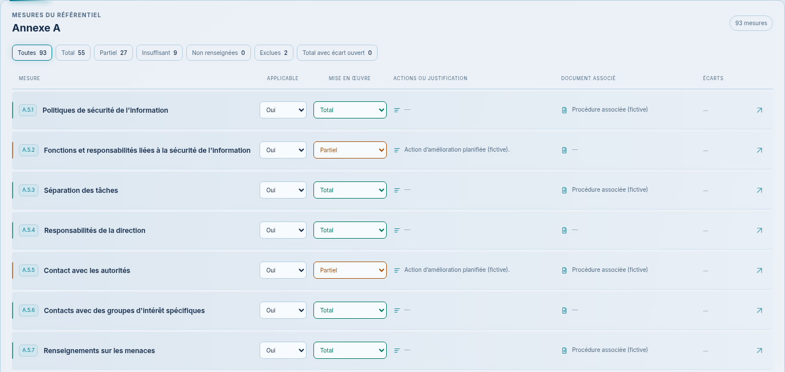

> 03/11/2026 — **Proposition complète validée et intégrée** après « je valide, tu peux intégrer », y compris la réduction de lueur. Voir [l’application réelle, les tests et les captures HD](../../DDA-INTEGREE.md), commit applicatif `4a1304b`. Les demandes de validation ci-dessous décrivent les étapes historiques de conception. Session : Codex.

# DdA — mesures en lignes compactes

03/11/2026, Europe/Paris. Session : Codex. Branche `codex/refonte-neon-main` ; référence applicative inchangée `aaac67c`.

**Format en lignes explicitement validé par le demandeur.** Les fonds légèrement plus foncés, l’applicabilité colorée, les champs remplis et les liserés néon sont présentés avant intégration ; ces finitions restent à valider. Le demandeur préfère une lecture en ligne compte tenu du nombre de mesures et écarte la proposition en cartes. Le registre est désormais présenté en lignes compactes ; la synthèse et la fiche de la nouvelle DdA restent la base. Aucun code applicatif modifié, aucun build ni test applicatif exécuté.

## Lueur des barres légèrement réduite

03/11/2026, Europe/Paris. Après le retour « un petit peu moins de blur / lueur » sur la dalle Mesures par niveau, le halo des barres est réduit de 9 px à 5 px et sa couleur à 50 % d’opacité, dans les deux thèmes. Dégradés, chiffres, dimensions, autres éléments et comportements conservés. Seule la règle CSS `.graph .fill` de la maquette évolue ; les scripts et les données sont identiques.

[Détail clair HD](repartition-clair-hd.png) · [Détail sombre HD](repartition-sombre-hd.png) · [Aperçu clair 4K](dda-clair-apercu-4k.png) · [Aperçu sombre 4K](dda-sombre-apercu-4k.png) · [Clair intégral HD](dda-clair-integrale-hd.png) · [Sombre intégral HD](dda-sombre-integrale-hd.png).

Douze rendus autonomes courants et six rendus HD produits, codes 0 ; détails clair/sombre inspectés. Les captures intégrales comprennent toujours les quatre dalles et les 93 mesures. Aucun fichier applicatif modifié, aucun build/test applicatif. **Ajustement présenté pour validation avant intégration ; les accords sur les lignes et la finition claire restent acquis.** Session : Codex.

## Vues intégrales HD pour validation clair et sombre

03/11/2026, Europe/Paris. Le demandeur accepte la finition claire (« ça me va ») et demande les deux thèmes en images complètes HD pour validation. La maquette `2862f8d` est rendue sans modification graphique ni applicative. Quatre dalles et 93 mesures de l’Annexe A fictive sont présentes dans chaque capture intégrale ; aucun filtre ni découpage de la liste.

| Thème | Aperçu 4K | Page intégrale HD |
| --- | --- | --- |
| Clair | [3 840 × 2 160](dda-clair-apercu-4k.png) | [3 840 × 14 508, 93 lignes](dda-clair-integrale-hd.png) |
| Sombre | [3 840 × 2 160](dda-sombre-apercu-4k.png) | [3 840 × 14 504, 93 lignes](dda-sombre-integrale-hd.png) |

Captures Chromium directes, fenêtre 1 920 × 1 080 et densité ×2 ; images intégrales avec `fullPage: true`, polices chargées avant capture. Quatre rendus autonomes produits, code 0 ; vues d’ensemble claire et sombre inspectées. [Dimensions et nombres d’éléments](captures-hd.json). Aucun chargement applicatif/API, aucune modification de CSS/HTML/JavaScript pour cette étape, aucun build/test applicatif. **Finition claire acceptée ; validation des vues complètes clair/sombre demandée avant intégration et tests.** Session : Codex.

## Clair : reprise des deux dernières captures

03/11/2026. Dernière demande : « ça doit ressembler à ça », avec deux images. La proposition reprend les lignes gris bleuté et les colonnes de la première, les dégradés horizontaux turquoise/orange et les libellés blancs de la seconde. Typographie des titres de mesure allégée, séparations gris bleuté et liserés fins ; ombre courte sous les champs, sans large halo. Les flèches de sélecteur restent masquées conformément à la demande antérieure ; clic et contrôle natif conservés. Les quatre dalles au-dessus et le rendu sombre sont conservés.

[Voir les lignes claires](lignes-light-1440.png) · [Voir la page avec les scores](registre-light-1440.png) · [Exclusions](applicabilite-light-1440.png) · [Alertes](alertes-light-1440.png) · [Mobile](lignes-light-390.png).

Douze rendus Chromium autonomes produits (code 0) ; les six captures sombres sont identiques aux précédentes. Inspection visuelle des lignes et de la page complète claire. Seul le CSS de la maquette évolue : données, scripts et code applicatif inchangés. Aucun build/test applicatif. **Nouvelle finition présentée pour validation ; intégration et tests après accord, puis nouvelles captures réelles.** Session : Codex.

## Clair : halos atténués et dégradés vert/orange

03/11/2026. À la demande du demandeur, les halos du clair sont atténués et les champs verts et orange reçoivent des dégradés. Textes foncés pour la lisibilité, rouge conservé ; structure et version sombre inchangées. Rendus de la maquette autonome uniquement, données et JavaScript identiques ; aucune modification, compilation ni test applicatif. Cette finition reste à valider avant intégration.

[Voir le clair](lignes-light-1440.png) · [Page complète](registre-light-1440.png) · [Mobile](lignes-light-390.png).

## Version claire rapprochée du modèle fourni

03/11/2026. Le demandeur indique que la version claire précédente ne correspond pas à son modèle. Cette nouvelle proposition reprend sa surface gris très clair, des fonds turquoise et orange plus lumineux et des halos. Les libellés sont foncés pour rester lisibles sur ces fonds ; Insuffisant et Applicable Non restent rouges. Les sélecteurs gardent le choix au clic sans flèche. Dalles de scores et format en lignes conservés, version sombre inchangée.

[Version claire](lignes-light-1440.png) · [Vue claire complète](registre-light-1440.png) · [Exclusions claires](applicabilite-light-1440.png) · [Clair mobile](lignes-light-390.png).

Rendus de la maquette autonome uniquement : aucune application ni API chargée. Les données et le JavaScript sont identiques ; seul le CSS de la version claire évolue. Aucun code/build/test applicatif. Nouveau rendu clair à valider avant intégration et contrôles réels.

## Reprise des deux références — sélecteurs sans flèche

03/11/2026. Reprise des deux exemples fournis : halos colorés et lignes lumineuses, sélecteurs arrondis dans le thème sombre et champs remplis dans le thème clair. Les dalles de scores sont conservées. Les flèches des deux sélecteurs Applicable et Mise en œuvre sont masquées ; les contrôles natifs restent cliquables et utilisables au clavier. Les flèches d’accès à la fiche sont conservées.

[Vue sombre](lignes-dark-1440.png) · [Vue claire](lignes-light-1440.png) · [Page complète](registre-dark-1440.png) · [Exclusions](applicabilite-dark-1440.png) · [Mobile](lignes-dark-390.png).

Douze captures du prototype autonome, code 0. Dans Chromium, les deux champs ont été cliqués et leurs choix modifiés dans la maquette, code 0 ; aucune application ni API chargée. Données et JavaScript identiques, seul le CSS évolue. Aucun fichier applicatif modifié, aucun build/test applicatif lancé. Rendu à valider avant intégration et contrôles réels.

## Applicabilité colorée et lignes plus néon

03/11/2026. La demande ajoute une distinction Oui/Non et un effet néon plus présent. Applicable Oui reçoit un fond vert, Non un fond rouge ; À déterminer garde le gris bleuté. Les lignes portent un liseré lumineux plus net de 3 px et une légère teinte selon le niveau : Total vert, Partiel orange, Insuffisant rouge. Les champs de niveau conservent leurs fonds pleins avec des halos plus visibles. Les exclusions gardent un liseré neutre pour distinguer une exclusion d’une insuffisance. Dimensions, densité, données, libellés et JavaScript conservés.

[Applicable Non en rouge](applicabilite-dark-1440.png) · [Non en clair](applicabilite-light-1440.png) · [Lignes sombres](lignes-dark-1440.png) · [Alertes rouges](alertes-dark-1440.png).

Douze rendus autonomes actualisés, code 0. Les deux vues d’exclusions utilisent les deux véritables mesures exclues du jeu fictif ; aucune valeur n’a été changée pour la capture. Les couleurs des options sont déterminées uniquement en CSS. Aucune application ni API chargée, aucun build/test applicatif, aucune source applicative modifiée. Finitions présentées pour validation avant intégration.

## Mise en œuvre avec fond coloré

03/11/2026. Demande : « mise en ouvre avec couleur remplit ». Le champ de niveau reçoit un fond plein turquoise pour Total, orange pour Partiel, rouge pour Insuffisant et gris bleuté pour Non renseigné. Le texte devient clair, la bordure et le halo gardent la couleur du niveau. Même présentation en clair/sombre et dans la fiche de maquette ; applicabilité et autres champs conservés. Les fonds légèrement foncés et le format validé sont maintenus.

[Remplissage clair](lignes-light-1440.png) · [Rouge en sombre](alertes-dark-1440.png) · [Remplissage sombre](lignes-dark-1440.png).

Dix rendus autonomes actualisés, code 0. Données et script identiques ; seules les couleurs CSS changent. Aucune application ni API chargée, aucun build/test applicatif, aucune source applicative modifiée. Validation du rendu avant intégration.

## Nuance légèrement plus foncée

03/11/2026. Après « Oui, essai un peu moins Claire », le format en lignes est retenu. Les fonds de page, surfaces et panneaux sont légèrement foncés dans les deux thèmes ; le clair adopte un gris bleuté plus présent. Textes, bordures, couleurs des niveaux, dimensions, données et JavaScript conservés. Dix rendus autonomes actualisés, code 0, sans chargement d’application ni d’API. Aucun build/test applicatif exécuté. La nuance est en attente de validation avant intégration.

[Comparer avec le clair précédent](https://raw.githubusercontent.com/yousername-ha/suivi-audits/cdf11372cc3d9809e879fadcd65a72eb1c49a107/docs/refonte-neon/propositions/dda-mesures-lignes/lignes-light-1440.png) · [Sombre précédent](https://raw.githubusercontent.com/yousername-ha/suivi-audits/cdf11372cc3d9809e879fadcd65a72eb1c49a107/docs/refonte-neon/propositions/dda-mesures-lignes/lignes-dark-1440.png).

## Format retenu

Une mesure occupe une ligne d’au moins 66 px sur ordinateur, avec 4 px d’écart : pastille de code, titre dominant, liseré de niveau turquoise/orange/rouge, contrôles courts d’applicabilité et mise en œuvre, actions ou justification, document, écarts et accès à la fiche. Les colonnes restent alignées, sans quadrillage vertical. Les textes longs agrandissent naturellement la ligne. Sur téléphone, les réglages et justificatifs se répartissent sous le titre, sans ascenseur interne.

[Clair](lignes-light-1440.png) · [Alertes et écarts](alertes-dark-1440.png) · [Alertes claires](alertes-light-1440.png) · [Page sombre](registre-dark-1440.png) · [Page claire](registre-light-1440.png) · [Mobile sombre](lignes-dark-390.png) · [Mobile clair](lignes-light-390.png) · [HTML autonome](index.html).

Dix captures Chromium du seul prototype avec données fictives : deux thèmes, deux largeurs, pages et gros plans, plus deux vues filtrées sur Insuffisant. Les rendus finaux correspondent au HTML autonome. Inter et sa licence SIL OFL sont embarqués. Les manipulations locales de référentiel, filtres, champs et fiche ne sauvegardent aucune donnée et ne chargent pas l’application ou l’API.

Les six informations existantes et les filtres sont conservés. Aucun score ni métrique de niveau n’est ajouté. L’applicabilité ISO obligatoire, l’exclusion, les justifications et la sémantique des écarts sont repris : NC rouge, autres écarts orange. Aucun rose. Les calculs et données de synthèse restent ceux de la proposition précédente.

Après validation, conserver les composants et parcours existants : calculs partagés, droits audit:modifier, enregistrement au fil de l’eau, erreurs et cas vides, liens/documents, extrait req, texte de référence, marqueur Tenacy et champs de fiche. Les contrôles serveur ne sont pas simulés par cette maquette. Aucun fichier de apps/, packages/ ou des tests n’a changé pour ce lot.

**Prochaine action : validation des finitions de couleurs et de lumière ; ne pas redemander l’accord sur le format en lignes déjà retenu.** Après accord, intégrer la DdA, effectuer les contrôles pertinents et fournir de nouvelles captures réelles, selon la règle visuel → validation → intégration et tests → nouveau visuel réel.

[Synthèse et fiche de référence](../dda-neon-nouveau/README.md) · [Cartes écartées](../dda-mesures-cartes/README.md).
