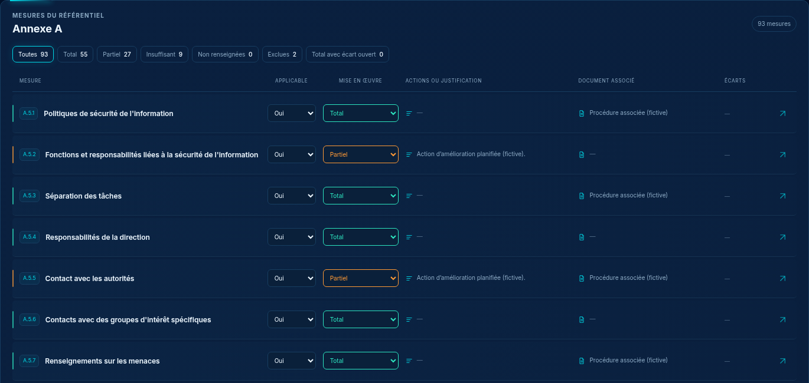

# DdA — mesures en lignes compactes

03/11/2026, Europe/Paris. Session : Codex. Branche `codex/refonte-neon-main` ; référence applicative inchangée `aaac67c`.

**Proposition à valider avant intégration.** Le demandeur préfère une lecture en ligne compte tenu du nombre de mesures et écarte la proposition en cartes. Le registre est désormais présenté en lignes compactes ; la synthèse et la fiche de la nouvelle DdA restent la base. Aucun code applicatif modifié, aucun build ni test applicatif exécuté.

Une mesure occupe une ligne d’au moins 66 px sur ordinateur, avec 4 px d’écart : pastille de code, titre dominant, liseré de niveau turquoise/orange/rouge, contrôles courts d’applicabilité et mise en œuvre, actions ou justification, document, écarts et accès à la fiche. Les colonnes restent alignées, sans quadrillage vertical. Les textes longs agrandissent naturellement la ligne. Sur téléphone, les réglages et justificatifs se répartissent sous le titre, sans ascenseur interne.

[Clair](lignes-light-1440.png) · [Alertes et écarts](alertes-dark-1440.png) · [Alertes claires](alertes-light-1440.png) · [Page sombre](registre-dark-1440.png) · [Page claire](registre-light-1440.png) · [Mobile sombre](lignes-dark-390.png) · [Mobile clair](lignes-light-390.png) · [HTML autonome](index.html).

Dix captures Chromium du seul prototype avec données fictives : deux thèmes, deux largeurs, pages et gros plans, plus deux vues filtrées sur Insuffisant. Les rendus finaux correspondent au HTML autonome. Inter et sa licence SIL OFL sont embarqués. Les manipulations locales de référentiel, filtres, champs et fiche ne sauvegardent aucune donnée et ne chargent pas l’application ou l’API.

Les six informations existantes et les filtres sont conservés. Aucun score ni métrique de niveau n’est ajouté. L’applicabilité ISO obligatoire, l’exclusion, les justifications et la sémantique des écarts sont repris : NC rouge, autres écarts orange. Aucun rose. Les calculs et données de synthèse restent ceux de la proposition précédente.

Après validation, conserver les composants et parcours existants : calculs partagés, droits audit:modifier, enregistrement au fil de l’eau, erreurs et cas vides, liens/documents, extrait req, texte de référence, marqueur Tenacy et champs de fiche. Les contrôles serveur ne sont pas simulés par cette maquette. Aucun fichier de apps/, packages/ ou des tests n’a changé pour ce lot.

**Prochaine action : validation des lignes compactes.** Après accord, intégrer la DdA, effectuer les contrôles pertinents et fournir de nouvelles captures réelles, selon la règle visuel → validation → intégration et tests → nouveau visuel réel.

[Synthèse et fiche de référence](../dda-neon-nouveau/README.md) · [Cartes écartées](../dda-mesures-cartes/README.md).
