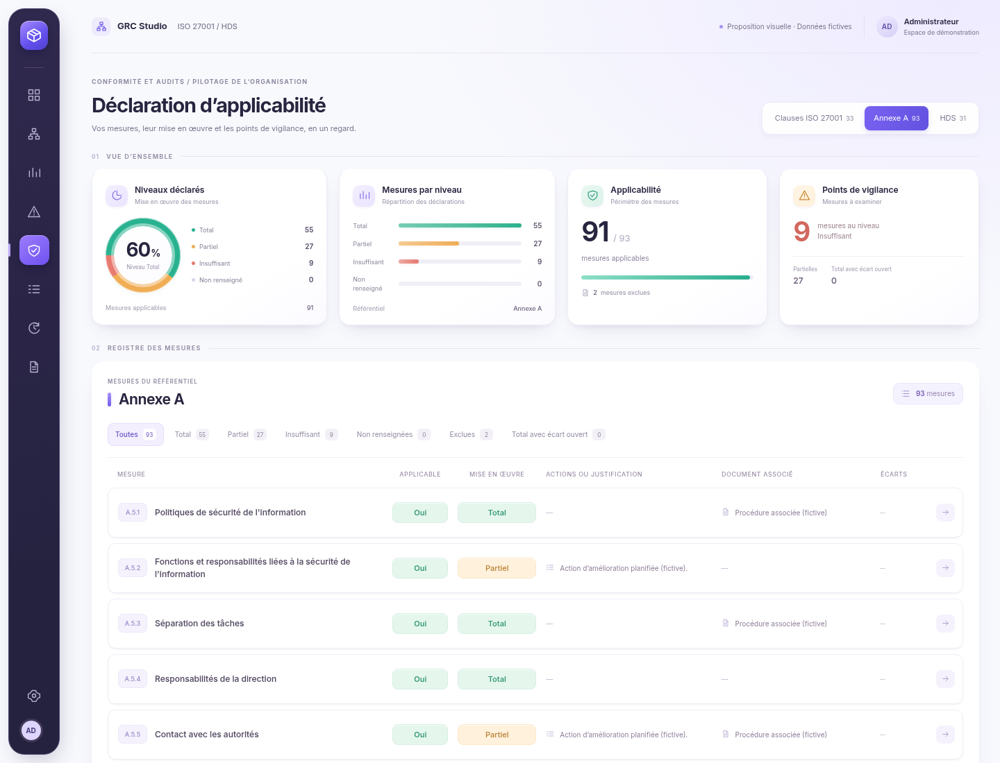

# DdA — nouvelle direction issue des deux images de référence

04/11/2026, Europe/Paris. Session : Codex (01a193c1-316c-7677-831f-2f31592aa052).

Le demandeur écarte les propositions précédentes et demande de repartir de zéro avec ses deux nouvelles images : interface blanche, navigation indigo, cartes en relief, icônes de volume et graphiques menthe/orange. Cette maquette dispose d'un HTML, d'un CSS et d'un JavaScript neufs ; aucun ancien thème n'est importé. Le jeu de démonstration fictif et la police Inter sont réutilisés.

**Nouvelle proposition visuelle à valider avant intégration.** Les pistes précédentes ne constituent pas une validation de cette direction. Aucun fichier applicatif n'a changé ; aucune compilation ni suite de tests applicatifs exécutée pour cette proposition. La DdA intégrée reste au commit `4a1304b`.

## Direction présentée

- Fond blanc légèrement lavande, cartes blanches opaques, ombres de profondeur et angles arrondis.
- Barre latérale indigo, sélection violette, icônes en relief et typographie Inter.
- Quatre dalles de synthèse : niveaux déclarés, répartition, applicabilité et vigilance.
- Mesures conservées en lignes, avec code discret, choix menthe/orange/rouge et accès à la fiche.
- Fiche assortie, regroupements lisibles, repères latéraux et défilement extérieur.

La barre latérale illustre le cadre graphique de référence ; elle ne change ni les rubriques ni les droits de l'application. Les onglets, filtres et champs de la maquette agissent uniquement dans la mémoire de la page. La navigation entre référentiels, les exclusions et les fiches sont représentées. Aucun export, score de certification ou historique d'évolution n'est inventé.

## Visuels

| Vue | Capture |
| --- | --- |
| Vue complète HD | [3840 × 2400](apercu-4k.png) |
| Toutes les mesures | [Registre intégral HD, 93 lignes](registre-integral-hd.png) |
| Mesures | [Détail du registre](mesures-1440.png) |
| Fiche | [Fiche complète HD](fiche-hd.png) · [Fiche dans l'écran](fiche-1440.png) |
| Insuffisances / exclusions | [Insuffisantes](insuffisantes-1440.png) · [Exclues](exclusions-1440.png) |
| Mobile | [Vue d'ensemble](ensemble-390.png) · [Mesures](mesures-390.png) · [Fiche](fiche-390.png) |

[Maquette HTML](index.html) · [Résultat des rendus autonomes](captures.json).

## Rendu et limites

Onze captures directes de Chromium système avec Node 26, sans retouche, police embarquée et mouvement réduit. Fenêtres 1440 × 1100, 1920 × 1200 à densité ×2 et 390 × 1200. Commande privée : `node /workspace/work/neon-instance/dda-nouvelle-direction/rendre.mjs`, code 0.

Le premier chargement par URL locale `file:` a été refusé par la politique du navigateur. Le rendu final charge les mêmes sources locales avec `setContent`, police/CSS/JavaScript incorporés en mémoire. Aucun réseau ni API chargé. Aucune erreur JavaScript détectée. Aucun débordement horizontal de page ou défilement vertical interne dans les dalles et dialogues mesurés ; les fiches longues défilent dans le voile extérieur.

Les données sont identiques au jeu fictif de la précédente maquette : 33 clauses ISO, 93 mesures Annexe A, 31 mesures HDS. Les filtres Insuffisant (9), Exclues (2) et le changement de référentiel ont été vérifiés dans cette page indépendante. Vues d'ensemble, lignes, mobile et fiche HD inspectées. Les vérifications de maquette ne valent pas tests d'intégration, audit d'accessibilité ou recette de l'application.

Après validation explicite : intégrer la direction retenue dans l'application, exécuter les contrôles pertinents et fournir de nouvelles captures réelles, selon la règle du demandeur. Aucune fusion ni aucun déploiement.

## Sources

Les deux images jointes au message du 04/11/2026 servent de références visuelles. Les illustrations ne sont pas copiées dans la maquette. Police Inter embarquée sous [SIL Open Font License](OFL.txt). Les données proviennent du jeu fictif déjà documenté ; aucune donnée réelle ni secret.
