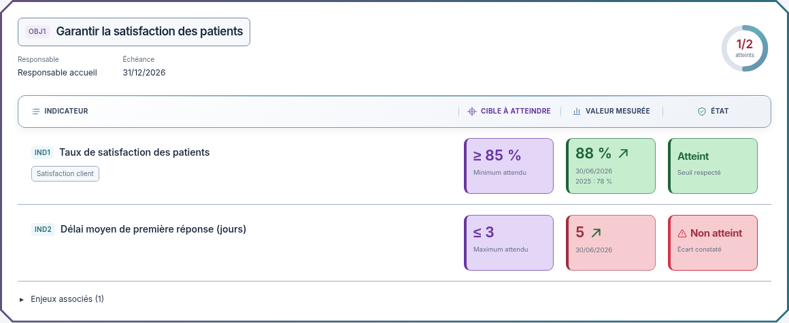

# En-têtes rapprochés du Dashboard de référence

02/11/2026, Europe/Paris. Session : Codex. Référence applicative inchangée : `eaadcf23c412dc9ac3f06003c9d8c34bcf919a6d`.

**Statut : nouvelle proposition indépendante à valider avant intégration de la barre. La version B est déjà intégrée ; son accord n'est pas à redemander. Aucun build ni test applicatif exécuté pour cette proposition.**

Après la proposition Biseau, le demandeur souhaite rester plus proche du Dashboard initial, puis reprendre la DdA une fois ce rendu validé, en limitant le violet.

## Direction retenue pour cette proposition

L'image initiale, les captures du dossier et le HTML GRC Studio fourni ont été relus comme références visuelles. Leurs surfaces arrondies, leur palette bleu nuit/ardoise et leurs accents lumineux discrets guident cette variante. Aucune donnée illustrative, logique ou instruction de ces pièces n'est reprise dans l'application.

- La barre retrouve des coins arrondis et un contour net, avec un fond très légèrement dégradé.
- En sombre, les surfaces `#1c2946` / `#18233e` reprennent celles du HTML Dashboard fourni ; en clair, fond blanc vers gris bleuté.
- Pictogrammes cyan, bleu et turquoise, texte surtout neutre, violet réservé à la cible dans les en-têtes.
- Les séparations deviennent droites et discrètes. Le liseré supérieur et l'ombre sont plus doux.
- Blocs, titres, couleurs renforcées et cadre extérieur Biseau de la version B sont conservés. La nouvelle proposition concerne la barre uniquement.

La vue compacte reprend le même bandeau. Les groupes pictogramme/libellé restent centrés sur les colonnes de données ; Indicateur reste aligné à gauche. Aucun tri ni nouvelle action n'est ajouté. Le mobile conserve les libellés dans les blocs et la hauteur naturelle de la présentation.

[Version sombre](detail-dark-1280.png) · [Gros plan clair](barre-detail-light.png) · [Gros plan sombre](barre-detail-dark.png) · [Vue compacte claire](compact-light-1280.png) · [Vue compacte sombre](compact-dark-1280.png) · [Maquette HTML autonome](index.html).

Douze captures de cette maquette autonome, avec mouvement réduit : deux thèmes, deux vues et deux largeurs 1280/390 px, plus quatre gros plans. Inter et sa licence SIL OFL restent embarqués. Aucune application ni API chargée, aucun fichier de `apps/`, `packages/` ou des tests applicatifs modifié. Aucun build ni test applicatif exécuté pour ce lot.

## Suite demandée

1. Attendre la validation explicite de cette version de la barre.
2. Intégrer la barre validée dans les vues Objectifs/Indicateurs, effectuer les contrôles pertinents et fournir les captures réelles.
3. Enchaîner ensuite sur une maquette de **DdA — Déclaration d'applicabilité**, avec le même thème Dashboard néon et peu de violet. Point d'entrée existant : `apps/web/src/dda/Dda.tsx`. Conserver données, calculs, applicabilité, niveaux, justifications, incohérences, liens, droits et actions existants.
4. Présenter la maquette DdA et attendre sa validation avant modification de cette partie de l'application, conformément à la règle générale du demandeur.

La DdA n'a pas été redessinée ni modifiée dans ce lot ; sa reprise est explicitement conditionnée à la validation du rendu actuel. Ne pas oublier cette demande lors de la prochaine validation et ne pas demander à nouveau si le demandeur souhaite cette reprise.

[Version B intégrée](../../OBJECTIFS-VERSION-B.md) · [Proposition Biseau précédente](../entetes-biseau/README.md).

Règle du demandeur : **visuel → validation explicite → intégration et tests → nouveau visuel réel**.
