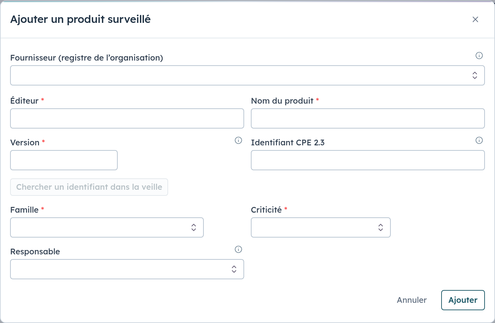

# Fiche plus sobre — piste inspirée des captures Tenacy

22/11/2026, Europe/Paris. Session « Codex » (`01a193c1-316c-7677-831f-2f31592aa052`).

Le RSSI a refusé la variante à fond cyan/bleu/lavande et souhaite trouver un style épuré comme ses références Tenacy.
Cette proposition présente **un seul exemple clair**, pour juger la composition avant d’en multiplier les variantes.
Elle garde Lexend et l’identité du menu de l’application. La direction claire a reçu « Top » du RSSI. L’[intégration native React et CSS](../../integration-fiches-sobres-2026-11-22/README.md)
prend la suite ; les sources de cet aperçu restent historiques.

[Voir la fiche dans l’application, en entier](captures/fiche-epuree-dans-application.png).
Le détail HD est rendu à un rapport de pixels de 2 par le navigateur, sans agrandissement ultérieur.

## Résumé technique des changements

- Surface blanche opaque, séparateurs gris discrets, cadre de rayon 8 px et ombre limitée.
- Titre Lexend de 16 px CSS en graisse 500, libellés de 12 px, valeurs de 13 px, alignements conservés.
- Champs blancs rectangulaires, contour neutre ; focus cyan. L’identité néon demeure dans une fine ligne cyan/violet.
- Explications conservées dans leur DOM et avec leurs identifiants ; une petite commande « i » permet de les ouvrir.
  Le texte s’affiche sous son champ et peut être refermé avec Échap. Aucun champ n’est retiré pour gagner de la place.
- Boutons de validation en contour bleu pétrole, Annuler discret ; erreurs explicitement rouges conservées.
- Exemple mesuré : largeur **736 px CSS**, hauteur **479 px** contre **614 px** dans
  l’essai Maintenance au même viewport, soit **22.0 % de hauteur en moins** pour ce seul formulaire.

## Sources et intégration après validation

[epure.css](epure.css) complète la [proposition Maintenance](../fenetres-maintenance-2026-11-22/fenetres-maintenance.css).
[composition-apercu.js](composition-apercu.js) crée uniquement les commandes contextuelles de l’aperçu, dans le formulaire réel.
Ce script est **un outil de proposition, pas un composant à importer dans le produit**. Aucun changement de fichier de
l’application n’a été effectué pour cette piste. Les valeurs, champs, API, droits et écritures ne sont pas modifiés.

Après validation, réaliser l’aide et le pied de fiche avec React/Mantine et les contrats existants, en conservant valeurs,
formulaire propriétaire, descriptions accessibles et gestion normale des annulations. Éviter un gestionnaire clavier
global et la décoration DOM de l’outil d’aperçu ; réutiliser les jetons communs de thème. Le style sombre et les autres
familles de fiches devront être déclinés et vérifiés ensuite si cette direction est retenue.

## Portée des contrôles

[Preuves, mesures et empreintes](preuves.json) : un cas de page, une fenêtre, données fictives et API interceptée. Ouverture
de l’aide, conservation du texte, fermeture avec Échap sans fermer la fenêtre, puis Annuler vérifiés. Aucun incident
JavaScript final, route imprévue ou mutation métier. Contrôles de syntaxe JavaScript et format CSS/JS effectués.
Le premier problème de gestion d’Échap du prototype est corrigé et tracé ; il n’a pas affecté le produit.
Pas de recette API/base/Docker, de validation du thème sombre ou de validation humaine.

Le [dossier d’intégration général](../../implementation-interface-2026-11-21/README.md) reste le point d’entrée pour la prochaine IA.
