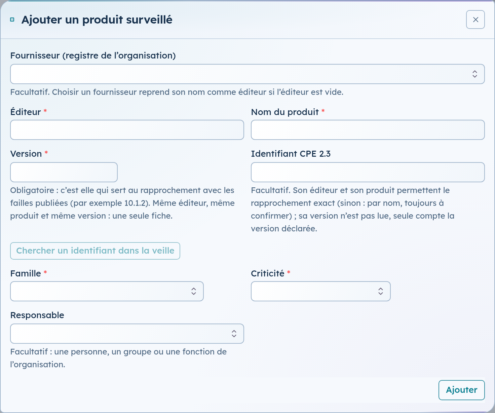
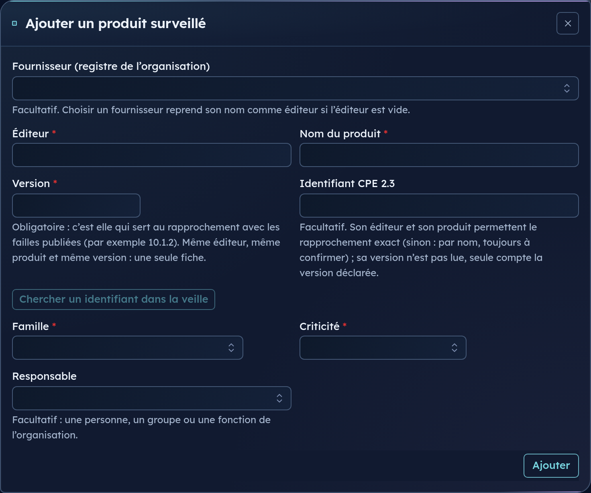

# Fenêtres dans le style de la maintenance — proposition à valider

22/11/2026, Europe/Paris. Session « Codex » (`01a193c1-316c-7677-831f-2f31592aa052`).

Le RSSI demande d’habiller les fenêtres récemment retravaillées dans le style de sa capture « Mise à jour en cours ».
Cette proposition porte sur **7 variantes de fenêtres, chacune en clair et sombre**. Elle n’est pas présentée comme la
recette de toutes les fenêtres de la plateforme. Le menu principal et les pages de fond conservent leur habillage.

## Évolution de la piste claire

La [variante cyan/bleu/lavande du cube central](variante-cube-clair/README.md) a été refusée par le RSSI.
Une [nouvelle fiche sobre inspirée de ses captures Tenacy](../fenetres-epurees-2026-11-22/README.md) est proposée :
un seul exemple clair pour validation de la composition. Les images ci-dessous restent celles de la première proposition.

## Aperçu en détail

Captures d’un vrai formulaire, rendues par le navigateur à un rapport de pixels de 2, sans agrandissement d’image.
Les images complètes de la plateforme sont liées dans la galerie ci-dessous pour apprécier les proportions à l’écran.





## Galerie des sept variantes

Chaque lien ouvre une capture complète de 1920×1080, en densité normale.

| Fenêtre | Clair | Sombre |
| --- | --- | --- |
| Ajouter un risque | [Clair](captures/risques-creation-clair-1920.png) | [Sombre](captures/risques-creation-sombre-1920.png) |
| Fiche de risque | [Clair](captures/risques-fiche-clair-1920.png) | [Sombre](captures/risques-fiche-sombre-1920.png) |
| Liens et preuves du risque | [Clair](captures/risques-liens-clair-1920.png) | [Sombre](captures/risques-liens-sombre-1920.png) |
| Ajouter un fournisseur | [Clair](captures/fournisseurs-creation-clair-1920.png) | [Sombre](captures/fournisseurs-creation-sombre-1920.png) |
| Fiche fournisseur | [Clair](captures/fournisseurs-fiche-clair-1920.png) | [Sombre](captures/fournisseurs-fiche-sombre-1920.png) |
| Évaluer un fournisseur | [Clair](captures/fournisseurs-evaluation-clair-1920.png) | [Sombre](captures/fournisseurs-evaluation-sombre-1920.png) |
| Ajouter un produit | [Clair](captures/produits-creation-clair-1920.png) | [Sombre](captures/produits-creation-sombre-1920.png) |

Les suites des fiches sont aussi disponibles :

- Risque : [clair](captures/risques-fiche-clair-suite-1920.png), [sombre](captures/risques-fiche-sombre-suite-1920.png).
- Fournisseur : [clair](captures/fournisseurs-fiche-clair-suite-1920.png), [sombre](captures/fournisseurs-fiche-sombre-suite-1920.png).

## Exemples compacts à 1280×720

- Risque clair : [Informations](captures/risque-compact-clair-partie-1-1280.png), [partie 2](captures/risque-compact-clair-partie-2-1280.png), [partie 3](captures/risque-compact-clair-partie-3-1280.png).
- Risque sombre : [Informations](captures/risque-compact-sombre-partie-1-1280.png), [partie 2](captures/risque-compact-sombre-partie-2-1280.png), [partie 3](captures/risque-compact-sombre-partie-3-1280.png).
- Produit : [clair](captures/produit-compact-clair-1280.png), [sombre](captures/produit-compact-sombre-1280.png).

## Résumé technique des changements de présentation

- Fond sombre bleu nuit `#111a30`, blanc cassé bleuté `#f6f9fd` en clair ; reflet cyan en haut à gauche, violet discret à droite.
- Cadre asymétrique doux, trait cyan/violet d’un pixel et ombre contenue. Les champs gardent une surface opaque lisible.
- Titres Lexend avec un petit repère carré cyan ; hiérarchie et dimensions du socle conservées.
- Champs et commandes légèrement rectangulaires, contours plus nets, aides contrastées ; erreurs explicitement rouges.
- Navigation interne cyan, commandes en contour transparent ; couleur secondaire pour les commandes discrètes.
- Arrière-plan de la page atténué par un flou de 2 px. Aucun décor de réseau placé sous les données de formulaire.

La [feuille de proposition](fenetres-maintenance.css) est **isolée dans ce dossier**. Elle ne change aucun fichier de
l’application, ne modifie pas les formulaires, la logique, les droits ou les écritures, et n’est pas importée dans `main.tsx`.
Une fois le visuel retenu, reporter ses règles dans le socle commun de `packages/ui` en réutilisant les jetons de thème.
Ne pas ajouter un second mécanisme de style par module. Respecter la CSP et exclure le tiroir de navigation.

Le découpage du prototype précédent reste à finaliser : certains champs peuvent être coupés à la limite d’une partie,
certains intitulés sont génériques et des parties sont peu remplies. Cette proposition vise l’habillage ; elle ne vaut
pas approbation de ces limites. Voir le [guide d’intégration](../../implementation-interface-2026-11-21/INTEGRATION-ET-RECETTE.md).

## Contrôles et reproduction

[Preuves synthétiques, dimensions et empreintes](preuves/recette-visuelle.json) : **12 cas de pages et 24 ouvertures**,
7 variantes représentées. Aucune erreur JavaScript, route imprévue ou mutation métier dans ces campagnes.
Le rendu utilise le frontend compilé `013ad9b`, une API interceptée et des données fictives ; aucun compte réel connecté.
Les tests métier antérieurs ne sont pas attribués à ce nouveau CSS. Aucune recette Docker/API/base ni validation humaine.

L’outil nécessite Python, Playwright et Chromium déjà présents dans l’environnement de recette. Il ajoute le CSS au flux
servi de la recette, sans injection de style dans le produit. Les écritures métier sont refusées.

```bash
python3 outils/capturer.py --base http://127.0.0.1:5179 --stage essai --pages risques,fournisseurs,produits --sizes 1920x1080 --themes clair,sombre --densities normale --fenetres
```

Ce dossier complète le [dossier d’implémentation et son prompt](../../implementation-interface-2026-11-21/README.md).
Il demande une validation graphique avant généralisation, selon la règle donnée par le RSSI.
