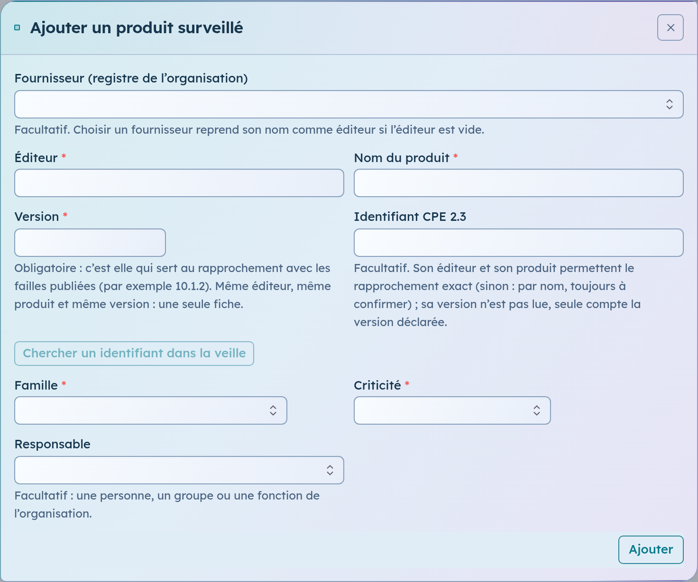

# Variante claire — palette du cube central

22/11/2026, Europe/Paris. Session « Codex » (`01a193c1-316c-7677-831f-2f31592aa052`).

**Variante refusée par le RSSI le 22/11/2026 — ne pas intégrer cette palette.** La demande est interprétée dans la continuité des fenêtres : utiliser leurs surfaces
intérieures pour reprendre en clair les teintes cyan, bleu et violet du cube situé dans le cercle de la maintenance.
La capture de maintenance elle-même n’est pas modifiée. La proposition précédente reste disponible.

[Écran complet, rendu HD](captures/produit-cube-clair-complet-1600.png) ; fiche Risque :
[Informations](captures/risque-cube-clair-informations-1920.png), [Analyse](captures/risque-cube-clair-analyse-1920.png).
La fenêtre Produit reste de 736 px CSS de large ; le détail est rendu par le navigateur à un rapport de pixels de 2,
sans agrandissement ultérieur de l’image.

## Résumé technique des modifications

- Surface intérieure : dégradé cyan clair `#d7edf1` → bleu `#e1edf7` → lavande `#e7e4f5`, plus visible que le premier essai.
- En-tête assorti, avec davantage de cyan à gauche et une pointe de violet à droite.
- Champs plus lumineux, texte bleu profond `#17364e`, aides `#4a6381` ; boutons transparents cyan conservés.
- Le [complément CSS](cube-clair.css) ne cible que `data-mantine-color-scheme='light'` avec l’attribut de proposition.
  Le thème sombre, les dimensions, formulaires, textes, erreurs, droits et comportements restent ceux du socle.

Le CSS s’applique **après** [la proposition précédente](../fenetres-maintenance.css), uniquement dans l’outil de capture.
Il n’est pas importé dans le frontend du produit. Après validation graphique, intégrer la palette dans les jetons communs
plutôt que multiplier les surcharges locales. Ne pas considérer cet essai comme une validation du découpage des fiches.

## Contrôles

[Preuves et empreintes](preuves.json) : deux cas de pages, quatre ouvertures de fenêtres, aucun incident JavaScript,
route imprévue ou mutation métier. Frontend réel, API interceptée, exemples fictifs. Pas de recette serveur ni de nouveau
test métier pour ce changement de palette. Les limites du mini-menu initial restent documentées dans le dossier d’intégration.

Pour reproduire, ajouter `cube-clair.css` au CSS de proposition lu par l’[outil précédent](../outils/capturer.py), après
`fenetres-maintenance.css`, conserver l’attribut de proposition et demander le thème `clair`.

[Retour aux fenêtres clair/sombre](../README.md).

Nouvelle piste : [fiche sobre inspirée des captures Tenacy](../../fenetres-epurees-2026-11-22/README.md), encore à valider.
