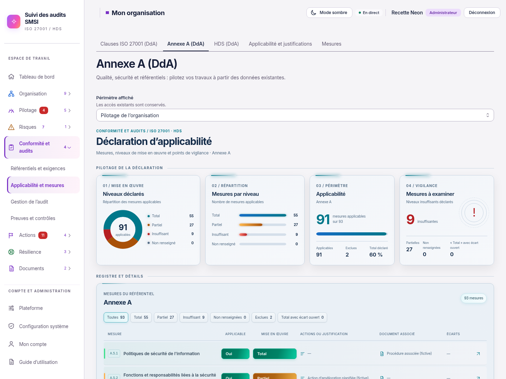
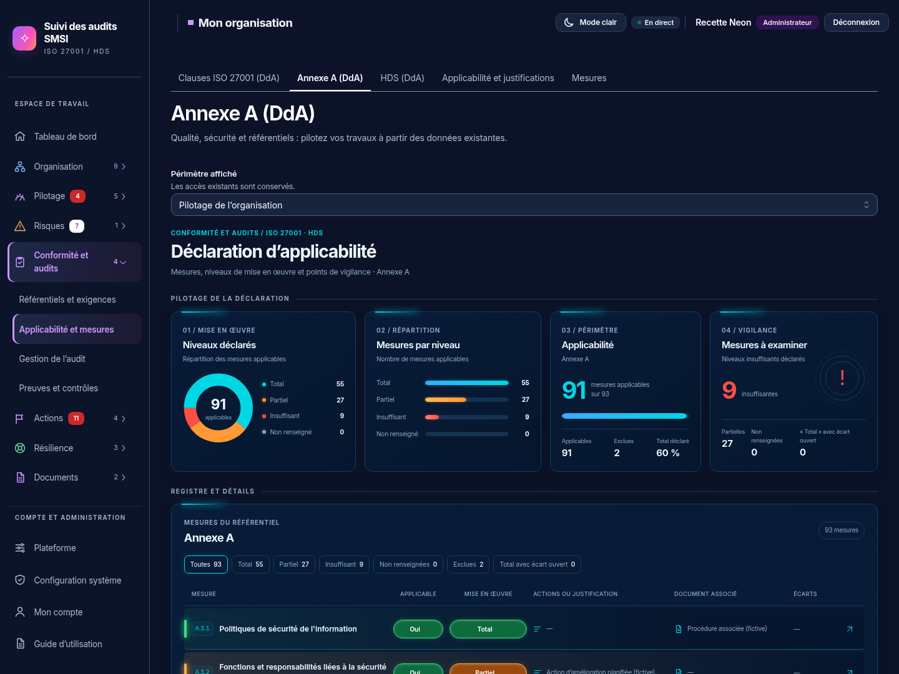

# DdA Neon — intégration validée

03/11/2026, Europe/Paris. Session : Codex (01a193c1-316c-7677-831f-2f31592aa052).
Branche `codex/refonte-neon-main`, copie indépendante de main. Commit applicatif : `4a1304ba80a9bc476fb9a3d3ab504ebb33c06c67`.

**Accord explicite reçu : « je valide, tu peux intégrer ».** La proposition en lignes, les thèmes clair/sombre et la dernière réduction de lueur sont intégrés. Aucune nouvelle validation préalable n'est en attente pour ce lot. Les captures proviennent de l'application compilée, avec son API et un jeu de démonstration fictif.

## Résultat

Les trois DdA (clauses ISO, Annexe A, HDS) partagent les quatre dalles de synthèse et le registre en lignes. Le clair reprend les surfaces gris bleuté et les dégradés horizontaux turquoise/orange approuvés ; le sombre utilise le bleu nuit et les accents vert/orange/rouge. Les barres conservent la lueur réduite. Applicable Oui est vert, Non rouge ; Mise en œuvre reprend la couleur du niveau.

Les menus s'ouvrent au clic ou au clavier, sans chevron. L'effacement reste disponible. Les filtres affichent leurs comptes et la fiche regroupe déclaration, documents, revue et repères. Son cadre Biseau est conservé. Les longues pages et fiches utilisent le défilement extérieur : aucun ascenseur vertical interne détecté dans les dalles et dialogues contrôlés. Le tableau peut défiler horizontalement à largeur intermédiaire ; les lignes se réorganisent sur mobile.

Calculs `statsDda`, règles d'applicabilité, filtres métier, API, sauvegardes, permissions et données inchangés. Les clauses ISO gardent leur caractère obligatoire. Documents multilignes, lien, texte de référence, risques, actions, justification, commentaire, écarts et mention Tenacy restent disponibles. Aucune dépendance, migration ou modification serveur ajoutée.

## Captures réelles

| Thème | Application HD | Registre intégral HD | Fiche HD |
| --- | --- | --- | --- |
| Clair | [Vue complète de l'écran](https://raw.githubusercontent.com/yousername-ha/suivi-audits/55d43eebbc77fa2e367037b246e5396ced79abc8/docs/refonte-neon/captures-dda/application-light-hd.png) | [93 mesures](https://raw.githubusercontent.com/yousername-ha/suivi-audits/55d43eebbc77fa2e367037b246e5396ced79abc8/docs/refonte-neon/captures-dda/dda-light-integrale-hd.png) | [Fiche complète](https://raw.githubusercontent.com/yousername-ha/suivi-audits/55d43eebbc77fa2e367037b246e5396ced79abc8/docs/refonte-neon/captures-dda/fiche-light-hd.png) |
| Sombre | [Vue complète de l'écran](https://raw.githubusercontent.com/yousername-ha/suivi-audits/55d43eebbc77fa2e367037b246e5396ced79abc8/docs/refonte-neon/captures-dda/application-dark-hd.png) | [93 mesures](https://raw.githubusercontent.com/yousername-ha/suivi-audits/55d43eebbc77fa2e367037b246e5396ced79abc8/docs/refonte-neon/captures-dda/dda-dark-integrale-hd.png) | [Fiche complète](https://raw.githubusercontent.com/yousername-ha/suivi-audits/55d43eebbc77fa2e367037b246e5396ced79abc8/docs/refonte-neon/captures-dda/fiche-dark-hd.png) |

[Lignes claires](https://raw.githubusercontent.com/yousername-ha/suivi-audits/55d43eebbc77fa2e367037b246e5396ced79abc8/docs/refonte-neon/captures-dda/mesures-light-1440.png) · [Lignes sombres](https://raw.githubusercontent.com/yousername-ha/suivi-audits/55d43eebbc77fa2e367037b246e5396ced79abc8/docs/refonte-neon/captures-dda/mesures-dark-1440.png) · [Mobile clair](https://raw.githubusercontent.com/yousername-ha/suivi-audits/55d43eebbc77fa2e367037b246e5396ced79abc8/docs/refonte-neon/captures-dda/mesures-light-390.png) · [Mobile sombre](https://raw.githubusercontent.com/yousername-ha/suivi-audits/55d43eebbc77fa2e367037b246e5396ced79abc8/docs/refonte-neon/captures-dda/mesures-dark-390.png) · [Fiche mobile claire](https://raw.githubusercontent.com/yousername-ha/suivi-audits/55d43eebbc77fa2e367037b246e5396ced79abc8/docs/refonte-neon/captures-dda/fiche-light-390.png) · [Fiche mobile sombre](https://raw.githubusercontent.com/yousername-ha/suivi-audits/55d43eebbc77fa2e367037b246e5396ced79abc8/docs/refonte-neon/captures-dda/fiche-dark-390.png).

Captures HD : fenêtre de 1920 × 1440, densité ×2, vues intégrales contenant toutes les mesures. Captures Chromium directes sans retouche, polices chargées, mouvement réduit. [Dimensions et résultats anonymisés](captures-dda/validation.json).

## Contrôles exécutés

Node 26.13.0, Chromium système, Vite preview, API réelle et PostgreSQL 18 isolés. La dernière correction CSS a été recompilée puis contrôlée dans la collecte finale.

| Contrôle | Résultat |
| --- | --- |
| TypeScript web, ESLint des fichiers TS/TSX modifiés, Prettier et `git diff --check` | Codes 0 |
| Suite web | 230 tests réussis dans 30 fichiers, dont les trois contrôles de charte graphique |
| Tests partagés DdA existants | 6 tests réussis : statistiques, filtres, cohérence, liens et schéma |
| E2E DdA/clausier existant | Réussi ; seuls les deux sélecteurs de filtres ont été précisés, assertions conservées |
| Nouvel E2E DdA Neon | Réussi : choix au clavier, filtres, effacement, documents, persistance, erreur de sauvegarde visible, clauses ISO et référentiel vide |
| Lecture seule réelle | Champs désactivés, filtres utilisables, fiche consultable, écriture API refusée avec 403 |
| Dimensions et affichage | 24 vues : trois référentiels et fiche, clair/sombre, 1440/1024/390 px ; aucun débordement horizontal de page ni ascenseur vertical interne détecté |
| Axe sur huit vues | Aucune violation WCAG 2 A/AA et 2.1 AA détectée dans les registres et fiches, clair/sombre, 1440/390 px |
| Collecte finale | Aucune erreur JavaScript, violation CSP stricte ou écriture DdA pendant les captures ; six captures HD produites |
| Compilation web finale | Code 0 ; avertissements existants sur `/update/client.js` et la taille des chunks |

Commandes avec Node 26 : `node_modules/typescript/bin/tsc -p apps/web/tsconfig.json --noEmit` ; `node_modules/eslint/bin/eslint.js` sur les composants DdA et les deux scénarios modifiés ; `node_modules/prettier/bin/prettier.cjs --check` sur les sources modifiées ; Vitest `run` depuis `apps/web`, puis `run test/suivi-dda.test.ts` depuis `packages/shared` ; `apps/web/node_modules/vite/bin/vite.js build apps/web`. Les deux scénarios Playwright ont été exécutés avec la configuration isolée `playwright-dda.config.mjs`, sans rejeu automatique. Les contrôles privés `dda-lecteur.mjs` et `dda-visuel.mjs` conservent leurs rapports hors Git ; le résumé public ne contient aucun secret.

Les essais intermédiaires ont signalé un contraste cyan légèrement insuffisant, des fonds hérités de la première colonne et une superposition masquant l'accès fiche sur mobile. Ces styles ont été corrigés ; la collecte finale complète passe sans assouplir les assertions. Le nouveau scénario a également nécessité une synchronisation du choix clavier et une restauration de ses seules données métier au-dessus de l'état courant, pour préserver les révisions techniques. Les données de démonstration ont été restaurées et les deux écarts fictifs créés par le scénario existant archivés dans l'instance isolée.

Non exécutés pour ce lot : suite API complète, suite UI complète, E2E exhaustifs, Docker Desktop Windows, recette de production et audit manuel par lecteur d'écran. Les contrôles Axe ne constituent pas une attestation d'accessibilité exhaustive. Aucun lancement manuel de CI, fusion, déploiement ou publication d'image Docker.

## Reprise et essai utilisateur

Prochaine étape : essai de cette branche sur l'instance locale du demandeur. Le ZIP de `codex/refonte-neon-main` contient l'intégration. Aucune migration n'est nécessaire pour cette refonte graphique.

[Maquette approuvée](propositions/dda-mesures-lignes/README.md) · [État général de la refonte](README.md).
