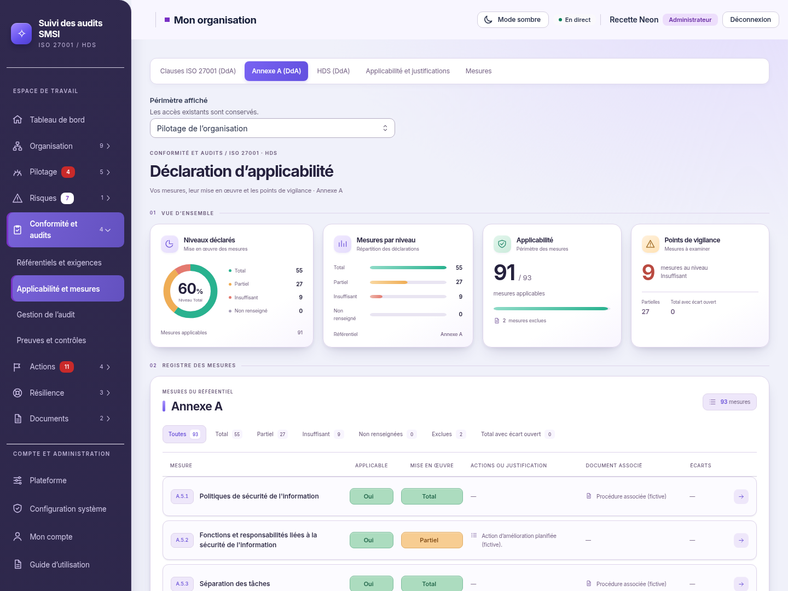

# DdA Studio — direction validée et intégrée

04/11/2026, Europe/Paris. Session : Codex (01a193c1-316c-7677-831f-2f31592aa052).
Branche `codex/refonte-neon-main`, commit applicatif `008cc3039ff79b9ed2d3c85860ed087dfbf05c3d`.

**Accord explicite : « Je valide pour intégration ».** La nouvelle composition issue des deux références et ses champs Applicable/Mise en œuvre renforcés sont intégrés. Les calculs partagés, données, sauvegardes et droits sont conservés. Aucune nouvelle validation préalable n'est attendue pour l'intégration de ce lot.

## Résultat

La DdA utilise les cartes en relief, les icônes assorties, le fond lavande clair et les champs vert/orange/rouge validés. Les quatre dalles affichent les statistiques existantes : pourcentage au niveau Total, répartition, applicabilité et vigilance. Le pourcentage provient de `statsDda` ; aucun score de certification ou historique n'est créé.

Les trois référentiels, le sélecteur de périmètre, les menus dépliables et les autres rubriques de navigation sont conservés. Le menu existant reçoit l'habillage indigo sur les pages DdA claires ; la maquette à rail compact n'a pas remplacé ses destinations. Le titre en double est masqué sur ces trois pages, le titre principal accessible reste dans la DdA. Le sombre garde ses surfaces bleu nuit, avec la même structure de données.

La fiche reprend les regroupements et le relief validés. Tous les champs d'origine, le texte de référence, les liens, commentaires, risques, justifications, actions, erreurs, écarts et marqueurs Tenacy restent disponibles. Les menus sans chevron conservent le choix au clavier et l'effacement. Les clauses ISO gardent leurs restrictions. Les fiches longues défilent dans le voile extérieur ; aucun ascenseur vertical interne détecté dans l'échantillon contrôlé.

Quatre sources modifiées : `apps/web/src/dda/Dda.tsx`, `DdaSynthese.tsx`, nouveau `DdaIcone.tsx` et `packages/ui/src/neon-dda.css`. Aucun changement dans l'API, les migrations, les schémas, les dépendances ou les tests existants.

## Captures réelles

| Vue | Clair | Sombre |
| --- | --- | --- |
| Application HD | [3840 × 2880](captures-dda-studio/application-light-hd.png) | [3840 × 2880](captures-dda-studio/application-dark-hd.png) |
| Registre intégral | [93 mesures](captures-dda-studio/dda-light-integrale-hd.png) | [93 mesures](captures-dda-studio/dda-dark-integrale-hd.png) |
| Fiche HD | [Fiche complète](captures-dda-studio/fiche-light-hd.png) | [Fiche complète](captures-dda-studio/fiche-dark-hd.png) |
| Lignes | [Ordinateur](captures-dda-studio/mesures-light-1440.png) · [Mobile](captures-dda-studio/mesures-light-390.png) | [Ordinateur](captures-dda-studio/mesures-dark-1440.png) · [Mobile](captures-dda-studio/mesures-dark-390.png) |
| Fiche mobile | [Clair](captures-dda-studio/fiche-light-390.png) | [Sombre](captures-dda-studio/fiche-dark-390.png) |

Captures directes du code compilé, API et PostgreSQL isolés, jeu de démonstration fictif, sans retouche. Polices chargées, mouvement réduit. [Dimensions et résultats anonymisés](captures-dda-studio/validation.json).

## Contrôles exécutés

Node 26.13.0, Chromium système, PostgreSQL 18 isolé et Vite preview. Aucun service de production utilisé.

| Vérification | Résultat |
| --- | --- |
| TypeScript web, ESLint des composants DdA, Prettier et `git diff --check` | Codes 0 |
| Suite web | 230 tests réussis, dont les trois contrôles de charte graphique |
| Tests partagés DdA | 6 tests réussis |
| E2E `dda-neon.spec.ts` existant | Réussi, sans rejeu : filtres, choix au clavier, effacement, documents et lien, persistance, erreur de sauvegarde, clauses ISO et référentiel vide |
| Lecture seule réelle | Champs et fiche désactivés, filtres utilisables, tentative d'écriture API refusée avec 403 |
| Collecte finale | 24 vues, trois référentiels et fiche, clair/sombre, 1440/1024/390 px ; six captures HD supplémentaires |
| Dimensions | Aucun débordement horizontal de page ni ascenseur vertical interne détecté dans les dalles et dialogues contrôlés |
| Axe ciblé | Huit analyses WCAG 2 A/AA et 2.1 AA : aucune violation détectée dans cet échantillon |
| Console et CSP stricte | Aucune erreur JavaScript ni violation CSP, aucune écriture DdA pendant les captures |
| Compilation finale | Code 0 ; avertissements existants sur `/update/client.js` et la taille des chunks |

Les textes orange/rouge et les petits repères ont dû être légèrement foncés après le premier contrôle de contraste (3,73 à 4,16 au lieu des 4,5 requis). Les fonds approuvés ont été conservés. Des styles hérités dans le fond de page et les pictogrammes du menu ont également été corrigés. La compilation et la collecte finale complète ont ensuite réussi sans assouplir les assertions. Le rapport initial reste privé hors Git ; seules les captures finales sont publiables.

Commandes : `node_modules/typescript/bin/tsc -p apps/web/tsconfig.json --noEmit` ; ESLint et Prettier sur les trois composants DdA et le CSS de l'UI ; Vitest `run` depuis `apps/web` et `run test/suivi-dda.test.ts` depuis `packages/shared` ; Vite `build apps/web`. Playwright : `test dda-neon.spec.ts --config=/workspace/work/neon-instance/playwright-dda.config.mjs`. Contrôles privés `dda-lecteur.mjs` et `dda-studio/visuel.mjs`, rapports conservés hors Git.

Non exécutés pour ce lot : scénario clausier/fournisseurs, suites complètes API/UI et E2E, Docker Desktop Windows, recette serveur de production et audit manuel par lecteur d'écran. Les résultats historiques ne sont pas attribués à ce commit ; les analyses Axe ne constituent pas une attestation exhaustive.

## Livraison locale

Un ZIP local `maj-dda-studio.zip` contient uniquement les quatre sources modifiées, un guide PowerShell pour la copie de test Docker Desktop déjà utilisée et un manifeste SHA-256. L'archive est vérifiée contre les sources commitées ; elle n'embarque ni configuration ni données ni secret. Aucune migration nécessaire. Les commandes utilisent le projet Compose existant `neon-refonte-test` et le fichier `docker-compose.dev.yml`.

**La publication GitHub reste en attente.** L'accord reçu valide l'intégration graphique. L'envoi vers le dépôt public avait été refusé par le contrôle automatique, qui demande une autorisation explicite de publication ; aucun nouvel essai ni contournement effectué. Aucune fusion, publication d'image Docker ou mise en production.

[Maquette validée](propositions/dda-nouvelle-direction/README.md) · [Précédente intégration, historique](DDA-INTEGREE.md).
