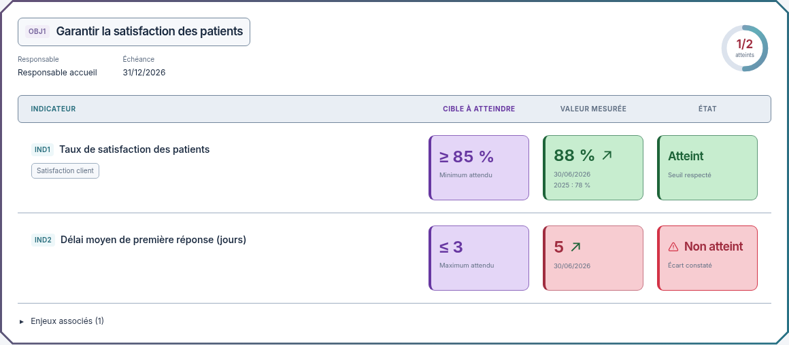

# Blocs mieux proportionnés aux intitulés

02/11/2026, Europe/Paris. Session : Codex. Référence applicative inchangée : `03b6640af352ce0e7a31754b97c5301d58fd551c`.

**Statut actualisé : proposition historique, suivie du choix explicite de la version B. [Version B intégrée et contrôlée](../../OBJECTIFS-VERSION-B.md), dimensions et fonds renforcés inclus.**

Le demandeur trouve les carrés trop imposants par rapport aux intitulés d'objectifs. Cette version réduit leur surface et la taille des chiffres, sans réduire les titres des objectifs ni les noms des indicateurs.

| Élément de la maquette | Proposition précédente | Nouvelle proposition |
| --- | --- | --- |
| Blocs détaillés sur ordinateur | 186 × 130 px minimum | 148 × 96 px minimum |
| Chiffres des blocs détaillés | 30 px | 24 px |
| Texte de l'état sur ordinateur | 21 px | 17 px |
| Hauteur minimale sur mobile | 130 px | 110 px |
| Chiffres sur mobile | 22 px | 20 px |
| Hauteur des blocs de la vue compacte | 42 px | 36 px |
| Hauteur compacte sur mobile | 60 px | 52 px |

Les espaces entre blocs et les marges verticales des lignes sont également réduits. L'espace gagné en largeur revient aux intitulés. Les cibles, valeurs, dates, historiques et états restent affichés ; les blocs gardent une hauteur naturelle si un contenu le nécessite.

Les fonds violet/vert/rouge plus soutenus de la proposition précédente sont repris dans cette maquette. Les trois en-têtes restent centrés ; contours renforcés, cadre Biseau, triangle warning et animations sont conservés. Les exemples restent fictifs, aucune valeur de la maquette n'est recopiée dans le produit.

[Vue détaillée sombre](https://raw.githubusercontent.com/yousername-ha/suivi-audits/55d43eebbc77fa2e367037b246e5396ced79abc8/docs/refonte-neon/propositions/blocs-proportionnes/dalle-dark-1280.png) · [Vue compacte claire](https://raw.githubusercontent.com/yousername-ha/suivi-audits/55d43eebbc77fa2e367037b246e5396ced79abc8/docs/refonte-neon/propositions/blocs-proportionnes/compact-light-1280.png) · [Vue compacte sombre](https://raw.githubusercontent.com/yousername-ha/suivi-audits/55d43eebbc77fa2e367037b246e5396ced79abc8/docs/refonte-neon/propositions/blocs-proportionnes/compact-dark-1280.png) · [Mobile clair](https://raw.githubusercontent.com/yousername-ha/suivi-audits/55d43eebbc77fa2e367037b246e5396ced79abc8/docs/refonte-neon/propositions/blocs-proportionnes/dalle-light-390.png) · [Mobile sombre](https://raw.githubusercontent.com/yousername-ha/suivi-audits/55d43eebbc77fa2e367037b246e5396ced79abc8/docs/refonte-neon/propositions/blocs-proportionnes/dalle-dark-390.png) · [Maquette HTML autonome](index.html).

Les images rendent uniquement la maquette indépendante, dans les deux thèmes et aux largeurs 1280/390 px, avec mouvement réduit pour des captures fixes. Les captures de dalles montrent directement le rapport entre intitulés et blocs. Inter et sa licence SIL OFL restent embarqués. Aucune application ni API n'a été chargée, aucun test applicatif ni build exécuté pour ce lot. Seuls la documentation et les supports de proposition évoluent ; sources applicatives inchangées depuis `03b6640`.

**Version B intégrée et vérifiée ; ces maquettes sont conservées comme historique.**

[Proposition précédente : fonds plus soutenus](../couleurs-soutenues/README.md). Règle du demandeur : **visuel → validation explicite → intégration et tests → nouveau visuel réel**.
