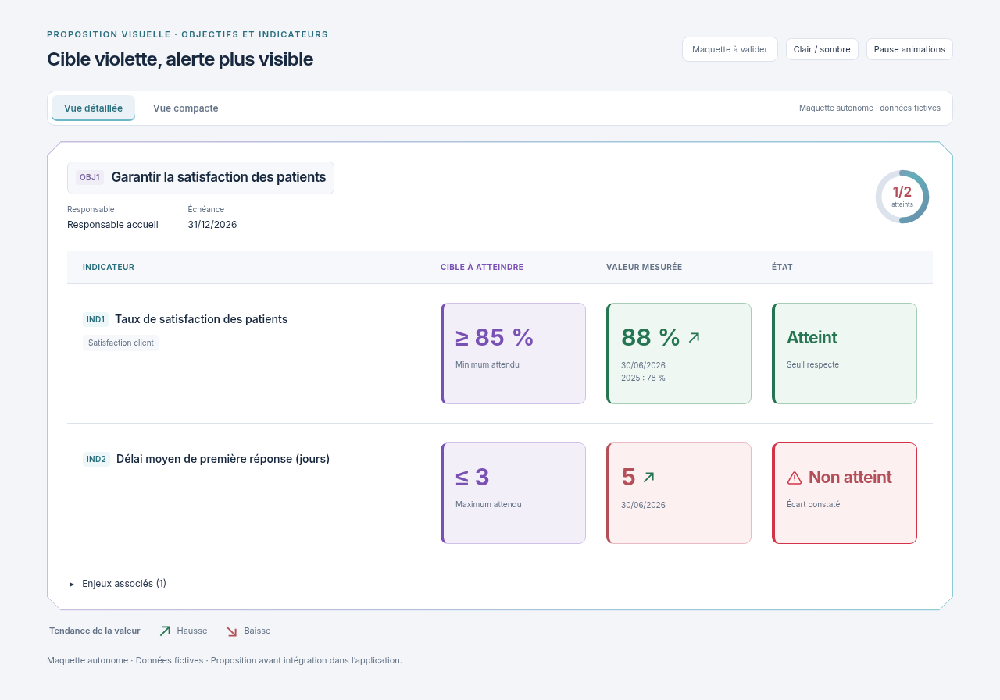

# Cible violette, colonnes restaurées et alerte renforcée

01/11/2026, Europe/Paris. Session : Codex. Référence applicative inchangée : `34921129f6117b8093e3d63216f827c76abbec4c`.

**Statut : maquette indépendante en attente de validation explicite. Aucune intégration, aucun build et aucun test applicatif exécuté pour cette proposition.**

Le demandeur souhaite conserver la palette atténuée, remettre la cible en violet, rétablir les noms des colonnes au-dessus et accentuer l'alerte Non atteint avec une petite icône warning.

- **Cible à atteindre** : intitulé, valeur, fond et bordure violets, dans les deux vues et les deux thèmes. Titres neutres, repères cyan et états vert/rouge restent dans la palette atténuée.
- **Vue détaillée** : noms des quatre colonnes restaurés au-dessus des données, alignés sur les mêmes colonnes. Les intitulés internes répétés sont masqués sur ordinateur ; sur mobile les libellés restent dans chaque encadré, pour conserver une lecture explicite.
- **Non atteint** : contour rouge plus vif, halo extérieur qui s'intensifie puis s'atténue en 2,6 secondes et petite icône triangulaire avec point d'exclamation. L'icône pulse légèrement ; le texte reste stable. Le même signal apparaît en vue compacte. Le triangle remplace le point animé de la version précédente.
- Les flèches de tendance, leur animation, les dimensions uniformes, la hauteur naturelle des dalles et le cadre Biseau sont conservés. Aucun ascenseur interne ajouté.
- Commande Pause / Lire et préférence système de mouvement réduit conservées. Sans mouvement, le contour rouge et le triangle restent visibles.

[Voir le halo rouge en mouvement — GIF](https://raw.githubusercontent.com/yousername-ha/suivi-audits/55d43eebbc77fa2e367037b246e5396ced79abc8/docs/refonte-neon/propositions/cible-violette-alerte/animations.gif) · [Vidéo MP4 de 12 secondes](https://raw.githubusercontent.com/yousername-ha/suivi-audits/55d43eebbc77fa2e367037b246e5396ced79abc8/docs/refonte-neon/propositions/cible-violette-alerte/animations.mp4) · [Maquette HTML autonome](index.html).

| Vue | Clair | Sombre | Mobile clair | Mobile sombre |
| --- | --- | --- | --- | --- |
| Détaillée | [1280 px](https://raw.githubusercontent.com/yousername-ha/suivi-audits/55d43eebbc77fa2e367037b246e5396ced79abc8/docs/refonte-neon/propositions/cible-violette-alerte/detail-light-1280.png) | [1280 px](https://raw.githubusercontent.com/yousername-ha/suivi-audits/55d43eebbc77fa2e367037b246e5396ced79abc8/docs/refonte-neon/propositions/cible-violette-alerte/detail-dark-1280.png) | [390 px](https://raw.githubusercontent.com/yousername-ha/suivi-audits/55d43eebbc77fa2e367037b246e5396ced79abc8/docs/refonte-neon/propositions/cible-violette-alerte/detail-light-390.png) | [390 px](https://raw.githubusercontent.com/yousername-ha/suivi-audits/55d43eebbc77fa2e367037b246e5396ced79abc8/docs/refonte-neon/propositions/cible-violette-alerte/detail-dark-390.png) |
| Compacte | [1280 px](https://raw.githubusercontent.com/yousername-ha/suivi-audits/55d43eebbc77fa2e367037b246e5396ced79abc8/docs/refonte-neon/propositions/cible-violette-alerte/compact-light-1280.png) | [1280 px](https://raw.githubusercontent.com/yousername-ha/suivi-audits/55d43eebbc77fa2e367037b246e5396ced79abc8/docs/refonte-neon/propositions/cible-violette-alerte/compact-dark-1280.png) | [390 px](https://raw.githubusercontent.com/yousername-ha/suivi-audits/55d43eebbc77fa2e367037b246e5396ced79abc8/docs/refonte-neon/propositions/cible-violette-alerte/compact-light-390.png) | [390 px](https://raw.githubusercontent.com/yousername-ha/suivi-audits/55d43eebbc77fa2e367037b246e5396ced79abc8/docs/refonte-neon/propositions/cible-violette-alerte/compact-dark-390.png) |

Les données fictives restent identiques. Les captures sont uniquement des rendus de cette maquette autonome, avec Inter et sa licence SIL OFL embarqués. Aucune application ni API n'a été chargée. Les PNG utilisent le mouvement réduit ; vidéo et GIF montrent les véritables images clés CSS à 10 images/seconde et à vitesse normale, six secondes par vue. Leur halo n'est donc visible en mouvement que dans le GIF, la vidéo ou le HTML.

Seuls la documentation et les supports de proposition changent ; aucun fichier de `apps/`, `packages/` ou des tests applicatifs n'est modifié.

**Prochaine action : attendre la validation explicite de cette proposition, puis intégrer dans la copie Codex, effectuer les contrôles pertinents et fournir les nouveaux visuels réels.**

[Palette précédente](../palette-equilibree/README.md), conservée pour référence. Règle du demandeur : **visuel → validation explicite → intégration et tests → nouveau visuel réel**.
