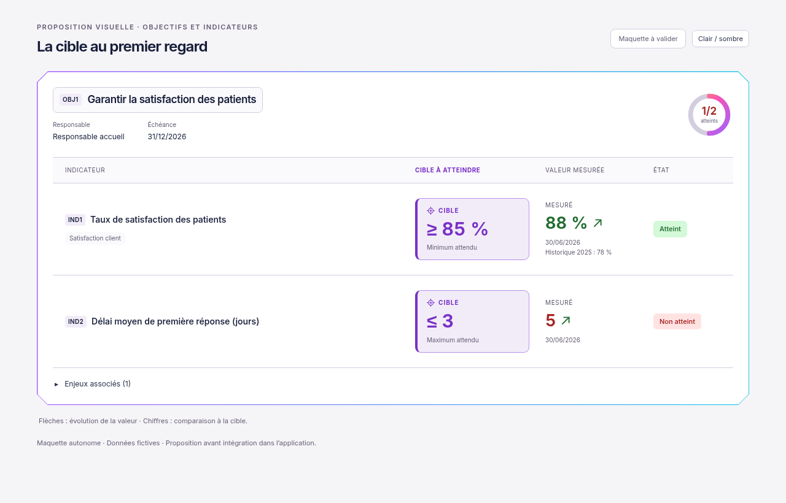

# Cible mise en évidence — proposition visuelle

01/11/2026, Europe/Paris. Session : Codex. Référence applicative : `34921129f6117b8093e3d63216f827c76abbec4c`.

**Statut : proposition à valider par le demandeur. Aucune intégration applicative réalisée.**

Le seuil cible devient un encadré contrasté : libellé Cible, valeur et signe (`≥`, `≤`) agrandis, précision « Minimum attendu » ou « Maximum attendu ». La cible se place à côté de la valeur mesurée, aussi sur mobile. Le cadre Biseau et les couleurs de mesure/tendance sont conservés. Les chiffres illustratifs sont ceux de données fictives : 88 % face à ≥ 85 %, et 5 face à ≤ 3 jours.

## Visuels

[Version sombre](https://raw.githubusercontent.com/yousername-ha/suivi-audits/55d43eebbc77fa2e367037b246e5396ced79abc8/docs/refonte-neon/propositions/cible-visible/proposition-dark-1280.png) · [Mobile sombre](https://raw.githubusercontent.com/yousername-ha/suivi-audits/55d43eebbc77fa2e367037b246e5396ced79abc8/docs/refonte-neon/propositions/cible-visible/proposition-dark-390.png) · [Maquette HTML autonome](index.html).

Il s’agit du rendu navigateur d’un fichier HTML indépendant, sans connexion à l’application ni appel API. Ce ne sont pas des captures d’une nouvelle version intégrée. Le fichier HTML embarque la police Inter et sa licence SIL OFL ; il peut être téléchargé et ouvert localement, sans serveur. Le bouton Clair / sombre sert uniquement à parcourir la proposition.

## Nouvelle règle de travail

Sur instruction explicite du demandeur : **visuel de proposition → validation explicite → modifications de l’application et tests → nouveau visuel réel de l’application**. La règle est consignée dans [AGENTS.md](../../../../AGENTS.md#refonte-neon-codex--validation-visuelle-préalable).

Pour cette étape, seules la maquette et la documentation ont été préparées. Aucun fichier de `apps/` ou `packages/` modifié ; aucun build, test applicatif ou contrôle métier exécuté. Les données, calculs, fonctionnalités et droits existants restent hors de cette proposition graphique.

**Prochaine action : attendre la validation visuelle du demandeur avant toute intégration ou recette applicative.** Après validation, reprendre cet encadré dans les vues concernées sans inventer de cible si elle est absente, exécuter les contrôles adaptés puis fournir de nouvelles captures du produit réel.
