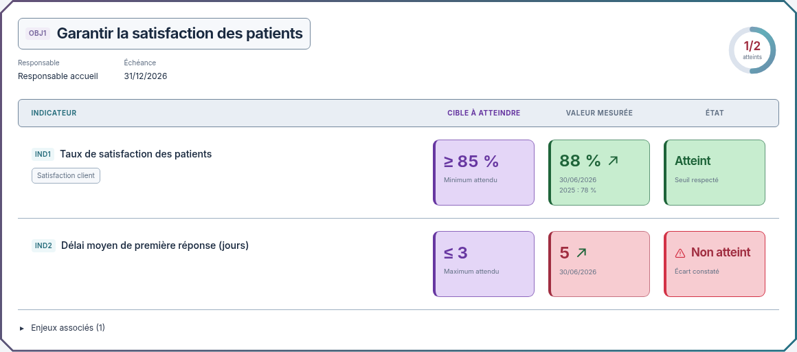
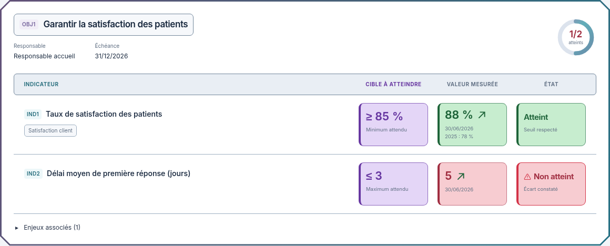

# Comparatif : titres agrandis ou blocs encore réduits

02/11/2026, Europe/Paris. Session : Codex. Référence applicative inchangée : `03b6640af352ce0e7a31754b97c5301d58fd551c`.

**Statut actualisé : version B explicitement choisie et intégrée, variante A non retenue. [Captures réelles et contrôles](../../OBJECTIFS-VERSION-B.md). Les visuels ci-dessous restent les maquettes historiques.**

Le demandeur souhaite deux versions distinctes : agrandir les titres des objectifs, ou réduire encore les blocs sans changer la taille des titres. La base commune est la dernière maquette avec fonds violet/vert/rouge plus soutenus et blocs déjà réduits.

| Élément | Variante A : titres agrandis | Variante B : blocs encore réduits |
| --- | --- | --- |
| Titre d'objectif sur ordinateur | 22 px au lieu de 17 | 17 px, inchangé |
| Blocs détaillés sur ordinateur | 148 × 96 px minimum, comme la dernière maquette | 132 × 82 px minimum |
| Chiffres des blocs sur ordinateur | 24 px, inchangés | 21 px |
| Titre d'objectif sur mobile | 17 px au lieu de 14 | 14 px, inchangé |
| Hauteur minimale des blocs mobiles | 110 px, inchangée | 96 px |
| Titre d'objectif dans la vue compacte | 16 px au lieu de 13 | 13 px, inchangé |
| Hauteur des encadrés compacts sur ordinateur | 36 px, inchangée | 32 px |

Les noms des indicateurs et les en-têtes des colonnes gardent leur taille dans les deux variantes. Les champs, libellés, sources, historiques et exemples fictifs sont identiques. Les hauteurs peuvent s'adapter aux contenus longs. Contours renforcés, en-têtes centrés, fonds plus soutenus, triangle warning, halo rouge et flèches animées restent communs.

## A — Titres des objectifs agrandis

[Sombre](https://raw.githubusercontent.com/yousername-ha/suivi-audits/55d43eebbc77fa2e367037b246e5396ced79abc8/docs/refonte-neon/propositions/comparatif-titres-blocs/a-detail-dark-1280.png) · [Mobile clair](https://raw.githubusercontent.com/yousername-ha/suivi-audits/55d43eebbc77fa2e367037b246e5396ced79abc8/docs/refonte-neon/propositions/comparatif-titres-blocs/a-detail-light-390.png) · [Mobile sombre](https://raw.githubusercontent.com/yousername-ha/suivi-audits/55d43eebbc77fa2e367037b246e5396ced79abc8/docs/refonte-neon/propositions/comparatif-titres-blocs/a-detail-dark-390.png) · [Vue compacte claire](https://raw.githubusercontent.com/yousername-ha/suivi-audits/55d43eebbc77fa2e367037b246e5396ced79abc8/docs/refonte-neon/propositions/comparatif-titres-blocs/a-compact-light-1280.png) · [Vue compacte sombre](https://raw.githubusercontent.com/yousername-ha/suivi-audits/55d43eebbc77fa2e367037b246e5396ced79abc8/docs/refonte-neon/propositions/comparatif-titres-blocs/a-compact-dark-1280.png).

## B — Blocs encore réduits, titres inchangés

[Sombre](https://raw.githubusercontent.com/yousername-ha/suivi-audits/55d43eebbc77fa2e367037b246e5396ced79abc8/docs/refonte-neon/propositions/comparatif-titres-blocs/b-detail-dark-1280.png) · [Mobile clair](https://raw.githubusercontent.com/yousername-ha/suivi-audits/55d43eebbc77fa2e367037b246e5396ced79abc8/docs/refonte-neon/propositions/comparatif-titres-blocs/b-detail-light-390.png) · [Mobile sombre](https://raw.githubusercontent.com/yousername-ha/suivi-audits/55d43eebbc77fa2e367037b246e5396ced79abc8/docs/refonte-neon/propositions/comparatif-titres-blocs/b-detail-dark-390.png) · [Vue compacte claire](https://raw.githubusercontent.com/yousername-ha/suivi-audits/55d43eebbc77fa2e367037b246e5396ced79abc8/docs/refonte-neon/propositions/comparatif-titres-blocs/b-compact-light-1280.png) · [Vue compacte sombre](https://raw.githubusercontent.com/yousername-ha/suivi-audits/55d43eebbc77fa2e367037b246e5396ced79abc8/docs/refonte-neon/propositions/comparatif-titres-blocs/b-compact-dark-1280.png).

[Maquette HTML autonome avec boutons A / B, vues détaillée / compacte, clair / sombre et Pause / Lire](index.html).

Les seize captures proviennent de cette seule maquette indépendante, avec mouvement réduit, dans les deux vues, deux thèmes et aux largeurs 1280/390 px. Elles sont cadrées sur la dalle pour comparer directement l'importance des titres et des blocs. Inter et sa licence SIL OFL restent embarqués. Aucune application ni API chargée, aucun build ni test applicatif exécuté. Seuls la documentation et les supports de proposition évoluent.

**Version B intégrée avec ses dimensions et ses fonds renforcés. Aucun nouvel accord nécessaire pour ce lot ; voir les captures réelles de l’application.**

[Maquette précédente](../blocs-proportionnes/README.md). Règle du demandeur : **visuel → validation explicite → intégration et tests → nouveau visuel réel**.
