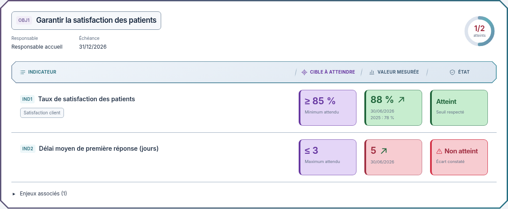

# Proposition : barre des en-têtes Biseau

02/11/2026, Europe/Paris. Session : Codex. Référence applicative inchangée : `eaadcf23c412dc9ac3f06003c9d8c34bcf919a6d`.

**Statut : proposition indépendante à valider avant intégration de la nouvelle barre. La version B est déjà intégrée et son accord n'est pas à redemander. Aucun build ni test applicatif exécuté pour cette proposition.**

Le demandeur souhaite améliorer le rectangle qui contient les noms de colonnes Indicateur / Cible à atteindre / Valeur mesurée / État. La proposition reprend la version B comme base et change uniquement le traitement graphique de cette barre :

- Angles biseautés de 10 px, dans le même langage que le grand cadre.
- Fond bleu ardoise en léger dégradé et reflet intérieur pour donner un peu de relief.
- Contour fin et liseré cyan discret en bas.
- Petits pictogrammes fixes pour repérer les colonnes et séparations inclinées entre les groupes.
- Groupes pictogramme/libellé centrés sur les trois colonnes de données ; Indicateur reste aligné à gauche. Accent violet réservé à la cible.

Le même traitement est proposé à la vue compacte, avec un pictogramme de source/date pour sa dernière colonne. Les en-têtes restent statiques : aucun tri, nouveau bouton ni nouvelle action n'est simulé. Sur mobile les libellés de blocs restent ceux de la version B ; aucune barre étroite ni ascenseur interne ajouté.

[Gros plan clair](https://raw.githubusercontent.com/yousername-ha/suivi-audits/55d43eebbc77fa2e367037b246e5396ced79abc8/docs/refonte-neon/propositions/entetes-biseau/barre-detail-light.png) · [Gros plan sombre](https://raw.githubusercontent.com/yousername-ha/suivi-audits/55d43eebbc77fa2e367037b246e5396ced79abc8/docs/refonte-neon/propositions/entetes-biseau/barre-detail-dark.png) · [Dalle sombre](https://raw.githubusercontent.com/yousername-ha/suivi-audits/55d43eebbc77fa2e367037b246e5396ced79abc8/docs/refonte-neon/propositions/entetes-biseau/detail-dark-1280.png) · [Vue compacte claire](https://raw.githubusercontent.com/yousername-ha/suivi-audits/55d43eebbc77fa2e367037b246e5396ced79abc8/docs/refonte-neon/propositions/entetes-biseau/compact-light-1280.png) · [Vue compacte sombre](https://raw.githubusercontent.com/yousername-ha/suivi-audits/55d43eebbc77fa2e367037b246e5396ced79abc8/docs/refonte-neon/propositions/entetes-biseau/compact-dark-1280.png) · [Maquette HTML autonome](index.html).

Les blocs réduits, les titres, les fonds renforcés, les exemples fictifs et les animations restent ceux de la maquette B. Les douze PNG montrent des rendus de ce seul HTML autonome : deux thèmes et deux largeurs 1280/390 px, dans les vues détaillée et compacte, plus quatre gros plans de barres. Les images fixes utilisent le mouvement réduit. Inter et sa licence SIL OFL sont embarqués.

Aucune application ni API chargée pour ces rendus. Aucun fichier de `apps/`, `packages/` ou des tests applicatifs n'est modifié ; seules la maquette et la documentation changent.

**Prochaine action : validation explicite de cette barre, puis intégration dans la présentation B, contrôles pertinents et nouvelles captures réelles.**

[Version B intégrée](../../OBJECTIFS-VERSION-B.md). Règle du demandeur : **visuel → validation explicite → intégration et tests → nouveau visuel réel**.
