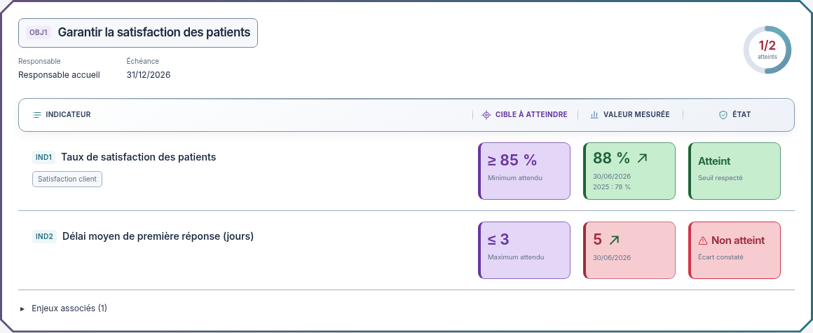

# En-têtes rapprochés du Dashboard de référence

02/11/2026, Europe/Paris. Session : Codex. Référence applicative inchangée : `eaadcf23c412dc9ac3f06003c9d8c34bcf919a6d`.

**Statut actualisé le 02/11/2026 : proposition explicitement validée (« Oui je valide »), puis intégrée et contrôlée. [Captures réelles et résultats de l'intégration](../../ENTETES-DASHBOARD.md). Les rendus de cette page conservent la maquette d'origine ; les paragraphes sur l'absence de build/test ci-dessous décrivent sa préparation avant accord.**

Après la proposition Biseau, le demandeur souhaite rester plus proche du Dashboard initial, puis reprendre la DdA une fois ce rendu validé, en limitant le violet.

## Direction retenue pour cette proposition

L'image initiale, les captures du dossier et le HTML GRC Studio fourni ont été relus comme références visuelles. Leurs surfaces arrondies, leur palette bleu nuit/ardoise et leurs accents lumineux discrets guident cette variante. Aucune donnée illustrative, logique ou instruction de ces pièces n'est reprise dans l'application.

- La barre retrouve des coins arrondis et un contour net, avec un fond très légèrement dégradé.
- En sombre, les surfaces `#1c2946` / `#18233e` reprennent celles du HTML Dashboard fourni ; en clair, fond blanc vers gris bleuté.
- Pictogrammes cyan, bleu et turquoise, texte surtout neutre, violet réservé à la cible dans les en-têtes.
- Les séparations deviennent droites et discrètes. Le liseré supérieur et l'ombre sont plus doux.
- Blocs, titres, couleurs renforcées et cadre extérieur Biseau de la version B sont conservés. La nouvelle proposition concerne la barre uniquement.

La vue compacte reprend le même bandeau. Les groupes pictogramme/libellé restent centrés sur les colonnes de données ; Indicateur reste aligné à gauche. Aucun tri ni nouvelle action n'est ajouté. Le mobile conserve les libellés dans les blocs et la hauteur naturelle de la présentation.

[Version sombre](https://raw.githubusercontent.com/yousername-ha/suivi-audits/55d43eebbc77fa2e367037b246e5396ced79abc8/docs/refonte-neon/propositions/entetes-dashboard/detail-dark-1280.png) · [Gros plan clair](https://raw.githubusercontent.com/yousername-ha/suivi-audits/55d43eebbc77fa2e367037b246e5396ced79abc8/docs/refonte-neon/propositions/entetes-dashboard/barre-detail-light.png) · [Gros plan sombre](https://raw.githubusercontent.com/yousername-ha/suivi-audits/55d43eebbc77fa2e367037b246e5396ced79abc8/docs/refonte-neon/propositions/entetes-dashboard/barre-detail-dark.png) · [Vue compacte claire](https://raw.githubusercontent.com/yousername-ha/suivi-audits/55d43eebbc77fa2e367037b246e5396ced79abc8/docs/refonte-neon/propositions/entetes-dashboard/compact-light-1280.png) · [Vue compacte sombre](https://raw.githubusercontent.com/yousername-ha/suivi-audits/55d43eebbc77fa2e367037b246e5396ced79abc8/docs/refonte-neon/propositions/entetes-dashboard/compact-dark-1280.png) · [Maquette HTML autonome](index.html).

Douze captures de cette maquette autonome, avec mouvement réduit : deux thèmes, deux vues et deux largeurs 1280/390 px, plus quatre gros plans. Inter et sa licence SIL OFL restent embarqués. Aucune application ni API chargée, aucun fichier de `apps/`, `packages/` ou des tests applicatifs modifié. Aucun build ni test applicatif exécuté pour ce lot.

## Suite après l'accord reçu

La barre est intégrée aux vues détaillée et compacte. Voir les [contrôles et captures réelles](../../ENTETES-DASHBOARD.md). Ne pas redemander son autorisation d'intégration.

Le demandeur précise pour la DdA : **« tu utilise le thème original que j'ai fournis en images au début de la conversation »**. La [proposition DdA issue de ces références originales](../dda-dashboard/README.md) est prête, avec peu de violet ; attendre son propre accord visuel avant de modifier son application. Conserver données, calculs, applicabilité, niveaux, justifications, incohérences, liens, droits et actions existants.

[Version B intégrée](../../OBJECTIFS-VERSION-B.md) · [Proposition Biseau précédente](../entetes-biseau/README.md).

Règle du demandeur : **visuel → validation explicite → intégration et tests → nouveau visuel réel**.
