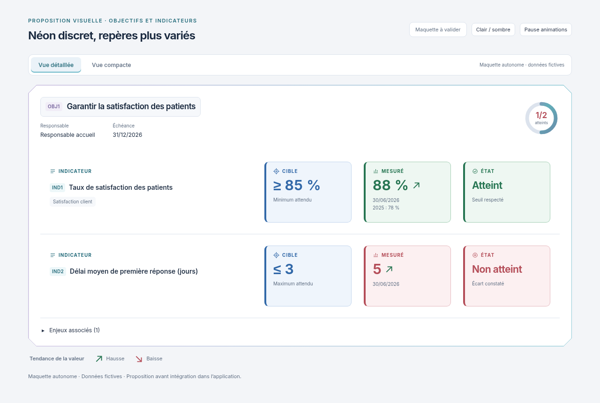
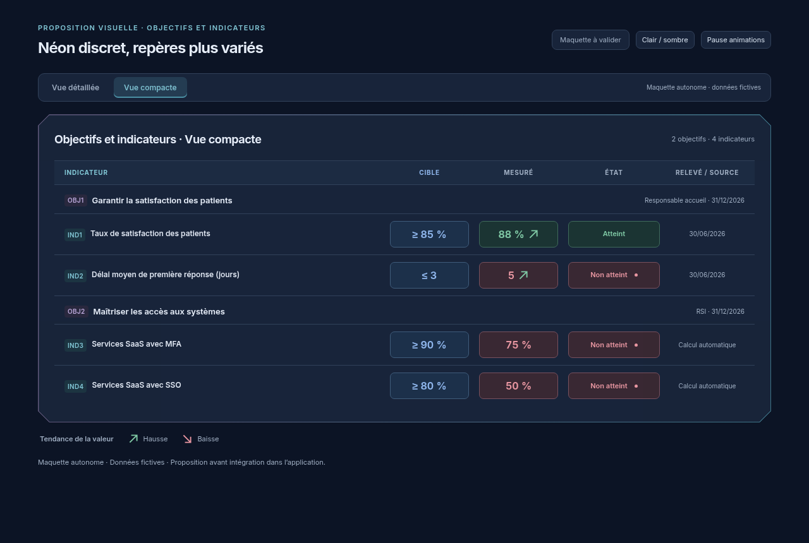

# Palette néon plus discrète et diversifiée

01/11/2026, Europe/Paris. Session : Codex. Référence applicative inchangée : `34921129f6117b8093e3d63216f827c76abbec4c`.

**Statut : proposition visuelle indépendante, en attente de validation explicite. Aucune intégration, aucun build et aucun test applicatif exécuté pour ce lot.**

Le demandeur trouve le violet trop présent dans la proposition précédente. Cette variante atténue sa présence tout en conservant le cadre Biseau, les alignements, les encadrés colorés et les deux vues.

| Élément | Nouveau traitement |
| --- | --- |
| Titres et noms des indicateurs | Bleu nuit en clair, gris clair en sombre |
| Repères d'indicateurs et vue active | Cyan atténué |
| Cible et valeur attendue | Bleu, fond léger et bordure fine |
| Mesure et état | Vert ou rouge adoucis selon l'atteinte |
| Violet | Petits codes d'objectifs et touche discrète du cadre |
| Jauge | Dégradé bleu/cyan, touche mauve désaturée |

Les fonds des encadrés sont moins saturés et leurs bordures moins marquées. Les textes et les valeurs gardent leur contraste visuel. La cible reste bien distincte des états. Les flèches sont conservées et animées, hausse verte et baisse rouge ; leur sens reste indépendant de l'atteinte de la cible. « Non atteint » conserve son animation discrète, avec texte stable. Les commandes Lire / Pause et la préférence système de mouvement réduit sont préservées.

[Animations en vidéo — 12 secondes](https://raw.githubusercontent.com/yousername-ha/suivi-audits/55d43eebbc77fa2e367037b246e5396ced79abc8/docs/refonte-neon/propositions/palette-equilibree/animations.mp4) · [Aperçu GIF animé](https://raw.githubusercontent.com/yousername-ha/suivi-audits/55d43eebbc77fa2e367037b246e5396ced79abc8/docs/refonte-neon/propositions/palette-equilibree/animations.gif) · [Maquette HTML autonome](index.html).

| Vue | Clair | Sombre | Mobile clair | Mobile sombre |
| --- | --- | --- | --- | --- |
| Détaillée | [1280 px](https://raw.githubusercontent.com/yousername-ha/suivi-audits/55d43eebbc77fa2e367037b246e5396ced79abc8/docs/refonte-neon/propositions/palette-equilibree/detail-light-1280.png) | [1280 px](https://raw.githubusercontent.com/yousername-ha/suivi-audits/55d43eebbc77fa2e367037b246e5396ced79abc8/docs/refonte-neon/propositions/palette-equilibree/detail-dark-1280.png) | [390 px](https://raw.githubusercontent.com/yousername-ha/suivi-audits/55d43eebbc77fa2e367037b246e5396ced79abc8/docs/refonte-neon/propositions/palette-equilibree/detail-light-390.png) | [390 px](https://raw.githubusercontent.com/yousername-ha/suivi-audits/55d43eebbc77fa2e367037b246e5396ced79abc8/docs/refonte-neon/propositions/palette-equilibree/detail-dark-390.png) |
| Compacte | [1280 px](https://raw.githubusercontent.com/yousername-ha/suivi-audits/55d43eebbc77fa2e367037b246e5396ced79abc8/docs/refonte-neon/propositions/palette-equilibree/compact-light-1280.png) | [1280 px](https://raw.githubusercontent.com/yousername-ha/suivi-audits/55d43eebbc77fa2e367037b246e5396ced79abc8/docs/refonte-neon/propositions/palette-equilibree/compact-dark-1280.png) | [390 px](https://raw.githubusercontent.com/yousername-ha/suivi-audits/55d43eebbc77fa2e367037b246e5396ced79abc8/docs/refonte-neon/propositions/palette-equilibree/compact-light-390.png) | [390 px](https://raw.githubusercontent.com/yousername-ha/suivi-audits/55d43eebbc77fa2e367037b246e5396ced79abc8/docs/refonte-neon/propositions/palette-equilibree/compact-dark-390.png) |

Les exemples restent fictifs et identiques à la proposition précédente. Aucun calcul, aucune donnée ni action du produit n'évolue. Les captures sont des rendus de cette seule maquette ; aucune application ni API n'a été chargée. Le HTML autonome conserve Inter et sa licence SIL OFL embarqués. Les PNG utilisent le mouvement réduit ; vidéo et GIF montrent les véritables images clés CSS, échantillonnées à 10 images/seconde et à vitesse normale, six secondes par vue.

Seuls la documentation et les supports de proposition changent ; aucun fichier de `apps/`, `packages/` ni des tests applicatifs n'est modifié.

**Prochaine action : attendre la validation de cette palette, puis intégrer les vues et animations retenues dans la copie Codex, exécuter les contrôles pertinents et fournir les nouveaux visuels réels.**

[Proposition précédente, plus violette](../alignement-compact/README.md), conservée pour référence. Règle du demandeur : **visuel → validation explicite → intégration et tests → nouveau visuel réel**.
