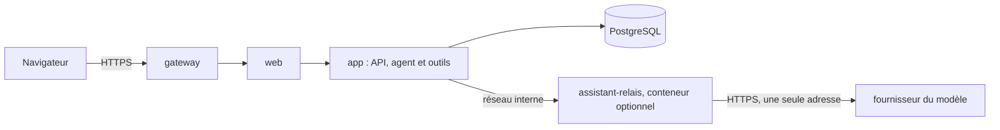

# Cadrage — assistant RSSI intégré (agent natif, modèle distant)

**Statut** : cadrage du 11/11/2026, à la demande du RSSI, avec ses décisions A1 à A11 de
l'[ADR 0086](../adr/0086-assistant-rssi-integre.md) (**acceptée** le 11/11/2026). Le cadrage lui-même ne contient ni code ni migration.
Rédaction : session « Assistant RSSI intégré plateforme » (`session_01EnWdzfTjPHLznQbaTS7Ugc`).

## 1. Besoin

Un assistant dans la plateforme qui aide à **maintenir la certification ISO/IEC 27001 et HDS** :

- **surveiller** : échéances, retards, preuves manquantes, évaluations anciennes, programme d'audit ;
- **analyser** : couverture des exigences, cohérence entre écarts, actions, risques et déclaration d'applicabilité ;
- **demander** : poser une question à la bonne personne, relancer, réclamer une preuve ;
- tenir deux rôles : aide à la **mise en œuvre** et aide à l'**audit interne** ;
- **se nourrir** de tout ce que la plateforme contient (référentiels, contenu des documents, actions, tâches récurrentes,
  historique) et **s'améliorer** avec l'usage ;
- échanger par un **chat** et par des **notifications** qu'il émet lui-même ;
- rester **autonome** : travailler sans qu'on l'interroge.

Ce que l'assistant **n'est pas** : un auditeur ou un RSSI au sens des normes. Il prépare, signale et rédige des
brouillons. Les décisions, les validations et la conclusion d'un audit restent celles de personnes désignées.

## 2. Schéma

L'API ne sort jamais. Le relais n'a ni base ni fichiers : il transmet les requêtes de modèle à l'adresse réglée par
l'administrateur. Le serveur (VPS sans carte graphique) n'héberge pas le modèle.

## 3. Ce qui est réutilisé et ce qui est nouveau

| Besoin | Réutilise (existant) | Nouveau (strict nécessaire) |
|---|---|---|
| Lire avec des droits | Porte de lecture (`apps/api/src/acces/portee.ts`, ADR 0083), services GRC et historiques | Portée d'un profil ; intersection avec la personne en chat ; outils de lecture internes |
| Module et droits | `MODULES`, `MODULE_REGISTRY`, `module_activation`, rôles personnalisés | Module `assistant` ; **droit dédié `assistant:lire`**, porté seulement par les rôles administrateur et RSSI |
| Appeler le modèle | Modèle de l'antivirus (conteneur optionnel sur réseau interne), coffre et secret en écriture seule (courriel), `REDACT` | Conteneur `assistant-relais` ; réglages du modèle ; boucle d'agent |
| Travailler seul | Tic de 60 s (`server.ts`), verrous consultatifs, acteur `planification`, événements du temps réel | File de rondes, déclencheurs sur événement, missions, relances, budget, pause |
| Proposer sans écrire | Cycle des rapprochements (`grc/rapprochements.ts`), aperçu puis confirmation | Tables de propositions et de questions |
| Appliquer une proposition | `Grc.insert`/`Grc.write`, clôtures, évaluations, tâches, avec versions, audit et temps réel | Aiguillage d'une proposition confirmée vers le service de sa cible |
| Prévenir une personne | Notifications métier (ADR 0058), réglages personnels, courriel par l'exécutant | Trois types : rappel, question, proposition à décider ; plafond |
| Détecter | Rappels de l'automate (`grc/tasks.ts`), couverture, plan d'audit, parcours ISO/HDS | Outil « signaux », sans nouveau calcul de conformité |
| Lire le contenu des documents | Circuit de fichiers (`files.ts`), chiffrement, versions | Extraction isolée hors de l'API ; index de recherche en texte intégral (A9) |
| S'améliorer | Décisions tracées (`decided_by`, motif), `grc_object_versions` | Mémoire par profil en tables ; outil « retours » ; taux d'acceptation calculé |
| Dialoguer | SSE et temps réel, `packages/ui`, CSP stricte | Fil par personne et par profil, sources cliquables |
| Tracer | `Db.audit`, `audit_log` en ajout seul | Audits `assistant.*`, journal des rondes, compteur de jetons |
| Recette | Organisation fictive du RSSI virtuel (`tests/e2e/rssi-virtuel/`), faux serveur comme pour le courriel | Faux serveur de modèle pour les tests ; jeu d'évaluation |

## 4. Autonomie : ce que l'assistant fait sans qu'on lui demande

| Déclencheur | Exemple | Ce qu'il produit |
|---|---|---|
| Ronde planifiée | Chaque matin, par profil | Rappels, questions, propositions, rapport de ronde |
| Synthèse planifiée | Chaque semaine | État d'avancement adressé au RSSI |
| Événement | Action passée en retard, nouvelle version d'un document, audit dans 30 jours | Ronde ciblée sur l'objet |
| Mission du RSSI | « Préparer l'audit interne de mars » | Travail repris à chaque ronde jusqu'à clôture de la mission |
| Suivi de ses demandes | Question sans réponse après le délai | Relance, puis signalement au RSSI |

Seul : lire, analyser, rappeler, questionner, proposer, rédiger, tenir sa mémoire. Jamais seul : écrire dans un registre,
valider, clore, publier.

Bornes : une ronde à la fois, durée maximale, budget quotidien de jetons, plafond de notifications, interrupteur de pause.
Sans modèle joignable, la ronde échoue proprement et les rappels existants de l'automate continuent.

## 5. Parcours cibles

- **Ronde.** L'agent appelle « signaux », lit les objets concernés, relit ses missions et sa mémoire, envoie rappels et
  questions, dépose des propositions, écrit un rapport daté.
- **Décision.** La personne ouvre la proposition, lit les sources, confirme, modifie ou rejette avec un motif. L'agent lit
  ce retour à la ronde suivante.
- **Chat.** Une personne choisit le profil et pose sa question ; la réponse cite les objets et documents lus. Elle ne
  contient rien que cette personne ne puisse lire elle-même.
- **Préparation d'un audit interne.** À partir du programme, du périmètre et des exigences du référentiel attaché, l'agent
  prépare un plan, des points à vérifier et les preuves à demander. Aucun texte de norme n'est reconstitué.
- **Après l'audit.** L'auditeur saisit ses observations ; l'agent propose des constats rattachés aux exigences, puis un
  brouillon de rapport. L'auditeur valide chaque constat.
- **Administration.** Régler le modèle, définir les profils et leurs périmètres, rédiger les missions, lire et purger la
  mémoire, suivre la consommation, mettre en pause.

## 6. Séparation des deux rôles

Un auditeur n'audite pas son propre travail (ISO/IEC 27001, 9.2 ; ISO 19011).

| | Profil « Mise en œuvre » | Profil « Audit interne » |
|---|---|---|
| Périmètres, missions, mémoire | Propres | Propres, sans partage |
| Peut proposer | Écarts, actions, tâches, évaluations | Éléments de préparation, constats |
| Ne propose jamais | Constat d'audit | Action corrective |
| Garde-fou | — | Constat sur un objet issu de l'assistant : signalé à l'auditeur |

## 7. Sécurité

| Risque | Parade |
|---|---|
| Extraits du SMSI envoyés au fournisseur | Périmètres explicites par profil ; fournisseur affiché ; périmètres à données de santé non ouverts ; contrat et option sans conservation à vérifier |
| Usage par une personne non prévue | Droit dédié `assistant:lire` ; refus par l'API |
| Chat qui révèle plus que les droits de la personne | Lectures bornées à l'intersection des portées |
| Injection par un contenu lu | Aucun outil d'écriture directe, aucune navigation, une seule sortie ; décision humaine avec sources |
| Clé du modèle exposée | Scellée par le coffre, écriture seule, masquée dans les journaux |
| Relais détourné | Sans base ni fichiers ; une seule adresse, HTTPS vérifié ; tailles et durées bornées |
| Chiffres inventés | Aucun taux calculé par le modèle ; identifiants cités |
| Mémoire qui garde ce qui ne doit plus être lu | Lisible et purgeable ; purge à la réduction des périmètres |
| Fichier piégé à l'extraction | Extraction hors de l'API, isolée, après antivirus |
| Notifications envahissantes, dépense | Plafonds, budget de jetons, pause |

## 8. Lots proposés (sans calendrier ; estimations non établies)

| Lot | Contenu | Acceptation |
|---|---|---|
| A0 | ADR 0086 et ce cadrage | Relus et acceptés par le RSSI |
| A1 | **Socle et chat.** Module et droit dédié, profils et périmètres, outils de lecture par la porte, outil « signaux », réglages du modèle, relais, boucle d'agent, chat avec sources, audit | Refus sans le droit dédié, module désactivé, hors périmètre. Deux comptes de droits différents n'obtiennent pas la même réponse (intersection prouvée). Aucun outil n'écrit. Clé jamais relue. API toujours sans sortie. Tests sur faux serveur de modèle. `rbac.test.ts` vert. Migration sur base vierge et existante |
| A2 | **Propositions, questions, rappels.** Tables, décision avec droit de la cible, trois types de notification, réponses, outil « retours », taux d'acceptation | Rien n'est écrit dans un registre avant confirmation. Rejet non redéposé à sources inchangées. Rappel refusé vers une personne sans accès à l'objet. Plafond respecté |
| A3 | **Autonomie.** Rondes planifiées, déclencheurs sur événement, missions, relances, mémoire par profil, budget, pause, journal des rondes | Une seule ronde à la fois. Pause immédiate. Budget respecté. Modèle injoignable : échec consigné, automate inchangé. Jeu d'évaluation sur organisation fictive, résultats **mesurés et publiés**, échecs compris |
| A4 | **Contenu des documents.** Extraction isolée, index de recherche, outil de lecture | Droits du document respectés. Texte supprimé avec la version. Formats non lus signalés |
| A5 | **Audit interne.** Profil dédié, préparation, constats proposés, brouillon de rapport, garde-fou d'indépendance | Aucune action corrective déposée par ce profil. Recette par un auditeur |
| A6 | **Mise en œuvre.** Parcours ISO/HDS, DdA, couverture, préparation de la revue de direction | Chaque réponse cite ses sources ; aucun taux hors outils |
| A7 | **Optionnel : serveur MCP** pour brancher un agent extérieur | Addendum à l'ADR |

## 9. Branche de développement

Décision A10 : tout l'assistant se développe sur **`claude/assistant-rssi`**, créée le 11/11/2026 comme copie de
`claude-suivi-smsi` avec ce cadrage et l'ADR.

- Avant chaque lot, la branche reprend `claude-suivi-smsi` par fusion.
- Les sessions qui travaillent sur l'assistant partent de cette branche et y reviennent par PR.
- `claude-suivi-smsi` et `main` ne reçoivent rien de l'assistant avant une PR décidée par le RSSI, contrôles verts.
- Les migrations de l'assistant prennent leur numéro au moment de cette PR.

## 10. Non vérifié à ce jour

- Compatibilité de l'API du fournisseur (Mistral, OVHcloud AI Endpoints) avec le format et l'appel d'outils utilisés.
- Conditions contractuelles du fournisseur : lues sur des sources tierces ; aucune certification HDS trouvée pour Mistral.
- Qualité d'un modèle sur ces outils ; coût à l'usage.
- Bibliothèques d'extraction de texte (PDF, bureautique) : à retenir par addendum.
- Aucun essai n'a été exécuté : ce document repose sur la lecture du code et de documentations du 11/11/2026.
