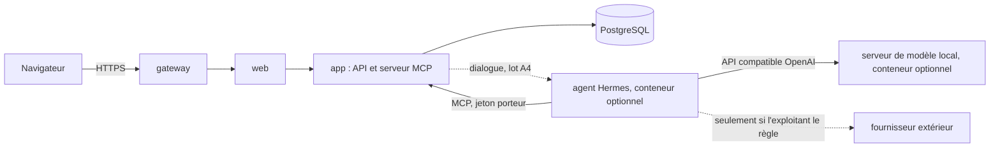

# Cadrage — assistant RSSI intégré (serveur MCP et agent Hermes)

**Statut** : cadrage du 11/11/2026, à la demande du RSSI, avec ses décisions A1 à A10 de
l'[ADR 0086](../adr/0086-assistant-rssi-serveur-mcp-et-agent.md) (**proposée**, à accepter). Aucun code, aucune migration.
Rédaction : session « Assistant RSSI intégré plateforme » (`session_01EnWdzfTjPHLznQbaTS7Ugc`).

## 1. Besoin

Un assistant dans la plateforme qui aide à **maintenir la certification ISO/IEC 27001 et HDS** :

- **surveiller** : échéances, retards, preuves manquantes, évaluations anciennes, programme d'audit ;
- **analyser** : couverture des exigences, cohérence entre écarts, actions, risques et déclaration d'applicabilité ;
- **demander** : poser une question à la bonne personne, relancer, réclamer une preuve ;
- tenir deux rôles : aide à la **mise en œuvre** et aide à l'**audit interne** ;
- **se nourrir** de tout ce que la plateforme contient (référentiels, contenu des documents, actions, tâches récurrentes,
  historique) et **s'améliorer** avec l'usage ;
- échanger par un **chat** et par des **notifications** qu'il émet lui-même (rappel, question, proposition).

Décisions du RSSI : modèle réglable et local par défaut ; serveur MCP natif avec Hermes Agent à côté ; l'assistant lit et
propose, une personne valide.

Ce que l'assistant **n'est pas** : un auditeur ou un RSSI au sens des normes. Il prépare, signale et rédige des
brouillons. Les décisions, les validations et la conclusion d'un audit restent celles de personnes désignées.

## 2. Schéma

Réseaux : `assistant` (interne) entre `app` et l'agent ; `modele` (interne) entre l'agent et le modèle local. L'API ne
sort jamais. L'agent n'a ni base, ni socket Docker, ni fichiers de l'application.

## 3. Ce qui est réutilisé et ce qui est nouveau

| Besoin | Réutilise (existant) | Nouveau (strict nécessaire) |
|---|---|---|
| Lire les données avec des droits | Porte de lecture (`apps/api/src/acces/portee.ts`, ADR 0083), services GRC et historiques, `grc_members`, `droits_ressources` | Portée d'un compte d'assistant ; outils MCP de lecture, paginés |
| Authentifier l'agent | Hachage SHA-256 des jetons (sessions, écran mural), `REDACT`, limiteurs (`http/security.ts`) | Compte d'assistant, jeton porteur, type d'accès `assistant` dans `route()` |
| Module et droits | `MODULES`, `MODULE_REGISTRY`, `module_activation`, rôles, rôles personnalisés | Module `assistant` (3 actions) et migration de la contrainte ; **droit dédié `assistant:lire` pour utiliser l'assistant**, porté seulement par les rôles administrateur et RSSI, attribuable par rôle personnalisé |
| Proposer sans écrire | Cycle des rapprochements (`grc/rapprochements.ts` : statuts, `decide()`), aperçu puis confirmation | Tables de propositions et de questions ; outils de dépôt |
| Appliquer une proposition | `Grc.insert`/`Grc.write`, clôtures, évaluations d'exigences, tâches : chacun avec ses versions, son audit, son temps réel | Aiguillage d'une proposition confirmée vers le service de sa cible |
| Prévenir une personne | Notifications métier (ADR 0058), réglages par groupe, rôle et utilisateur, courriel par l'exécutant | Trois types émis par l'assistant : rappel, question, proposition à décider ; plafond par personne et par jour |
| Lire le contenu des documents | Circuit de fichiers (`files.ts` : formats, signature, antivirus), chiffrement par le coffre, versions de document | Extraction du texte hors de l'API, isolée ; texte chiffré par version ; index de recherche en texte intégral dans la base (accepté, A9) ; outil de lecture et de recherche |
| S'améliorer | Décisions tracées (`decided_by`, motif), `grc_object_versions`, validations d'occurrences | Outil « retours » ; taux d'acceptation calculé par la plateforme ; écran de la mémoire (lire, corriger, purger) |
| Dialoguer | SSE et temps réel existants, `packages/ui` | Fil de conversation par personne et par profil, relais vers l'agent, sources cliquables |
| Détecter | Rappels de l'automate (`grc/tasks.ts`), couverture (`couverture.ts`), plan d'audit, parcours ISO/HDS | Outil « signaux » qui assemble ces faits, sans nouveau calcul de conformité |
| Tracer | `Db.audit`, `audit_log` en ajout seul, acteurs non humains déjà admis | Audits `assistant.*` par appel d'outil |
| Déployer | Profil Compose facultatif (antivirus), réseaux internes, épinglage par empreinte (ADR 0063), `DATA_DIR` | Profil `assistant` : conteneurs Hermes et modèle, configuration générée |
| Interface | `packages/ui`, CSP stricte, écran des rapprochements, cloche des notifications | Rubrique « Assistant » : propositions, questions, rapports, puis dialogue |
| Recette | Organisation fictive et harnais du RSSI virtuel (`tests/e2e/rssi-virtuel/`) | Jeu d'évaluation de l'assistant sur données fictives |

## 4. Parcours cibles

- **Ronde de surveillance (planifiée dans Hermes).** L'agent appelle l'outil « signaux », lit les objets concernés, dépose
  des propositions et des questions, puis un court rapport daté. La personne voit une notification, ouvre la proposition,
  lit les sources citées, confirme, modifie ou rejette avec un motif.
- **Rappel ou question.** L'agent constate une action en retard ou une preuve manquante : il envoie un rappel ou une
  question à la personne concernée. Elle répond depuis la notification ou dans le chat ; l'agent relit la réponse à la
  ronde suivante et la garde en mémoire.
- **Chat.** Une personne ouvre le chat, choisit le profil et pose sa question ; la réponse cite les objets et documents
  lus, par des liens. Elle ne contient rien que cette personne ne puisse lire elle-même.
- **Apprentissage.** Une proposition est rejetée avec le motif « déjà couvert par l'action X » : l'agent lit ce retour, ne
  la redépose pas et en tient compte pour les suivantes. Le RSSI consulte le taux d'acceptation et ce que l'agent a retenu.
- **Mise en œuvre.** « Où en est-on sur la clause 9 ? » : l'agent lit couverture, DdA et parcours, répond avec les
  identifiants des exigences, et propose les actions manquantes.
- **Préparation d'un audit interne.** À partir du programme, du périmètre et des exigences du référentiel attaché, l'agent
  prépare un plan, une liste de points à vérifier et les preuves à demander. Aucun texte de norme n'est reconstitué : seuls
  les intitulés présents dans la bibliothèque de l'organisation sont repris.
- **Pendant et après l'audit.** L'auditeur dicte ou saisit ses observations ; l'agent propose des constats rattachés aux
  exigences, puis un brouillon de rapport. L'auditeur valide chaque constat.
- **Administration.** Créer un compte d'assistant par profil, choisir ses périmètres, générer le jeton (affiché une fois),
  le révoquer, purger la mémoire de l'agent, lire le journal des appels.

## 5. Séparation des deux rôles

Un auditeur n'audite pas son propre travail (ISO/IEC 27001, 9.2 ; ISO 19011). D'où :

| | Profil « Mise en œuvre » | Profil « Audit interne » |
|---|---|---|
| Compte, jeton, mémoire | Propres | Propres, sans partage |
| Peut proposer | Écarts, actions, tâches, évaluations, relances, questions | Éléments de préparation, constats, questions |
| Ne propose jamais | Constat d'audit | Action corrective |
| Garde-fou | — | Constat sur un objet issu de l'assistant : signalé à l'auditeur |

## 6. Sécurité

| Risque | Parade |
|---|---|
| Fuite de données du SMSI vers un fournisseur | Modèle local par défaut, réseaux internes ; sortie seulement par réglage explicite, affichée dans l'interface |
| Injection par un contenu lu (rapport importé, fiche fournisseur) | Aucun outil d'écriture directe, aucun outil sur l'hôte, aucune sortie ; décision humaine avec sources |
| Jeton volé | Haché, à expiration, révocable, lecture seule, périmètres explicites, limiteur, journal |
| Agent compromis | Conteneur sans privilège, lecture seule, sans socket Docker ni montage ; image épinglée |
| Chiffres inventés | Aucun taux calculé par le modèle ; signaux et couvertures viennent des outils ; identifiants cités |
| Validation à la chaîne sans lecture | Pas de confirmation en lot au départ ; motif exigé au rejet ; mention d'origine conservée sur l'objet créé |
| Usage par une personne non prévue | Droit dédié `assistant:lire`, attribué explicitement ; refus par l'API, pas seulement menu masqué |
| Chat qui révèle plus que les droits de la personne | Lectures bornées à l'intersection des périmètres ; à défaut, chat réservé aux personnes qui couvrent le périmètre du profil |
| Mémoire qui garde ce qui ne doit plus être lu | Mémoire par profil, lisible et purgeable ; purge à la réduction des périmètres |
| Fichier piégé à l'extraction | Extraction hors de l'API, sans réseau ni privilège, après antivirus, tailles et délais bornés |
| Notifications envahissantes | Plafond par personne et par jour ; pas de réémission à objet inchangé ; réglages personnels respectés |
| Déni de service par l'agent | Pagination, plafonds, limiteur par jeton, verrou d'une seule ronde à la fois |

L'assistant est un usage d'IA de l'organisation : GAP IA (ADR 0064) et appréciation des risques avant mise en service.

## 7. Lots proposés (sans calendrier ; estimations non établies)

| Lot | Contenu | Acceptation |
|---|---|---|
| A0 | ADR 0086 et ce cadrage | Relus et acceptés par le RSSI |
| A1 | **Socle MCP en lecture.** Module `assistant` et migration ; comptes d'assistant et jetons ; type d'accès `assistant` ; outils de lecture par la porte de lecture ; outil « signaux » ; audit ; écran d'administration. Essai d'interopérabilité avec Hermes (révision du protocole) avant d'écrire le transport | Refus sans le droit dédié (rôles contributeur, lecteur et auditeur externe refusés). Refus sans jeton, jeton expiré ou révoqué, module désactivé, hors périmètre, registre restreint. Aucun outil n'écrit (prouvé par test). Jeton jamais relu ni journalisé. `rbac.test.ts` vert. Migration sur base vierge et existante. Utilisable sans aucun modèle, par un client MCP quelconque |
| A2 | **Propositions, questions, rappels.** Tables, outils de dépôt, rubrique « Assistant », décision avec droit de la cible, trois types de notification, réponse à une question, outil « retours », taux d'acceptation | Rien n'est écrit dans un registre avant confirmation. Confirmation refusée sans le droit de la cible. Rejet non redéposé à sources inchangées. Objet créé sous l'identité de la personne, origine mentionnée. Rappel refusé vers une personne sans accès à l'objet ; plafond respecté |
| A3 | **Agent et modèle.** Profil Compose `assistant`, durcissement, configuration Hermes générée (outils natifs désactivés, liste blanche), modèle local, rondes planifiées, guide d'installation, mémoire par profil (lecture, correction, purge, sauvegarde) | Aucune sortie réseau constatée en configuration par défaut. Outils natifs absents (prouvé). Jeu d'évaluation sur organisation fictive : résultats **mesurés et publiés**, y compris les échecs. Mesure de temps de réponse sur le matériel du RSSI |
| A4 | **Chat.** Relais de l'API vers l'agent, fil par personne et par profil, sources cliquables, réponse aux questions de l'assistant | CSP stricte respectée. Une personne n'obtient par le chat rien qu'elle ne puisse lire (prouvé par test avec deux comptes). Captures clair et sombre |
| A5 | **Contenu des documents.** Extraction isolée (formats texte, puis PDF et bureautique par addendum), texte chiffré par version, outil de lecture et de recherche | Droits du document respectés. Texte supprimé avec la version. Fichier piégé sans effet sur l'API. Formats non lus signalés, jamais devinés |
| A6 | **Audit interne.** Profil dédié, préparation, constats proposés, brouillon de rapport, garde-fou d'indépendance | Aucune action corrective déposée par ce profil. Aucun texte de norme reconstitué. Recette par un auditeur |
| A7 | **Mise en œuvre.** Parcours ISO/HDS, DdA, couverture, préparation de la revue de direction | Chaque réponse cite ses sources ; aucun taux hors outils |

A1 et A2 ont une valeur sans modèle : tout client MCP peut s'y brancher. A3 est le lot à risque (matériel, qualité du
modèle local) : s'il échoue, le reste n'est pas perdu.

## 8. Branche de développement

Décision A10 : tout l'assistant se développe sur **`claude/assistant-rssi`**, créée le 11/11/2026 comme copie de
`claude-suivi-smsi` avec ce cadrage et l'ADR.

- Avant chaque lot, la branche reprend `claude-suivi-smsi` par fusion, pour ne pas s'en éloigner.
- Les sessions qui travaillent sur l'assistant partent de cette branche et y reviennent par PR.
- `claude-suivi-smsi` et `main` ne reçoivent rien de l'assistant avant une PR `claude/assistant-rssi` →
  `claude-suivi-smsi` décidée par le RSSI, contrôles verts. Aucune version publiée ne contient l'assistant d'ici là.
- Les migrations de l'assistant prennent leur numéro au moment de cette PR : un numéro pris trop tôt peut être repris
  entre-temps par `claude-suivi-smsi`.

## 9. Non vérifié à ce jour

- Révision MCP parlée par le client de Hermes 0.23.1 (2025-11-25 ou 2026-07-28).
- Existence d'un réglage Hermes unique « outils MCP seulement » : les mécanismes existent, la recette n'est pas documentée.
- Mémoire et savoir-faire appris de Hermes avec ses outils de fichiers désactivés ; bornage des droits par conversation.
- Bibliothèques d'extraction de texte (PDF, bureautique) : non choisies, à retenir par addendum.
- Qualité et vitesse d'un modèle sur ces outils. Le serveur est un VPS OVHcloud sans carte graphique : l'emplacement du
  modèle est à décider avant le lot A3 (ADR 0086, point ouvert 2) ; périmètre HDS et conditions d'OVHcloud AI Endpoints
  non vérifiés.
- Aucun essai n'a été exécuté : ce document repose sur la lecture du code et des documentations officielles du 11/11/2026.
