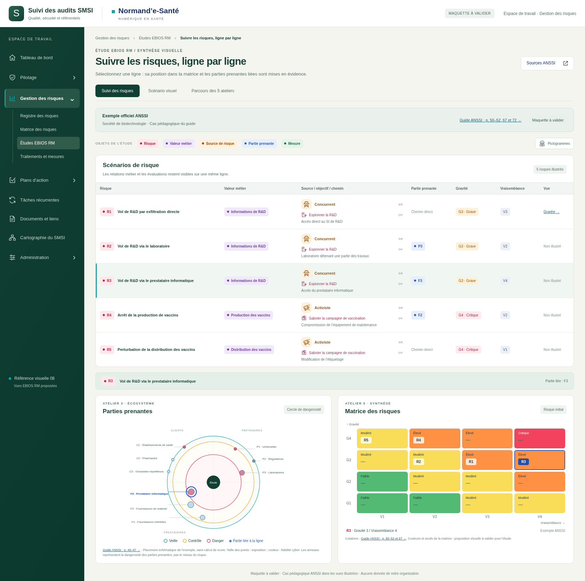
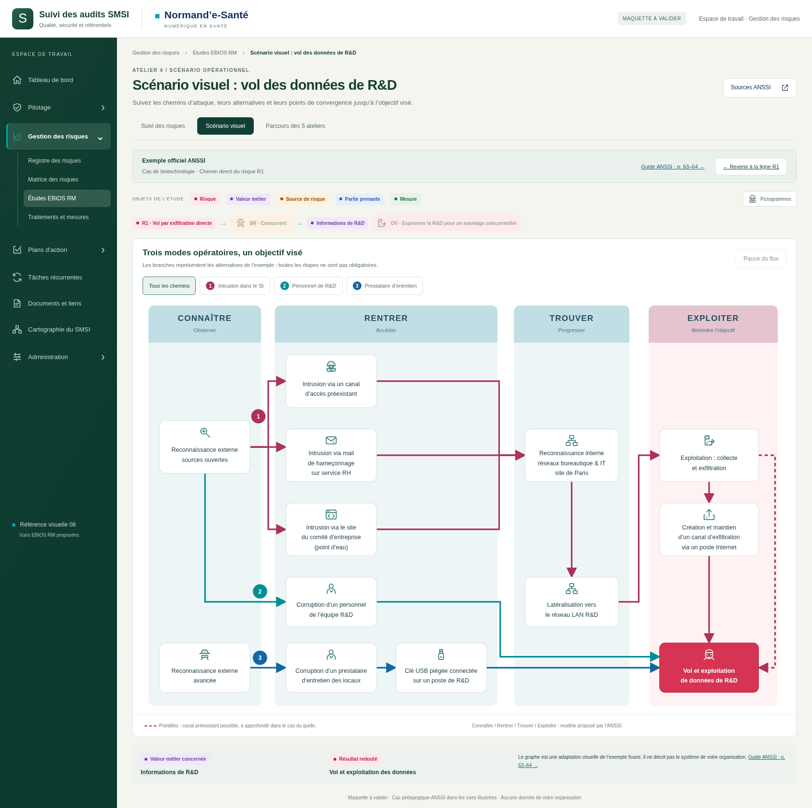
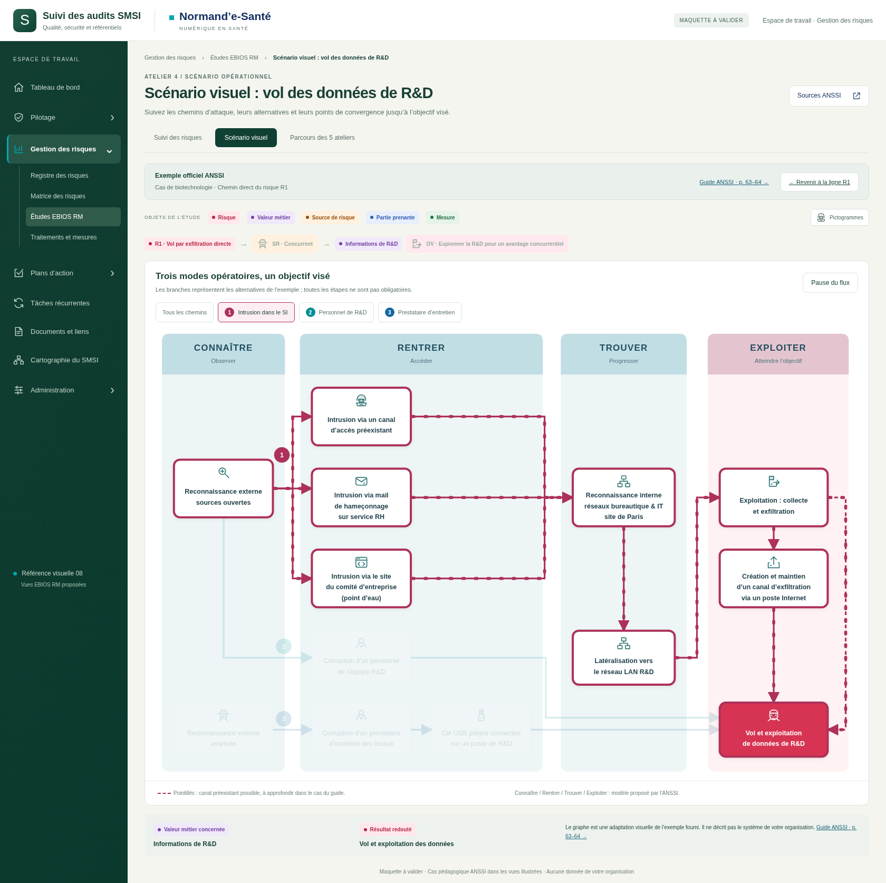
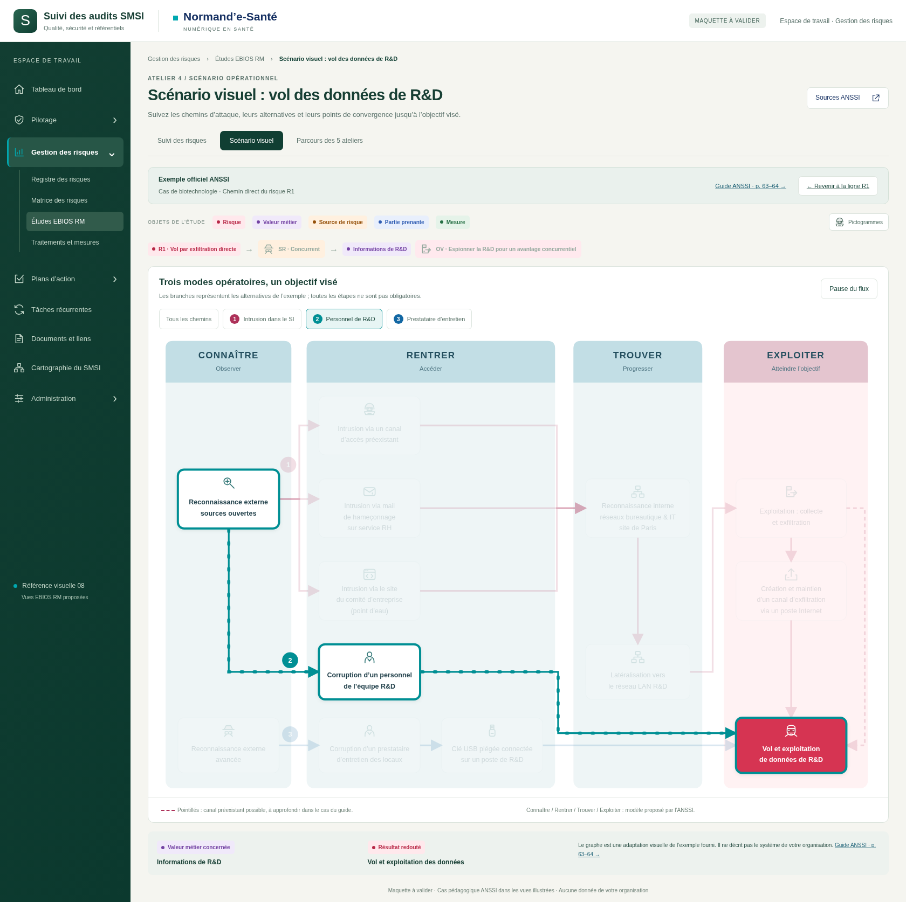
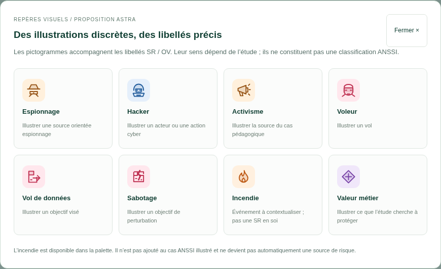

# EBIOS RM — chemins animés et contours renforcés

**Maquette courante · style 08 · lancement Windows par fichier BAT.**

[Télécharger le ZIP Windows](https://github.com/yousername-ha/suivi-audits/raw/refs/heads/legacy/downloads/EBIOS-RM-maquette-Windows.zip). Extraire tout puis lancer **DEMARRER.bat**. Le navigateur ouvre la maquette locale ; Python et Node ne sont pas nécessaires.

Dans « Scénario visuel », sélectionner un chemin 1, 2 ou 3 pour voir le flux se déplacer du départ vers la pointe des flèches. Les blocs concernés prennent un contour plus épais de la couleur du chemin. La vue « Tous les chemins » reste statique. Un bouton permet de mettre le flux en pause ; le réglage système de réduction des mouvements est respecté.

Le tableau, le cercle, la matrice, les pictogrammes et le parcours des cinq ateliers restent disponibles. C’est une maquette à valider, sans modification de la cartographie dynamique de l’application. Les données illustrées proviennent du cas pédagogique ANSSI : [sources](SOURCES.md).

Base : `95058fbeeb2daff1cb1c525d70a736322e69705b`. Cette série remplace les maquettes EBIOS RM 17–19 dans l’arbre courant, conformément au nettoyage demandé. Les versions précédentes restent dans l’historique Git.

## Tester le parcours complet

Lancer **TESTER-PARCOURS-COMPLET.bat** pour commencer par les cinq ateliers. Suivre le [guide de test complet](PARCOURS-DE-TEST.md) : 18 étapes, notes, sources, risques et graphe.

## Aperçus

### Suivi des risques · Matrice et cercle

### Scénario opérationnel · Trois chemins

### Sélection R2 · Laboratoire

### Sélection R4 · Production

### Chemin 1 · Intrusion et embranchements

### Chemin 2 · Personnel R&D

### Palette de pictogrammes SR / OV

## Contrôles

Navigation, matrice et cercle synchronisés ; trois filtres ; trois blocs sélectionnés et deux flèches animées pour le chemin 2 ; progression temporelle et sens du décalage SVG ; pause et reprise ; réduction des mouvements ; retour statique à « Tous les chemins ». Vérifications d’affichage aux largeurs 390, 768 et 1440 pixels. Aucune erreur JavaScript. Détails : `technique/verification.json`.

Le ZIP est extrait et contrôlé avant livraison. Le BAT, en CRLF, utilise des chemins entre guillemets pour les dossiers contenant des espaces. Son exécution sous Windows n’a pas été testée dans cet environnement Linux.

Reproduire les captures : serveur local sur le port 8768, Playwright et Chromium, puis `node technique/capturer.cjs`.

[Rapport du parcours complet](technique/parcours-complet.json) : cinq ateliers, 18 étapes, 36 notes restituées après rechargement et vues graphiques vérifiées.
