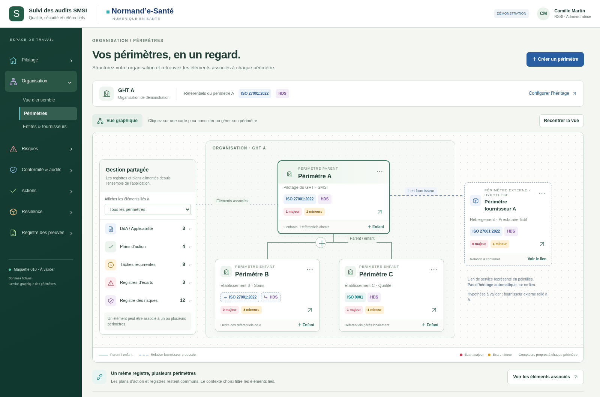
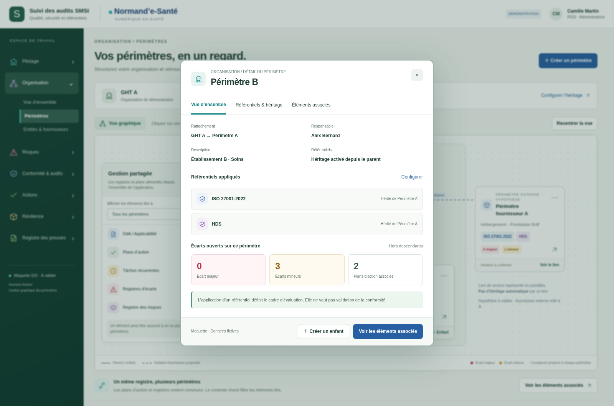
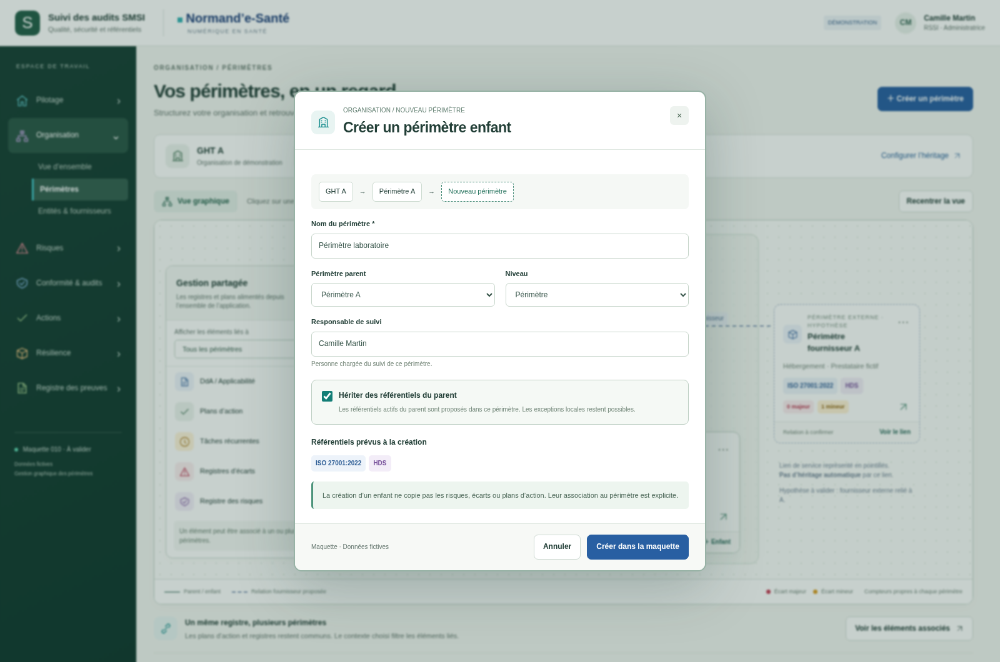
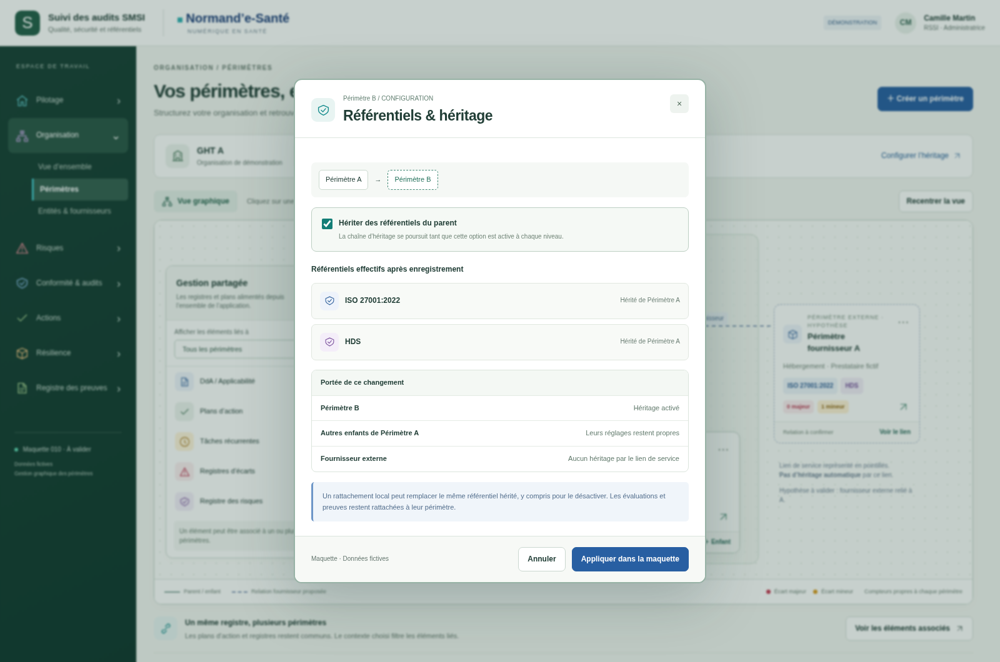
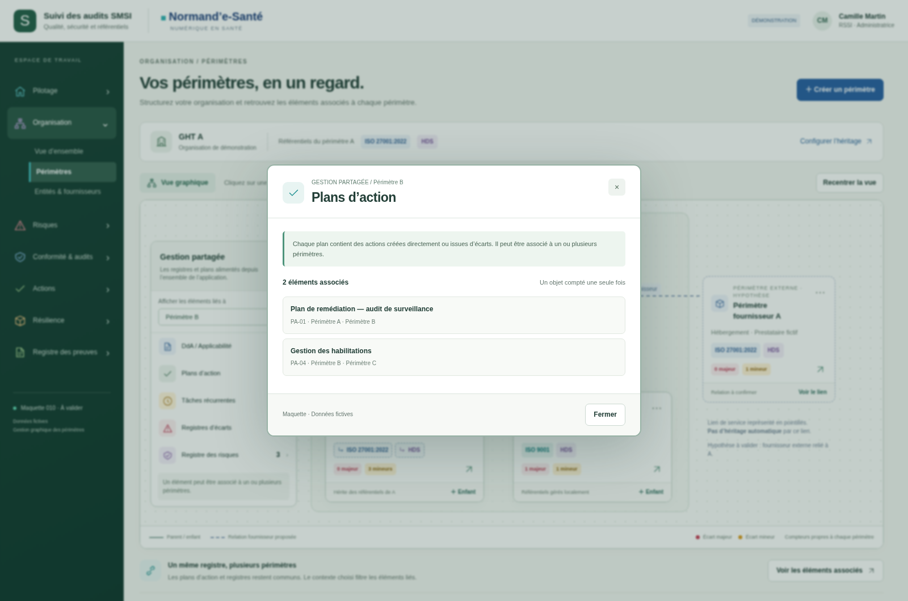

# 010 · Gestion graphique des périmètres — v003

**Proposition à valider · 19 octobre 2026 · Données fictives.**

Le croquis utilisateur devient un espace graphique : organisation, périmètre A, enfants B/C, référentiels et accès aux registres partagés. Le fournisseur est représenté comme un périmètre externe relié à A : **hypothèse en attente de réponse**, pas une règle métier validée.

## Visuels

### Vue graphique de l’organisation

[Ouvrir l’image](visuels/01-vue-graphique.png)

### Détail d’un périmètre

[Ouvrir l’image](visuels/02-detail-perimetre.png)

### Création d’un périmètre enfant

[Ouvrir l’image](visuels/03-creation-enfant.png)

### Configuration de l’héritage

[Ouvrir l’image](visuels/04-heritage-referentiels.png)

### Plans d’action associés à un périmètre

[Ouvrir l’image](visuels/05-plans-associes.png)

## Principes proposés

- Le bandeau et le menu restent fixes. Le contenu principal et le graphique possèdent leurs propres zones de défilement. Sur mobile, le menu est repliable.
- Les fenêtres de détail, de création et d’héritage sont centrées, avec un contour marqué.
- Un lien plein désigne la hiérarchie. Les pointillés fournisseur représentent une relation externe proposée, sans héritage automatique.
- Un référentiel direct porte un badge plein. Un référentiel hérité porte un badge pointillé et une indication de provenance.
- Les compteurs rouges et jaunes montrent les écarts ouverts propres au périmètre. Ils n’additionnent pas implicitement les descendants.
- « Gestion partagée » filtre les registres et plans existants : tous les périmètres, un périmètre ou plusieurs. Un objet commun est compté une seule fois dans une sélection multiple.
- Un plan contient des actions créées directement ou issues d’écarts. La sélection d’un périmètre ne crée pas un nouveau plan et ne copie pas les objets métier.

## Statut et limites

Livraison de cinq images et de leur source de rendu HTML/CSS/JS. Aucun ZIP ni BAT créé. Les interactions de la source servent à vérifier les visuels : données en mémoire, remise à zéro au rechargement, aucune API ni persistance. Les autres modules du menu sont des repères de navigation.

L’héritage simulé couvre les cas visibles, pas toute la logique du socle (exceptions locales désactivées, autorisations, versionnement, profondeur, accès concurrents). Réutiliser les contrats existants lors de l’implémentation, après validation visuelle. Les associations illustrées avec les registres ne prouvent pas la disponibilité d’un contrat multi-périmètres pour chaque module. Le responsable de suivi et la relation externe fournisseur nécessitent un contrat vérifié avant raccordement.

Les éditions de HDS et ISO 9001 sont à préciser avec les référentiels réellement publiés dans l’instance ; les badges n’affirment aucune certification.

[Contrats vérifiés et limites d’intégration](../../implementation/README.md) · [Résultats des contrôles](technique/verification.json).

Pour reproduire la capture : servir ce dossier par HTTP local sur le port 18778 ; exécuter `technique/verifier.cjs` avec Node et Playwright disponibles. Aucun test ni build n’est exécuté dans l’espace Claude. La cartographie dynamique reste inchangée.
