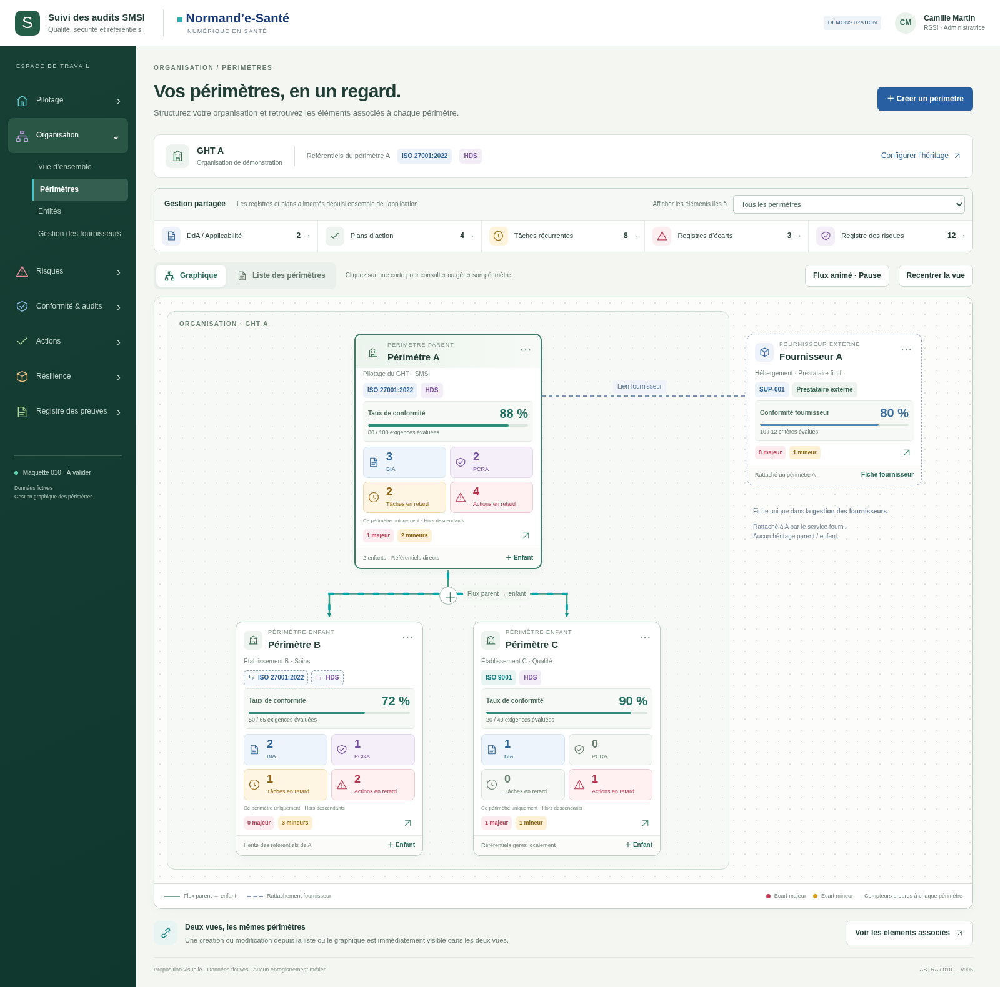
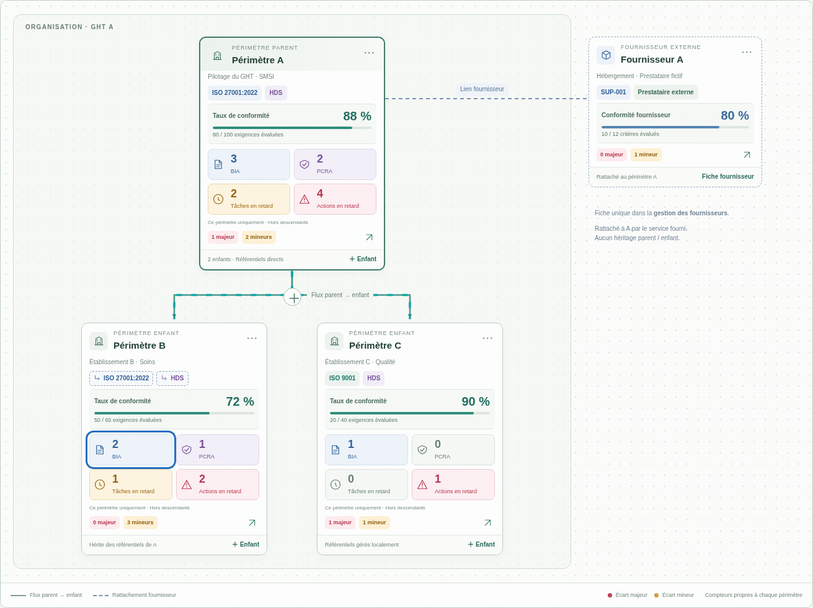
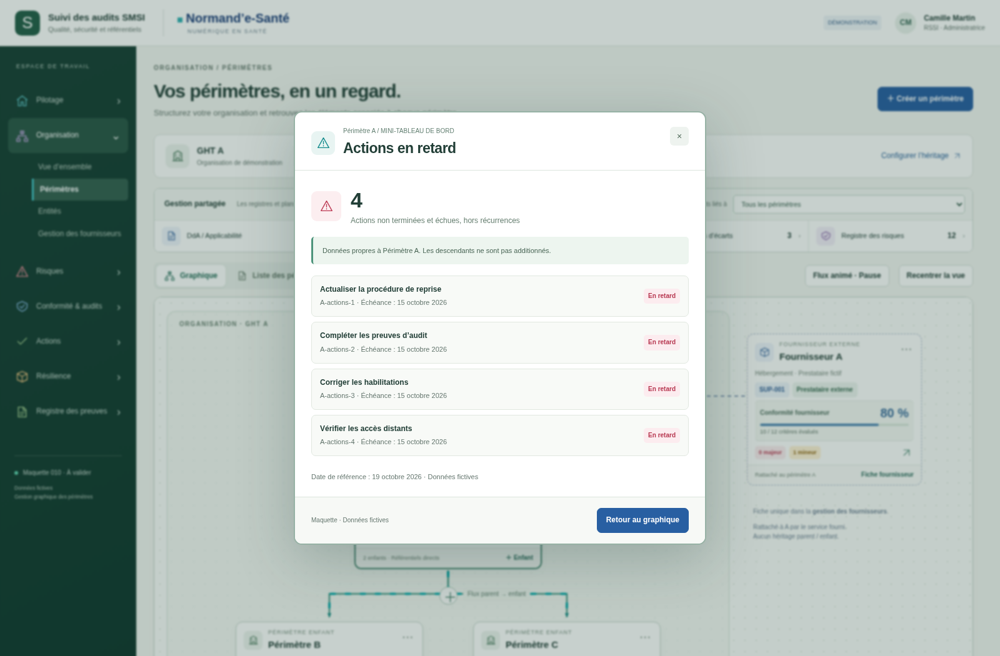
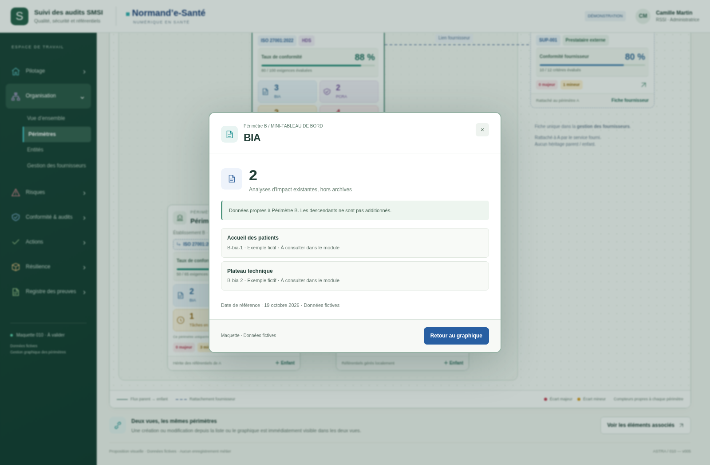

# 010 · v005 — Flux parent/enfants et mini-tableau de bord

**Proposition à valider · 19 octobre 2026 · Données fictives.** Trois images et un GIF animé. Aucun ZIP/BAT ni raccordement backend.

## Aperçus

### Cartes des périmètres et mini-tableau de bord

[Ouvrir le visuel](visuels/01-cartes-dashboard.png)

### Aperçu animé du flux parent vers enfants

[Ouvrir le visuel](visuels/04-flux-parent-enfants.gif)

### Détail des actions en retard

[Ouvrir le visuel](visuels/02-actions-en-retard.png)

### BIA du périmètre

[Ouvrir le visuel](visuels/03-bia-du-perimetre.png)

## Nouveautés

- Traits de base et pointes de flèches visibles en permanence. Flux turquoise animé dans le sens parent → enfant, sans déplacer les cartes. Bouton pause/reprise et respect de `prefers-reduced-motion`.
- Les points d’ancrage sont recalculés depuis les dimensions et positions réelles des cartes : création, modification, changement de vue et redimensionnement. L’arbre se réorganise et le graphique devient défilant lorsqu’il s’élargit.
- Quatre tuiles cliquables par périmètre : BIA existants, PCRA existants, tâches récurrentes en retard et actions en retard. Les nombres sont propres au périmètre, sans cumul implicite des descendants.
- Le clic ouvre une fenêtre centrale avec les éléments fictifs correspondants, ou un état vide. La conformité et les écarts restent visibles.
- Fournisseur conservé comme fiche externe : relation pointillée statique, sans héritage et sans indicateurs de périmètre copiés sur sa carte.

## Définitions de la démonstration

BIA : analyses non archivées. PCRA : plans non archivés dont `planType` vaut `pcra`, sans compter les PCA/PRA séparés. Tâches en retard : occurrences récurrentes non terminées dont l’échéance est dépassée ; actions en retard : autres actions non terminées et échues, hors récurrences. Ces deux compteurs n’additionnent pas deux fois la même action. Les objets sans date, futurs, terminés ou archivés ne sont pas en retard dans le jeu de démonstration.

Date fixe du jeu fictif : 19 octobre 2026 à 12 h UTC. Réutiliser en production les horloges, fuseaux, règles terminales et fenêtres d’échéance du domaine métier. Un indicateur indisponible ou non autorisé devra afficher un état distinct de zéro. Les comptes de démonstration ne sont pas des mesures réelles.

## Contrôles et limites

[Rapport de contrôle](technique/verification.json) · [Script reproductible](technique/verifier.cjs) · [Spécification préparatoire](../../implementation/PERIMETRES-GRAPHIQUES.md).

Quatorze groupes de contrôles passent dans la source autonome : compteurs et filtres, détail/vide, animation/pause/mouvement réduit, symétrie et absence de chevauchement vertical, conformité, fournisseur, héritage, menu fixe, plans dédupliqués, fenêtres centrales, saisies échappées, réciprocité liste/graphique, remise à zéro et mobile. Le GIF est issu de 24 captures de phases d’animation de cette interface.

Les données restent en mémoire et disparaissent au rechargement. Les liens vers les véritables modules, droits serveur, états de chargement/erreur et agrégations en production sont à raccorder lors de l’implémentation. L’agencement de maquette ne remplace pas une recette volumétrique complète. Aucun fichier du module de cartographie dynamique protégé n’est modifié. La version reste en développement ; aucun marqueur local « implémentation ok » trouvé.
